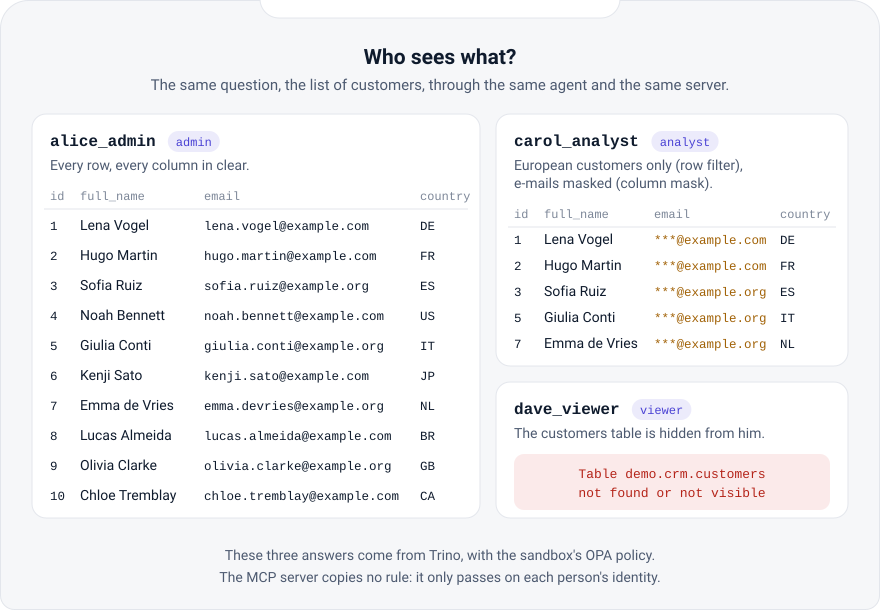
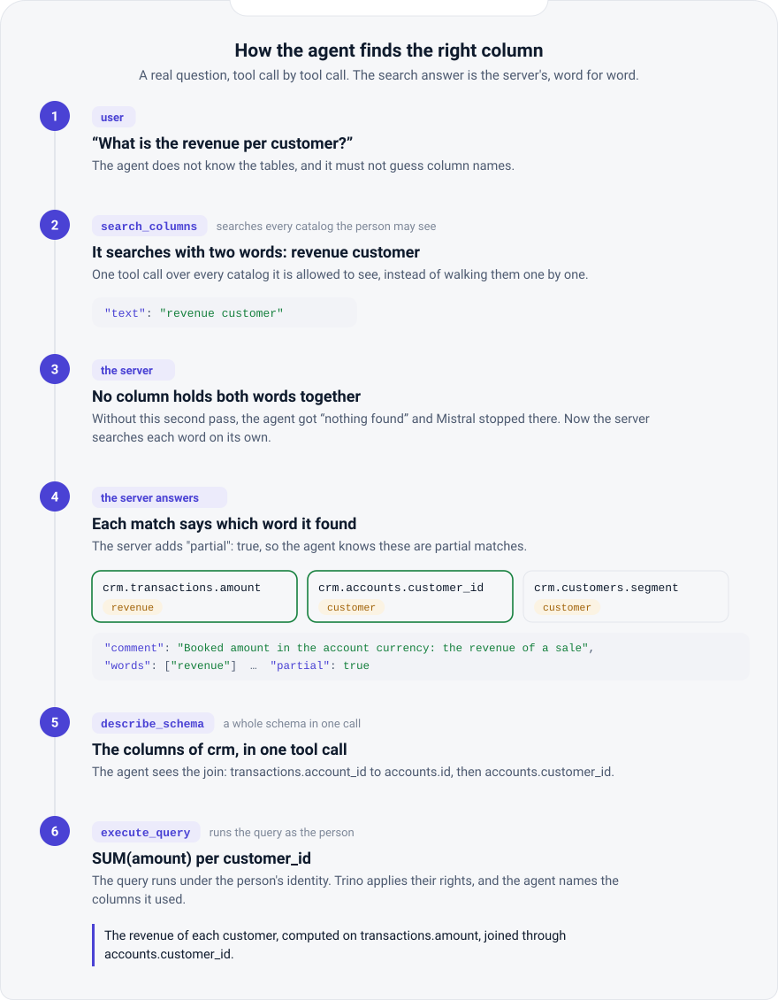
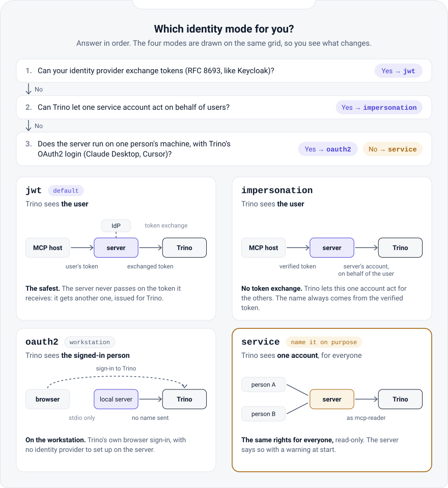
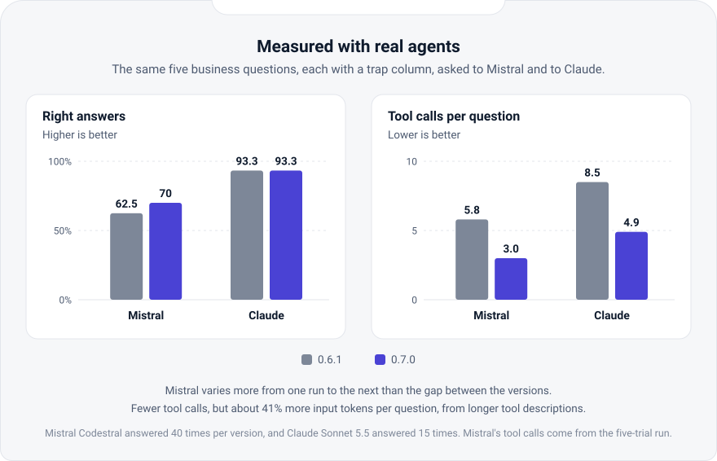

# akko-mcp-trino

**Give your AI agents read-only access to Trino, with the rights of the user they work for.**

akko-mcp-trino is an [MCP](https://modelcontextprotocol.io) server for Trino, under the
Apache 2.0 licence. It lets an agent find the tables and columns that hold what it is looking
for, describe a schema or a table, list catalogs, schemas and tables, explain a query and run
it, and it refuses every write it is sent: each statement is parsed,
and a write anywhere in it is refused before Trino.

- **The user's own rights, safe by default.** In `jwt` mode, the default, the server verifies
  the user's token (issued for this server), exchanges it at the identity provider for a token
  whose audience is Trino (OAuth 2.0 Token Exchange, RFC 8693), and Trino runs the query as that
  person. The user's token is never passed on, and a request without a valid token gets `401`.
- **Without token exchange**, `impersonation` mode: the server's own account (password or
  client certificate) and a Trino impersonation rule only that account has.
- **Or one identity, only when named** (`service` mode), announced as a warning at start and
  to every host.
- **Bounded and audited.** 100 rows, 60 s per query, 120 s per tool call by default, one audit
  line per call, and no token ever written to the logs.
- **Eight tools**, for any MCP host and any model: `search_columns` (where the data lives),
  `describe_schema`, `describe_table`, `list_catalogs`, `list_schemas` and `list_tables` (paged),
  `explain_query` and `execute_query`. Every error carries a `kind` that says what to do about it.

Source, documentation and issues: **[github.com/AKKO-p/akko-mcp-trino](https://github.com/AKKO-p/akko-mcp-trino)**

## Understand in five steps


An agent connected through one service account with broad rights reaches Trino under that
account, so the rules written for Carol no longer apply (the left panel is an illustration).
akko-mcp-trino brings Carol's own identity to Trino.



The same question from the three users of the sandbox. Trino answers each of them with the
sandbox's OPA policy; the server copies no rule.



A real trial, tool call by tool call: every tool answer shown is the server's.



Four identity modes, from the safest to the simplest, and three questions to pick yours.



The same five business questions asked to Mistral and to Claude, on 0.6.1 and on 0.7.0. Mistral
varies more from one run to the next than the gap between the versions, and 0.7.0 sends about 41%
more input tokens per question (longer tool descriptions). The interactive version of these steps is on
[akko-ai.com/en/docs/understand](https://akko-ai.com/en/docs/understand/).

Try it in five minutes with the [sandbox](https://github.com/AKKO-p/akko-sandbox): Keycloak,
Trino, OPA and this image, with the three users above.

```bash
git clone https://github.com/AKKO-p/akko-sandbox.git
cd akko-sandbox
docker compose up -d --wait
./demo.sh
```

## Tags

| Tag | Meaning |
|---|---|
| `X.Y.Z` (e.g. `0.7.0`) | one release |
| `X.Y` (e.g. `0.7`) | the latest release of that minor line |
| `latest` | the latest release |

Every tag is built for `linux/amd64` and `linux/arm64`, runs as a non-root user (uid 10001),
and carries a health check. The same image is published as `ghcr.io/akko-p/akko-mcp-trino`.

## Run it

Each user with their own rights (`jwt`, the default), Trino trusting the same identity
provider:

```bash
docker run -d --name akko-mcp-trino -p 3000:3000 -p 3001:3001 \
  -e TRINO_HOST=trino.example.internal -e TRINO_PORT=8443 -e TRINO_HTTP_SCHEME=https \
  -e TRINO_CATALOG=iceberg \
  -e MCP_JWKS_URL=https://idp.example.com/realms/data/protocol/openid-connect/certs \
  -e MCP_OIDC_ISSUER=https://idp.example.com/realms/data \
  -e MCP_OIDC_AUDIENCE=akko-mcp -e MCP_JWT_USER_CLAIM=preferred_username \
  -e TRINO_TOKEN_EXCHANGE_URL=https://idp.example.com/realms/data/protocol/openid-connect/token \
  -e TRINO_TOKEN_EXCHANGE_CLIENT_ID=akko-mcp -e TRINO_TOKEN_EXCHANGE_CLIENT_SECRET=... \
  -e TRINO_TOKEN_EXCHANGE_AUDIENCE=trino \
  akkoai/akko-mcp-trino:0.7
```

Without token exchange: `-e TRINO_IDENTITY_MODE=impersonation -e TRINO_USER=mcp-service` and a
password or client certificate for that account. One identity for every caller:
`-e TRINO_IDENTITY_MODE=service -e TRINO_USER=mcp-reader -e TRINO_PASSWORD=...`. Upgrading from
0.6: let the engine's policy read `system.jdbc` and `system.metadata` (the two new tools read them),
keep `MCP_CALL_TIMEOUT_SECONDS` at 0 or above `MCP_SEARCH_RESERVE_SECONDS` (2 by default), and read a
`truncated` listing on with `next_offset`. Upgrading from 0.6 or 0.5: see
[MIGRATING.md](https://github.com/AKKO-p/akko-mcp-trino/blob/main/MIGRATING.md).

The MCP endpoint is `http://localhost:3000/mcp` (streamable HTTP); the host sends the user's
access token as `Authorization: Bearer <token>`. Then:

```bash
curl -s localhost:3001/health   # {"status":"ok"}
curl -s localhost:3001/ready    # {"status":"ready"} once Trino answers
docker run --rm akkoai/akko-mcp-trino:0.7 akko-mcp-trino --version
```

Before serving, `akko-mcp-trino --check` prints the effective configuration (never a secret)
and exits with 2 if something would refuse to start:

```bash
docker run --rm -e TRINO_HOST=... -e TRINO_HTTP_SCHEME=https -e MCP_JWKS_URL=... \
  akkoai/akko-mcp-trino:0.7 akko-mcp-trino --check
```

Every setting, the Trino configuration for each mode, local hosts over stdio and the extension
points are described in the [README](https://github.com/AKKO-p/akko-mcp-trino#readme) and on
[akko-ai.com](https://akko-ai.com/en/docs/open-source-core/).

## About

Built and maintained by [AKKO](https://akko-ai.com), a French project working on governed access
for AI agents to enterprise data. Security reports: security@akko-ai.com.
