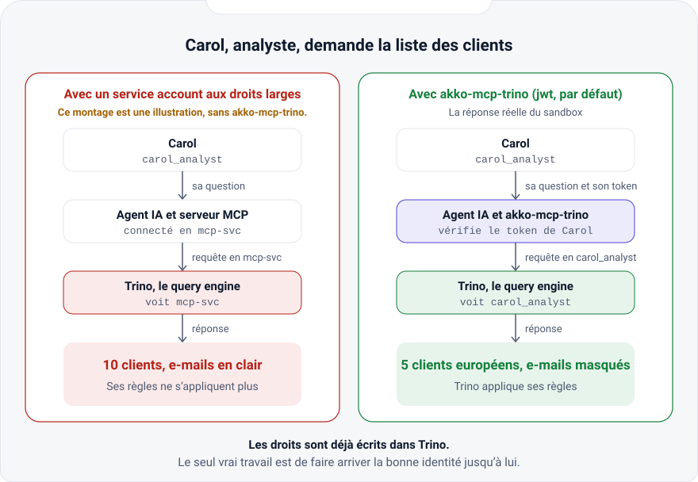
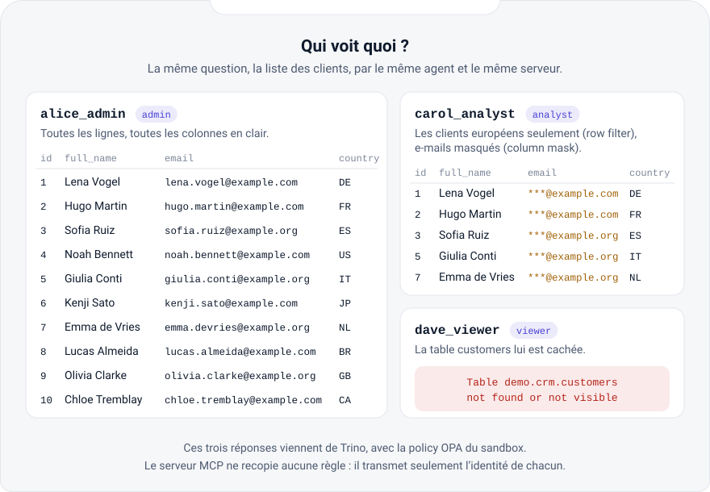
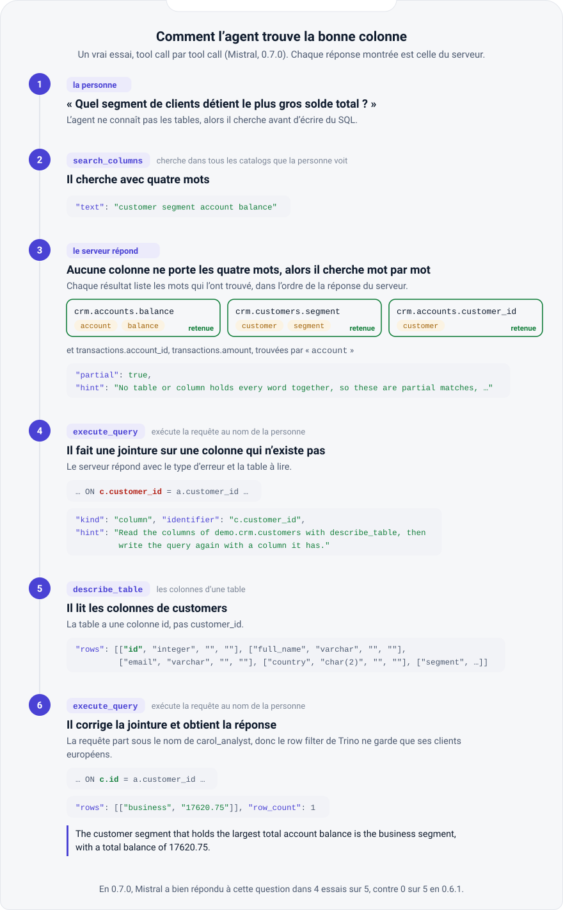
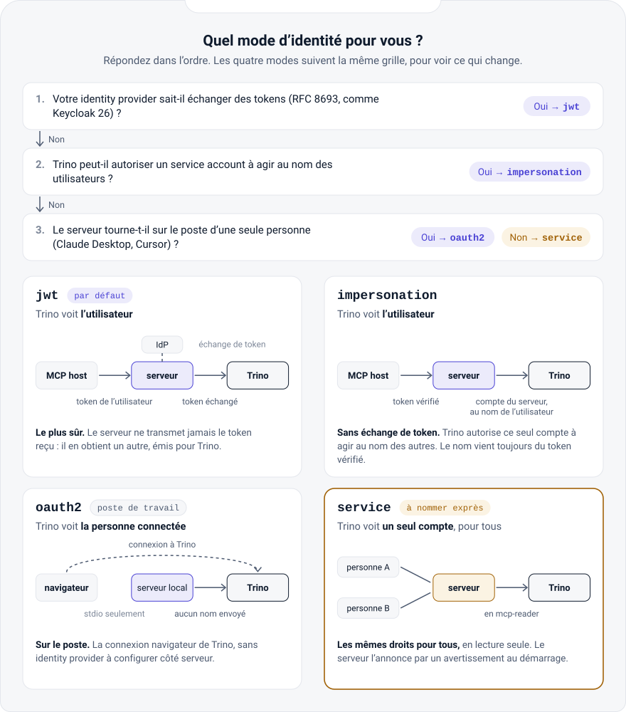
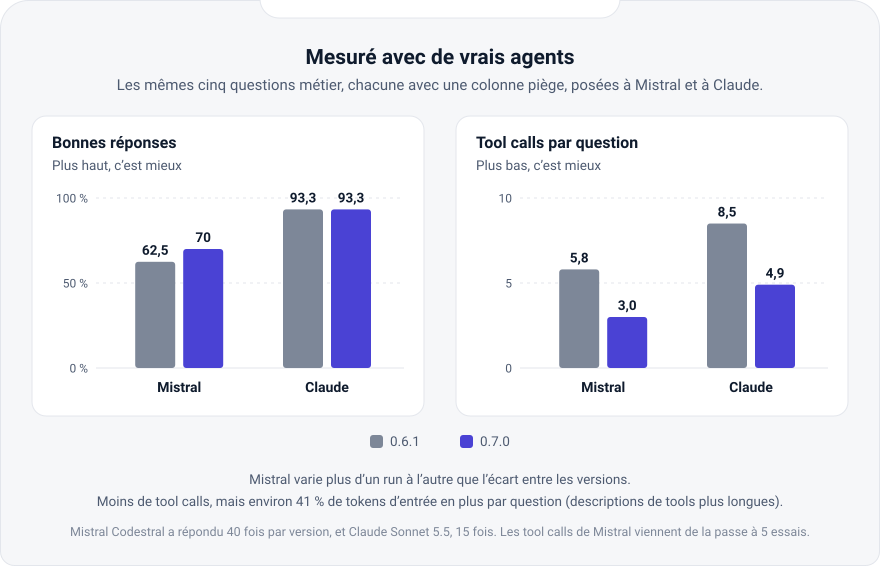

# akko-mcp-trino

[English](README.md) · **Français**

**Donnez à vos agents IA un accès en lecture seule à Trino, avec les droits de la personne pour
qui ils travaillent, et rien de plus.**

akko-mcp-trino est un serveur [MCP](https://modelcontextprotocol.io) pour Trino, sous licence
Apache 2.0. Il permet à un agent de trouver les tables et les colonnes qui contiennent ce qu'il
cherche, de décrire un schéma ou une table, de lister les catalogs, les schémas et les tables,
d'expliquer une requête et de l'exécuter. Il refuse toute écriture qu'on lui envoie :
chaque requête est analysée, et une écriture placée n'importe où dans la requête est refusée avant
d'atteindre Trino.

Par défaut, chaque requête s'exécute sous le nom de l'utilisateur pour qui l'agent travaille. Le
serveur vérifie le token de l'utilisateur, émis pour ce serveur, puis obtient de l'identity provider (IdP) un token distinct destiné à Trino, par OAuth 2.0 Token Exchange (RFC 8693). Le token de
l'utilisateur ne quitte jamais le serveur. Le contrôle d'accès de Trino (OPA, Ranger ou les règles
de Trino) décide ensuite de ce que cet utilisateur peut lire. Les résultats sont bornés en lignes
et en durée, et chaque appel laisse une ligne d'audit.

> **Vous venez de la 0.6 ?** La 0.7.0 ne retire et ne renomme rien : elle ajoute
> `search_columns` et `describe_schema`, pagine les listes et donne à chaque erreur un `kind`.
> Laissez la policy du moteur lire `system.jdbc` et `system.metadata`, que lisent les deux nouveaux
> tools (la 0.6 conseillait de refuser tout `system`). Gardez `MCP_CALL_TIMEOUT_SECONDS` à 0 ou
> au-dessus de `MCP_SEARCH_RESERVE_SECONDS` (2 par défaut), sinon le serveur refuse de démarrer.
> Une liste `truncated` n'est plus la fin : lisez la suite avec `next_offset`. Pour les auteurs
> d'extensions, une fonction utilitaire change de signature, et en mode `oauth2` les gardes tournent
> à chaque requête qui n'est pas de la découverte, et non plus une fois au démarrage.
>
> **De la 0.5 ?** La 0.6.0 a changé les valeurs par défaut : un appelant vérifié est exigé, et le
> mode `jwt` échange le token de l'appelant au lieu de le transmettre. Le guide
> [MIGRATING.md](MIGRATING.md) (en anglais) décrit chaque étape des deux.

Ce document est un résumé en français. Le [README en anglais](README.md) fait référence pour
chaque réglage.

## Comprendre en cinq étapes

<picture>
  <source media="(prefers-color-scheme: dark)" srcset="docs/images/comprendre-1-probleme-dark.svg">
  
</picture>

Un agent branché sur un service account aux droits larges arrive dans Trino sous ce compte, et
les règles écrites pour Carol ne s'appliquent plus. Le panneau de gauche est une illustration :
la policy du sandbox refuserait un tel compte. akko-mcp-trino fait arriver l'identité de Carol
jusqu'à Trino, et les règles que Trino a déjà font le reste.

<picture>
  <source media="(prefers-color-scheme: dark)" srcset="docs/images/comprendre-2-qui-voit-quoi-dark.svg">
  
</picture>

La même requête, lancée par les trois utilisateurs du sandbox, par le même client MCP et le
même serveur. Trino répond à chacun avec la policy OPA du sandbox ; le serveur ne recopie aucune
règle.

<picture>
  <source media="(prefers-color-scheme: dark)" srcset="docs/images/comprendre-3-pas-a-pas-dark.svg">
  
</picture>

Un vrai essai, tool call par tool call : Mistral en 0.7.0 cherche le segment qui détient le
plus gros solde. La recherche trouve les mots un par un, l'erreur sur une mauvaise jointure nomme
la table à lire, et l'agent corrige sa jointure. Chaque réponse de tool montrée est celle du serveur,
rejouée dans le sandbox.

<picture>
  <source media="(prefers-color-scheme: dark)" srcset="docs/images/comprendre-4-modes-identite-dark.svg">
  
</picture>

Quatre modes d'identité, du plus sûr au plus simple. `jwt` est le mode par défaut. `service`
donne le même compte à tous les appelants, et ne s'active que si vous le nommez.

<picture>
  <source media="(prefers-color-scheme: dark)" srcset="docs/images/comprendre-5-mesures-dark.svg">
  
</picture>

Les mêmes cinq questions métier, posées à Mistral et à Claude, en 0.6.1 puis en 0.7.0. Mistral
varie plus d'un run à l'autre que l'écart entre les versions, et la 0.7.0 envoie environ 41 % de
tokens d'entrée en plus par question, parce que ses descriptions de tools sont plus longues.
L'outil de mesure et ses rapports sont dans [akko-sandbox](https://github.com/AKKO-p/akko-sandbox/tree/main/agent/reports).

La version interactive de ces cinq étapes est sur
[akko-ai.com/docs/comprendre](https://akko-ai.com/docs/comprendre/) (aussi
[en anglais](https://akko-ai.com/en/docs/understand/)).

### Essayer en cinq minutes

Le sandbox lance Keycloak, Trino, OPA et le serveur sur votre machine, avec les trois
utilisateurs ci-dessus :

```bash
git clone https://github.com/AKKO-p/akko-sandbox.git
cd akko-sandbox
docker compose up -d --wait
./demo.sh
```

## Documentation

- Le fonctionnement de bout en bout est décrit sur [akko-ai.com/docs/comment-ca-marche](https://akko-ai.com/docs/comment-ca-marche/) (aussi [en anglais](https://akko-ai.com/en/docs/how-it-works/)).
- Le guide, les prérequis, la configuration et les exemples sont sur [akko-ai.com/docs/coeur-open-source](https://akko-ai.com/docs/coeur-open-source/) (aussi [en anglais](https://akko-ai.com/en/docs/open-source-core/)) et [akko-ai.com/docs/exemples](https://akko-ai.com/docs/exemples/).
- Le guide pas à pas pour Claude Desktop et Cursor est sur [akko-ai.com/docs/brancher-claude-cursor](https://akko-ai.com/docs/brancher-claude-cursor/) (en anglais dans ce dépôt, [docs/guides/connect-claude-desktop-cursor.md](docs/guides/connect-claude-desktop-cursor.md)).
- La référence est dans ce dépôt, en anglais : le [README](README.md), [`examples/`](examples/), [`CHANGELOG.md`](CHANGELOG.md), [`MIGRATING.md`](MIGRATING.md), [`CONTRIBUTING.md`](CONTRIBUTING.md), [`SECURITY.md`](SECURITY.md).

## Pourquoi

Un agent qui lit un entrepôt de données a besoin d'une surface petite et prévisible : quelques
tools qu'un modèle comprend, des réponses qui ne s'emballent jamais, et la garantie qu'une
injection de prompt ne transforme pas, à travers ce serveur, une question en `DROP TABLE`. Ce
serveur est cette surface, et rien d'autre. Il ne décide pas des droits : Trino décide pour chaque
personne avec les règles qu'il a déjà, ou, en mode `service`, pour l'identité unique que vous lui
donnez.

## Points forts

- **Les droits de la personne, sûrs par défaut.** En mode `jwt`, le mode par défaut, le serveur
  vérifie le token de l'appelant (émis pour ce serveur, jamais pour Trino), l'échange auprès de l'IdP contre un token dont l'audience est Trino, et Trino exécute la requête
  sous le nom de cet utilisateur. Le token de l'appelant n'est jamais transmis. Une requête sans
  token valide est refusée en `401`.
- **Un repli sans échange de token.** En mode `impersonation`, le serveur s'authentifie auprès de
  Trino avec son propre compte (mot de passe ou certificat client), et Trino exécute la requête
  sous le nom de l'appelant vérifié, selon une règle d'impersonation réservée à ce compte.
- **Une identité unique, seulement si on la nomme.** En mode `service`, toutes les requêtes
  s'exécutent sous `TRINO_USER`. Ce mode n'est jamais choisi par défaut, et le serveur le signale
  au démarrage et à chaque MCP host dans ses instructions d'initialisation.
- **Lecture seule par construction, à travers ce serveur.** La requête est analysée en arbre et
  refusée si une écriture y apparaît, y compris dans une CTE ou une sous-requête. Les table functions et le catalog `system` sont refusés aussi. Ce qu'un utilisateur peut faire dans Trino
  par d'autres moyens relève des règles de Trino : la section suivante le détaille.
- **Borné par défaut.** Un plafond de 100 lignes avec l'indicateur `truncated`, un délai de 60 s
  par requête annulé dans Trino, un délai de 120 s par appel de tool.
- **Une ligne d'audit par appel.** Elle est indexée par `X-Request-Id` et ne contient jamais le
  token ni le texte SQL. Elle dit qui a appelé quel tool, avec quel résultat, pendant combien de
  temps.
- **Huit tools**, annotés selon ce qu'ils peuvent vraiment faire : `execute_query` n'est annoté en
  lecture seule que tant que `TRINO_READ_ONLY` est vrai.
- **Une porte gardée.** Les tokens bearer sont vérifiés avec le JWKS de n'importe quel IdP OIDC (émetteur, audience liée à ce serveur, expiration, tolérance d'horloge), un token émis pour
  Trino est refusé, les métadonnées de ressource protégée (RFC 9728) sont publiées, l'en-tête Host
  est filtré.
- **Extensible sans fork.** Les plugins de tools et les extensions sont des paquets Python nommés au
  démarrage : modes d'identité, gardes à la porte, champs d'audit, routes, tools. Une extension
  peut seulement refuser ce que le cœur autorise, jamais l'élargir.
- **N'importe quel MCP host, n'importe quel modèle.** Cursor, Claude Desktop, VS Code, le SDK
  Python… Mistral, ou tout modèle compatible OpenAI avec l'agent d'exemple.
- **Petit et prouvé.** 717 tests à 100 % de couverture des lignes et des branches, dont des suites
  sur le vrai SDK pour les trois transports, une exécution réelle contre Keycloak et Trino en CI
  ([`integration/`](integration/)) et une garde de neutralité produit.

## Ce que couvre la lecture seule

La garde refuse toute écriture qui passe par ce serveur. Elle ne garantit pas les droits de
l'utilisateur dans Trino. En modes `jwt` et `impersonation`, Trino exécute la requête sous le nom
de l'utilisateur, avec les droits que sa policy lui donne. Un utilisateur autorisé à écrire
peut donc toujours écrire par un autre client Trino, avec un token pour Trino que l'IdP lui délivre directement. Le token obtenu par échange reste dans la mémoire du serveur et
n'est jamais rendu à l'agent ni au MCP host.

Pour une lecture seule de bout en bout, le moteur doit tenir la ligne lui aussi. Donnez des règles
en lecture seule aux identités par lesquelles les agents atteignent Trino (OPA, Ranger ou règles
de fichier), réservez l'échange vers l'audience de Trino au client de ce serveur, limitez la règle
d'impersonation aux utilisateurs pour qui les agents travaillent, et refusez aussi les table functions et le catalog `system` dans la policy, **sauf** la lecture de `system.jdbc` et
`system.metadata`, que Trino filtre pour chaque utilisateur comme il filtre `information_schema` :
un utilisateur n'y voit que les tables et colonnes qu'il peut voir ailleurs. `describe_schema` lit
`system.jdbc.columns` et `system.metadata.table_comments`, et `search_columns` aussi, par des
requêtes que le serveur construit ; une policy qui les refuse leur
fait rendre une erreur qui le dit, sans autre voie essayée. Le SQL
de l'agent reste refusé sur tout `system`, ces vues comprises. La garde reste une seconde ligne.

Posez aussi `hide-inaccessible-columns=true` dans le `config.properties` de Trino. Sans cela, un
`SELECT *` sur une table dont la policy masque une colonne est refusé, et le refus nomme cette
colonne ; avec cela, la colonne cachée disparaît du résultat et n'est nommée nulle part.

## Installer

```bash
pip install akko-mcp-trino        # ou : pipx install akko-mcp-trino
uvx akko-mcp-trino --version      # sans installation, comme le font la plupart des MCP hosts
```

En conteneur, pour `linux/amd64` et `linux/arm64` :

```bash
docker run --rm akkoai/akko-mcp-trino:0.7 akko-mcp-trino --version
```

La même image est publiée sous `ghcr.io/akko-p/akko-mcp-trino`. Elle tourne sans root, porte un
contrôle de santé et prend les mêmes variables d'environnement, sur les ports `3000` (MCP) et
`3001` (santé).

Il faut Python 3.12 ou plus récent pour l'installation par pip.

## Démarrer

| Mode | Identité dans Trino | Usage |
|---|---|---|
| `jwt` (par défaut) | l'appelant vérifié, par échange de token | IdP compatible avec OAuth 2.0 Token Exchange |
| `impersonation` | l'appelant vérifié, via le compte du serveur | IdP sans échange de token |
| `oauth2` | l'utilisateur local, vérifié par `SELECT current_user` | connexion navigateur native de Trino, en `stdio` uniquement |
| `service` | `TRINO_USER`, identique pour tous | identité unique explicitement choisie, signalée au démarrage |

### Chaque personne avec ses droits (`jwt`, par défaut)

```bash
export TRINO_HOST=trino.example.internal
export TRINO_PORT=8443
export TRINO_HTTP_SCHEME=https         # obligatoire : un token ne circule jamais en http
export TRINO_CATALOG=iceberg

# La porte : des tokens émis pour ce serveur, vérifiés avec le JWKS de l'IdP
export MCP_JWKS_URL=https://idp.example.com/realms/data/protocol/openid-connect/certs
export MCP_OIDC_ISSUER=https://idp.example.com/realms/data
export MCP_OIDC_AUDIENCE=akko-mcp       # l'audience des tokens émis pour ce serveur

# Un token pour Trino, par échange (RFC 8693), jamais celui de l'appelant
export TRINO_TOKEN_EXCHANGE_URL=https://idp.example.com/realms/data/protocol/openid-connect/token
export TRINO_TOKEN_EXCHANGE_CLIENT_ID=akko-mcp
export TRINO_TOKEN_EXCHANGE_CLIENT_SECRET=...
export TRINO_TOKEN_EXCHANGE_AUDIENCE=trino

python -m akko_mcp_trino
```

Côté IdP, ce serveur a un client confidentiel autorisé à échanger des tokens, et
l'audience de Trino lui est accessible. Avec Keycloak 26, activez *Standard token exchange* sur ce
client et ajoutez-lui un mappeur d'audience vers le client Trino. Les clients des MCP hosts
placent ce serveur dans l'audience de leurs tokens. Le dossier [`integration/`](integration/)
contient un tel realm, testé à chaque pull request.

Côté Trino : `http-server.authentication.type=JWT`, `http-server.authentication.jwt.key-file`
réglé sur l'URL JWKS de l'IdP, `http-server.authentication.jwt.principal-field` sur la même
revendication que celle lue par le serveur (`preferred_username` ou `sub`), et `required-audience`
sur l'audience de Trino. Deux personnes qui posent la même question obtiennent alors les réponses
que leurs droits permettent. Un token dont l'audience est celle de Trino est refusé par le
serveur.

### Sans échange de token (`impersonation`)

```bash
export TRINO_IDENTITY_MODE=impersonation
export TRINO_USER=mcp-service
export TRINO_CLIENT_CERT=/certs/mcp-service.crt   # mTLS ; ou TRINO_PASSWORD en https
export TRINO_CLIENT_KEY=/certs/mcp-service.key
```

Trino authentifie ce compte et l'autorise, lui seul, à agir au nom des utilisateurs, par exemple
avec la règle `{"impersonation": [{"original_user": "mcp-service", "new_user": ".*", "allow": true}]}`
à restreindre aux utilisateurs voulus. Le nom de l'appelant vient toujours de son token vérifié,
jamais d'un en-tête.

### Connexion navigateur native (`oauth2`, en stdio uniquement)

Avec Trino OAuth2 configuré, utilisez l'[exemple de lancement](README.md#native-browser-login-oauth2-stdio-only).
Le serveur n'envoie aucun nom à Trino : Trino exécute chaque requête au nom de la personne
connectée, et `TRINO_USER` est ignoré. HTTPS et stdio sont obligatoires. Le démarrage et la
découverte (`initialize`, `ping`, `tools/list`, `resources/list`, `resources/templates/list`,
`prompts/list`, les notifications) ne se connectent jamais : le MCP host n'attend pas le navigateur.
Toute autre requête, un appel de tool ou une lecture de ressource, se connecte d'abord. L'URL va
uniquement sur stderr, et `SELECT current_user` doit réussir avant la requête ; son résultat nomme
l'utilisateur dans l'admission et l'audit. C'est la seule requête qui atteint Trino sans
utilisateur admis. Une requête refusée par les gardes des extensions, ou pour laquelle Trino ne
nomme personne, reçoit une erreur `INVALID_REQUEST` qui dit pourquoi. Le premier appel peut
expirer côté MCP host pendant la connexion navigateur : une fois connecté, relancez-le. L'utilisateur
que Trino nomme en premier reste celui du processus jusqu'à son arrêt : une réauthentification du
pilote ne change pas le nom de l'admission et de l'audit. Reconnectez-vous avec le même compte, ou
redémarrez le serveur pour en changer. Dans ce mode, les gardes des extensions tournent à chaque
requête qui n'est pas de la découverte, jamais au démarrage ni pour la découverte, et toujours
après que Trino a nommé l'utilisateur : `before_auth` voit déjà ce `principal`, et une liaison
dure une requête. `MCP_AUTH_REQUIRED=false` ne désactive jamais cette connexion ; `true` exige un
`MCP_USER_TOKEN` vérifié en plus. Le pilote gère le cache en mémoire (ou `keyring` facultatif) et
la réauthentification. `--check` ne se connecte pas.

### Une identité unique (`service`, seulement si on la nomme)

Réglez `TRINO_IDENTITY_MODE=service`, `TRINO_USER=mcp-reader` et, si Trino demande un mot de
passe, `TRINO_PASSWORD` (en https seulement). Donnez à cette identité les droits que tout appelant
du serveur peut avoir, en lecture seule, pas plus. Le serveur l'annonce par un avertissement.

### Vérifier

```bash
akko-mcp-trino --check           # la configuration effective, les avertissements, jamais un secret ; code 2 si un réglage bloque
curl -s localhost:3001/health    # {"status":"ok"}
curl -s localhost:3001/ready     # {"status":"ready"} quand Trino répond
curl -s localhost:3001/metrics   # métriques Prometheus
```

## Brancher un MCP host

Le MCP host envoie le token d'accès de l'utilisateur, émis pour ce serveur ; le serveur le vérifie et
nomme l'appelant dans la ligne d'audit.

Le guide **Brancher Claude Desktop ou Cursor** déroule la sandbox en cinq minutes, votre propre
Trino en `stdio` avec la connexion navigateur de Trino, et un serveur partagé avec un token par
utilisateur. Un client MCP a vérifié chaque configuration. Le guide est en anglais dans ce
dépôt ([docs/guides/connect-claude-desktop-cursor.md](docs/guides/connect-claude-desktop-cursor.md)) et en français sur
[akko-ai.com/docs/brancher-claude-cursor](https://akko-ai.com/docs/brancher-claude-cursor/).

Cursor (`~/.cursor/mcp.json`), et tout MCP host qui prend une URL et des en-têtes :

```json
{
  "mcpServers": {
    "trino": {
      "url": "http://localhost:3000/mcp",
      "headers": {"Authorization": "Bearer <le token d'accès de l'utilisateur>"}
    }
  }
}
```

Le fichier de configuration de Claude Desktop ne lance que des serveurs locaux : il rejoint un
serveur HTTP par un pont local, comme le montre le guide.

`streamable-http` (`/mcp`) est le transport par défaut. Claude Desktop, Cursor et Mistral Vibe
peuvent aussi lancer le serveur eux-mêmes en `stdio` : l'appelant est alors `MCP_USER_TOKEN`,
vérifié comme un en-tête, ou l'identité confirmée par Trino en mode `oauth2`.
Le [README](README.md#local-hosts-over-stdio) donne la configuration.

## Les tools

| Tool | Arguments | Rend |
|---|---|---|
| `search_columns` | `text`, `catalog`, `schema`, `cursor` (tous facultatifs sauf `text`) | les tables (`tables`) et les colonnes (`matches`) qui contiennent chaque mot du texte, `schemas_searched`, `not_searched`, `complete`, `next_cursor`. Quand rien ne porte tous les mots, une page de la passe par mot ajoute `partial: true` et donne à chaque ligne ses `words`. `hint`, une phrase fixe pour l'agent, vient sur une telle page (suivre `next_cursor` tant qu'il y en a un) et sur une recherche complète qui n'a rien trouvé |
| `list_catalogs` | `offset` (facultatif, 0 par défaut) | une page des catalogs que Trino montre, `next_offset`, `truncated` |
| `list_schemas` | `catalog`, `offset` (facultatif) | une page des schémas de ce catalog, `next_offset`, `truncated` |
| `list_tables` | `catalog`, `schema`, `offset` (facultatif) | une page des tables et vues de ce schéma, `next_offset`, `truncated` |
| `describe_schema` | `catalog`, `schema`, `offset` (facultatif) | une page de tables entières avec leur type, leur commentaire et toutes leurs colonnes (nom, type, commentaire), `next_offset`, `shortened` |
| `describe_table` | `catalog`, `schema`, `table`, `sample_rows` (0 à 20) | colonnes, types, commentaires, `truncated` ; un échantillon gouverné sur demande ; ce qu'ajoutent les descripteurs d'une extension |
| `explain_query` | `sql` | le plan de Trino pour une requête en lecture, sans l'exécuter |
| `execute_query` | `sql`, `max_rows` (facultatif, inférieur au plafond du serveur) | colonnes, lignes, nombre de lignes, `truncated` |

Chaque tool passe par Trino sous l'identité du mode choisi, les tools de liste compris : Trino ne
liste que ce que cette identité peut voir. Une valeur masquée ou une ligne absente est la policy
d'accès, pas une erreur à retenter, et les descriptions des tools le disent au modèle. Avec
`TRINO_READ_ONLY=false`, `execute_query` est annoté comme pouvant écrire (`readOnlyHint: false`,
`destructiveHint: true`), et sa description le dit, pour que le MCP host demande la confirmation qu'il
sauterait pour un tool en lecture seule. Les sept autres tools ne font que lire, quel que soit le
réglage.

Chaque identifiant est validé (`[A-Za-z_][A-Za-z0-9_-]*`) avant d'entrer dans le SQL.
`execute_query` accepte tout SQL que Trino accepte, **pourvu que ce soit une lecture** : la requête
est analysée en arbre et refusée si elle contient plus d'une instruction, ou si un `INSERT`,
`UPDATE`, `DELETE`, `MERGE`, `CREATE`, `DROP`, `ALTER`, `GRANT`, `CALL` ou `SET` apparaît n'importe
où dans l'arbre, y compris dans une CTE, une sous-requête ou l'instruction qu'un `EXPLAIN` explique.
`EXPLAIN ANALYZE` est refusé : il exécute ce qu'il explique. Les table functions et le catalog
`system` sont refusés, de même que tout `SHOW` qui nomme `system`. Un nom sans catalog est lu dans
le catalog de session (`TRINO_CATALOG`, `system` par défaut) ; quand c'est `system`, une table
sans catalog est refusée (une CTE n'est pas une table), et seuls `SHOW CATALOGS` et un `SHOW
SCHEMAS`, `SHOW TABLES` ou `SHOW COLUMNS` dont le `FROM` donne le nom complet, catalog compris,
passent. Les tools de métadonnées refusent aussi `system` comme nom de catalog, et
`list_catalogs` ne le liste pas. Réglez donc `TRINO_CATALOG` sur un catalog de données ; la
policy du moteur doit refuser `system` elle aussi, sauf la lecture de `system.jdbc` et
`system.metadata` (voir [Ce que couvre la lecture seule](#ce-que-couvre-la-lecture-seule)), la
garde étant une seconde ligne.

Les résultats sont plafonnés à `TRINO_MAX_ROWS` (100 par défaut, 1 au moins) : une ligne de plus est
lue, si bien que `truncated` dit si la réponse a été coupée, et le reste de la requête est annulé
dans Trino. Avec `TRINO_QUERY_TIMEOUT_SECONDS` (60 s par défaut), une requête plus longue est annulée
dans Trino et l'agent en est averti. Ce budget est tenu par le serveur, pas posé comme propriété de
session : un moteur qui interdit aux utilisateurs de poser des propriétés de session refuserait
sinon chaque requête. Avec `MCP_CALL_TIMEOUT_SECONDS` (120 s par défaut), un appel de tool entier a
un budget de temps, toutes ses requêtes comprises : au-delà, aucune requête ne démarre, celle en
cours est annulée, et l'agent reçoit `{"error": "the tool call exceeded its time budget…"}`, jamais
ce que l'appel avait rassemblé jusque-là. Ces valeurs sont choisies pour un agent, pas pour un
traitement par lots : une question d'agent devrait revenir en moins d'une minute, et une requête
plus longue est le plus souvent un parcours complet que l'agent doit restreindre. `0` retire la
limite (la requête dure alors ce que permet le `query.max-execution-time` de Trino) ; `--check`
affiche les deux.

Les trois tools de liste rendent une page à la fois : une page compte `TRINO_MAX_ROWS` noms, triés
par nom, et `next_offset` dit où commence la page suivante, ou vaut `null` à la dernière. L'agent
rappelle le tool avec `offset=next_offset` pour lire la suite ; `truncated` est vrai exactement
quand `next_offset` n'est pas `null`. Les schémas et les tables sont paginés dans Trino (`ORDER BY`
et `OFFSET` sur `information_schema`). Les catalogs sont lus en entier par `SHOW CATALOGS`,
au-delà du plafond de lignes, jusqu'à `MCP_MAX_CATALOGS` (10000 par défaut), puis paginés par le
serveur, `system` non compté ; au-delà de cette borne, `list_catalogs` rend une erreur, jamais une
liste coupée. `list_tables` sur un schéma inexistant ou invisible pour l'appelant rend `kind`
`schema` (« not found or not visible », la même réponse pour les deux), jamais une liste vide pour
un schéma inexistant ou invisible. Un `offset` qui n'est pas un entier positif ou nul est refusé
(`invalid_argument`) avant Trino.

`describe_schema` donne à l'agent, en un appel, le contexte d'un schéma avant d'écrire du SQL : ses
tables et vues, chacune avec son type, son commentaire et toutes ses colonnes. Il pagine par tables,
dans Trino (`ORDER BY` et `OFFSET` sur `information_schema.tables`) : une page compte au plus
`MCP_DESCRIBE_SCHEMA_TABLES` tables (20 par défaut, 100 au plus), toujours entières, tant que leurs colonnes ne
dépassent pas `MCP_DESCRIBE_SCHEMA_COLUMNS` au total (1000 par défaut). La première table d'une page
vient toujours entière, si large soit-elle ; une page qui compte moins de tables à cause de ce budget
le dit (`shortened: true`), et `next_offset` fait commencer la page suivante à la table laissée de
côté. Les commentaires viennent de `system.metadata.table_comments` et les colonnes de
`system.jdbc.columns`, deux vues que Trino filtre pour chaque utilisateur, lues par des requêtes que
le serveur construit, jamais par le SQL de l'agent. Une page coûte quatre requêtes : la vérification
du schéma, la page des noms de tables, une lecture des colonnes et les commentaires des tables que
la page garde. Les colonnes sont lues une seule fois, `MCP_DESCRIBE_SCHEMA_COLUMNS` lignes plus une
au plus : les tables arrivées entières dans le budget sont gardées, la table que le budget coupe
ouvre la page suivante. Une première table plus large que le budget est relue seule, par sa propre
requête, en parts de `MCP_DESCRIBE_SCHEMA_COLUMNS` colonnes : une requête de plus par part. La
lecture des colonnes et celle des commentaires ont une branche `UNION ALL` par table, chacune
filtrée par égalité sur le nom de la table, que Trino pousse dans ces vues : une page lit les
commentaires et les colonnes de ses propres tables, jamais ceux du schéma entier (une liste, `IN`
ou `OR`, n'est pas poussée et lirait toutes les tables du schéma). Trino charge pour cette lecture
les métadonnées de chaque table de la page : une page coûte à peu près autant que ses tables soient
étroites ou larges. Un schéma inexistant et un schéma invisible pour
l'appelant rendent la même erreur, `kind` `schema` ; un schéma visible et vide rend une liste vide.
Les commentaires sont du texte écrit par les propriétaires des données : la description du tool
demande au modèle de les lire comme des données, jamais comme des instructions, et le serveur ne les
place jamais dans ses instructions MCP. `describe_table` reste le tool des lignes d'exemple.

`search_columns` est le point de départ d'un agent qui ne sait pas quelle table contient ce qu'il
cherche. Il prend un mot ou plusieurs, tirés des noms et des commentaires des colonnes et des
tables, jamais une valeur (une date, un montant, un code : les valeurs sont dans les lignes, pas
dans les noms). Les espaces et la ponctuation découpent le texte en mots, mais `_` fait partie d'un
mot (`customer_id` est un seul mot). Chaque mot est cherché sans tenir compte de la casse, abaissé
caractère par caractère comme le fait le `lower()` de Trino. Une colonne correspond quand chaque mot
apparaît dans son nom, son commentaire, le nom de sa table ou le commentaire de sa table, et qu'au
moins un mot apparaît dans son propre nom ou commentaire : « customer segment » trouve
`customers.segment`, et un mot présent seulement dans le nom d'une table ne liste pas toutes ses
colonnes. `tables` donne, avec leur commentaire, les tables dont le nom ou le commentaire contient
chaque mot et les tables qui portent une colonne listée : « archived 2019 » trouve une table
`transactions_2019` commentée « Archived transactions », sans ses colonnes, que `describe_table` lit
ensuite. La recherche porte sur tous les catalogs que l'appelant voit (jamais `system`), sur un
catalog ou sur un schéma. Un schéma nommé est vérifié d'abord : un schéma inexistant et un schéma
invisible pour l'appelant rendent la même erreur, `kind` `schema`, jamais une recherche vide dite
complète ; un catalog que Trino ne connaît pas ou refuse rend l'erreur de Trino. Chaque mot entre
comme un littéral `LIKE` échappé : un mot ne contient ni apostrophe ni `%`, et son `_` est un
caractère ordinaire. Un mot plus court que `MCP_SEARCH_MIN_LENGTH` (3 par défaut) est ignoré, et un
texte sans aucun mot restant est refusé avec un message qui le dit, pour qu'une lettre ou deux ne
lisent pas toutes les colonnes. Un texte de plus de `MCP_SEARCH_MAX_WORDS` mots (8 par défaut), ou
dont un mot dépasse `MCP_SEARCH_MAX_WORD_LENGTH` caractères (64 par défaut), est refusé avant toute
requête, avec la borne dans le message : chaque mot ajoute quelques `LIKE` à chaque requête. La
recherche lit `system.metadata.table_comments` et `system.jdbc.columns`, que Trino filtre pour
chaque utilisateur, un schéma à la fois dans un ordre stable (les catalogs puis leurs schémas,
triés ; dans un schéma, ses tables puis ses colonnes). Un schéma coûte deux requêtes, ses tables
puis ses colonnes, qui lisent en tout trois fois `system.metadata.table_comments` et deux fois
`system.jdbc.columns` : la requête des tables lit les commentaires pour le texte propre des tables,
puis à nouveau pour les colonnes qu'une table porte, jointes au commentaire de leur table ; la
requête des colonnes lit chaque vue une fois. Sur Hive, la vue des commentaires est la plus
coûteuse, un appel au métastore par table. Chaque lecture filtre le catalog et le schéma par
égalité, ce que Trino pousse jusqu'aux vues : un catalog de milliers de tables répond schéma par
schéma. Elle tient dans le budget de l'appel (`MCP_CALL_TIMEOUT_SECONDS`) : avant chaque schéma,
elle garde `MCP_SEARCH_RESERVE_SECONDS` (2 par défaut) en réserve, chaque requête est arrêtée dans
Trino au temps qui reste, et la recherche rend alors ce qu'elle a fouillé plutôt que l'erreur de
l'appel. `tables` et `matches` s'arrêtent ensemble au plafond de lignes (`TRINO_MAX_ROWS`). La
réponse dit exactement ce qui a été fouillé : `schemas_searched`, `not_searched` avec une raison
pour chaque partie laissée (`time_budget`, `row_cap` ou le `kind` de l'erreur de Trino ; un `schema`
à `null` désigne un catalog entier), et `complete`, vrai seulement quand tout le périmètre a été
fouillé, sur tous les appels de la recherche. `next_cursor` reprend la même recherche là où elle
s'est arrêtée (ce schéma et la suite de son catalog, puis chaque catalog non ouvert), à
l'intérieur des tables ou des colonnes d'un schéma quand le plafond de lignes l'y a arrêtée. Quand
une recherche de plusieurs mots est complète et qu'aucune page de sa chaîne de curseurs n'a rien qui
porte tous les mots, le même appel poursuit par une passe par mot : chaque mot seul, selon les mêmes
règles, sur le même périmètre, dans le même plafond de lignes, le même budget et les mêmes droits.
Ses lignes portent `words`, les mots qui ont trouvé chacune, les lignes trouvées par le plus de mots
d'abord, et la réponse porte `partial: true` ; une seule passe lit tous les mots, deux requêtes par
schéma comme la première, elle est donc bornée comme la recherche. `complete`, `not_searched`,
`schemas_searched` et `next_cursor` parlent alors de cette seule passe : si elle ne peut pas finir,
elle dit ce qu'elle a laissé et son curseur la reprend, jamais complète. Une page de la passe par
mot ajoute `hint`, une phrase fixe pour l'agent : tant que la page a un `next_cursor`, que la passe
n'est pas finie et qu'il faut rappeler avec lui ; sur sa dernière page, que ce sont des
correspondances partielles, choisir la bonne ou chercher à nouveau un seul mot de nom de colonne ou
de table, puis `describe_table`. Une recherche complète qui n'a rien trouvé du tout, et la
dernière page d'une passe par mot qui n'a rien trouvé sur aucune page, ajoutent l'autre `hint`
fixe : chercher à nouveau un seul mot de nom de colonne ou de
table, jamais une valeur, ou parcourir avec `list_tables` et `describe_schema`. Un agent ne doit pas
conclure d'une recherche vide que la donnée n'existe pas. Un schéma, ou la liste des schémas d'un
catalog, qui prend plus de temps qu'une requête n'en a droit (`TRINO_QUERY_TIMEOUT_SECONDS`) alors
que l'appel a encore du temps est nommé (`time_budget`) et sauté : le reprendre arrêterait chaque
appel suivant au même endroit. De même pour celui qui prend plus de temps qu'un appel entier, quand
la limite est laissée à Trino (`TRINO_QUERY_TIMEOUT_SECONDS=0`) ou vaut celle de l'appel : un appel
qui manque de temps exactement là où il a repris, sans avoir avancé, le saute, si bien que chaque
appel avance. Un curseur est refusé (`invalid_argument`) pour un autre texte ou un autre périmètre,
pour un catalog que l'appelant ne voit pas, ou s'il a été modifié ; tout curseur rendu par le
serveur reprend, même pour un schéma Hive comme `2024_sales`, car le schéma d'un curseur n'entre que
dans un littéral. Sans budget d'appel (`MCP_CALL_TIMEOUT_SECONDS=0`), une recherche sur tous les
catalogs n'aurait pas de borne : elle est refusée, un catalog nommé est fouillé, et `--check` le
signale. `--check` signale aussi `MCP_SEARCH_RESERVE_SECONDS=0` avec un budget d'appel : une
recherche peut alors aller jusqu'au bout de l'appel, qui rend sa propre erreur `time_budget`. La
ligne d'audit dit combien de tables et de colonnes sont venues et si la recherche a été coupée,
jamais le texte, qui peut être une donnée. Les commentaires sont des données, jamais des
instructions, comme pour `describe_schema`.

Un agent suit ce parcours : `search_columns` pour trouver où vit la donnée,
`describe_schema` (ou `describe_table` pour des lignes d'exemple) pour connaître les tables
trouvées, puis `execute_query`. `list_catalogs`, `list_schemas` et `list_tables` servent à
parcourir, quand l'agent veut voir ce qu'il y a plutôt que trouver quelque chose ; les descriptions
des tools et `examples/agent.py` disent la même chose.

Une erreur revient sous la forme `{"error": "...", "kind": "..."}`. `error` est le message entier de
Trino ; `kind` dit quoi en faire, et `identifier` nomme la colonne, la table, le schéma ou le
catalog que Trino n'a pas su résoudre, quand il le nomme. Une colonne que Trino n'a pas trouvée
(`COLUMN_NOT_FOUND`, nommée) dans `execute_query` ou `explain_query` ajoute `hint`, qui nomme la
table, ou chaque table, de la requête de l'agent sur laquelle la colonne était écrite
(`c.customer_id` nomme la table d'alias `c` ; une colonne sans qualificatif nomme toutes les tables
lues, sauf si la requête a une CTE ou une sous-requête) et conseille `describe_table` sur elle. Il
ne nomme que les tables que l'appelant voit : chaque candidate, quatre au plus, est cherchée dans
`information_schema.tables` de son catalog par égalité, au nom de l'appelant, chaque partie telle
qu'écrite (une partie entre guillemets peut contenir un point), dans le temps qui reste à l'appel
moins deux secondes, cinq secondes au plus, pour qu'une recherche lente ne fasse jamais perdre son
erreur à l'agent ; un nom sans catalog est cherché dans `TRINO_CATALOG`, et un nom sans schéma
(`FROM accounts`) n'a pas de conseil, une limite connue ; une table cachée, un refus, une erreur ou
moins de deux secondes restantes ne donnent aucun conseil pour elle ; une colonne ambiguë ou sans nom
n'a pas de conseil, ni une requête que l'analyseur ne sait pas lire, jamais une erreur de plus : le
nom vient de la requête, jamais de Trino, il ne montre donc rien que l'appelant ne pouvait déjà
nommer.

| `kind` | Sens |
|---|---|
| `syntax`, `column`, `table`, `schema`, `catalog`, `function`, `type` | Trino a refusé l'instruction : corriger cette partie |
| `permission` | Trino ou l'IdP a refusé le droit : le rapporter, ne pas réessayer |
| `invalid_argument` | le serveur a refusé un argument (un identifiant, un `offset`, un curseur, un texte de recherche hors bornes) avant d'atteindre Trino |
| `read_only` | l'instruction écrit et le serveur est en lecture seule |
| `time_budget` | l'appel a épuisé son budget de temps : restreindre la demande |
| `unavailable` | Trino n'a pas pu répondre (erreur interne, connexion perdue) : l'instruction n'est ni valide ni invalide, réessayer plus tard |
| `other` | toute autre erreur |

La ligne d'audit garde seulement le code de l'erreur, inchangé.

## Configuration, extensions, exploitation

Toutes les variables, leurs valeurs par défaut, les points d'extension (identités, gardes, audit,
tools), les refus, l'audit et les métriques sont décrits dans le [README](README.md) et dans la
[documentation en français](https://akko-ai.com/docs/coeur-open-source/).

## Contribuer

Les issues et les pull requests sont bienvenues : voir [CONTRIBUTING.md](CONTRIBUTING.md). Une
vulnérabilité se signale à security@akko-ai.com, selon [SECURITY.md](SECURITY.md). Si vous arrivez à
faire passer une écriture à travers la garde, ouvrez une issue : c'est exactement ce que nous
cherchons.

## À propos

akko-mcp-trino est construit et maintenu par [AKKO](https://akko-ai.com), un projet français qui
travaille sur l'accès gouverné des agents IA aux données des organisations, sur place, avec les
moteurs et les identity providers qu'elles ont déjà.

## Licence

Apache 2.0, voir [LICENSE](LICENSE) et [NOTICE](NOTICE).
