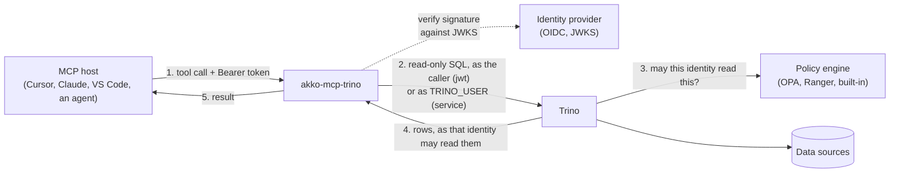
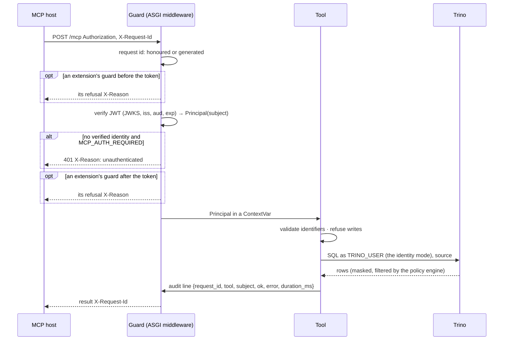

<p align="center">
  
  
  
  
  
  
  
  
  
  
</p>

# akko-mcp-trino

<!-- mcp-name: io.github.ab2dridi/akko-mcp-trino -->

**Give your AI agents read-only access to Trino, and nothing more.**

akko-mcp-trino is an [MCP](https://modelcontextprotocol.io) server for Trino.
It lets an agent list catalogs, schemas and tables, describe a table, explain a
query and run it, and it guarantees that nothing it sends can write: every
statement is parsed, and a write anywhere in it is refused before Trino. Every
query runs either as the one Trino identity the administrator configured, or as
the user the agent acts for, whose own token Trino verifies again. Either way
Trino's access control (OPA, Ranger, or Trino's own rules) decides what the
agent may read. Results are bounded in rows and in time, and every call leaves
one audit line.

## Why

An agent that reads a lakehouse needs a small, predictable surface: a few tools
whose descriptions a model understands, answers that never run away, and a
guarantee that a prompt injection cannot turn a question into a `DROP TABLE`.
This server is that surface, and nothing else. It does not decide access: in
`jwt` mode Trino decides for each user with the rules it already has, and in
`service` mode for the one identity you give it, with the rights every caller
of this server may have, no more.

## Highlights

- **Read-only by construction.** SQL is parsed into an AST and refused if a write appears anywhere in the tree, CTEs and subqueries included. Table functions (`TABLE(...)`, such as a JDBC connector's `system.query`) and the `system` catalog are refused too, including through a name without a catalog when the session catalog is `system`.
- **The user's own rights, end to end.** In `jwt` mode the caller's verified token goes to Trino, which verifies it again and runs the query as that user: Ranger or OPA decide for the person, not for a service account, with no password and no right to act for another user. A request without a verified token is refused, never run as anyone else.
- **Or one identity, configured by the administrator.** In `service` mode, the default, every query runs as `TRINO_USER`, authenticated by `TRINO_PASSWORD` over https (or nothing, for a local Trino). The agent cannot name another user.
- **Bounded.** A row cap with a `truncated` flag, a time budget per query cancelled in Trino, a time budget per tool call.
- **One audit line per call.** Keyed by `X-Request-Id`, never the token, never the SQL text: who called which tool, with which outcome, for how long.
- **Six tools, no more.** List catalogs, schemas and tables, describe a table, explain a statement, run a read-only query.
- **A guarded door.** Bearer tokens verified against any OIDC provider's JWKS (issuer, audience, expiry, clock tolerance), strict mode refusing a request without a verified caller, a Host header filter.
- **Built to be extended without being forked.** Tool plugins and extensions are Python packages named at start: identity modes, guards at the door, audit fields, routes, tools. An extension can only refuse what the core allows, never widen it.
- **Any MCP host, any model.** Cursor, Claude Desktop, VS Code, the Python SDK… Mistral, or any OpenAI-compatible model through the example agent.
- **Small and proven.** 322 tests at 100 % line and branch coverage, including in-process suites on the real SDK for all three transports, and a product-neutral guard in CI.

## Documentation

- **How it works, end to end:** [akko-ai.com/en/docs/how-it-works](https://akko-ai.com/en/docs/how-it-works/) (also [en français](https://akko-ai.com/docs/comment-ca-marche/)).
- **Guide, prerequisites, configuration, examples:** [akko-ai.com/docs/akko-mcp-trino](https://akko-ai.com/docs/akko-mcp-trino/) (also [in English](https://akko-ai.com/en/docs/akko-mcp-trino/)) and [akko-ai.com/docs/exemples](https://akko-ai.com/docs/exemples/).
- **Reference, in this repository:** this README, [`examples/`](examples/), [`CHANGELOG.md`](CHANGELOG.md), [`CONTRIBUTING.md`](CONTRIBUTING.md), [`SECURITY.md`](SECURITY.md).

## Contents

1. [How it works](#how-it-works)
2. [Compatibility](#compatibility)
3. [Prerequisites](#prerequisites)
4. [Install and run](#install-and-run)
5. [Connect an MCP host](#connect-an-mcp-host)
6. [Use it from an agent](#use-it-from-an-agent)
7. [The tools](#the-tools)
8. [Extensions](#extensions)
9. [What happens on a request](#what-happens-on-a-request)
10. [Configuration](#configuration)
11. [Operations](#operations)
12. [Development](#development)
13. [Design notes](#design-notes)
14. [Contributing](#contributing)
15. [About AKKO](#about-akko)

## How it works



The host calls a tool. When authentication is on, the server verifies the
caller's token (signature against the provider's JWKS, issuer, audience,
expiry) and refuses a request without one in strict mode; the caller's name
goes into the audit line. The server then checks the statement (read-only,
identifiers, table functions, the `system` catalog) and runs it in Trino under
the identity mode `TRINO_IDENTITY_MODE` names. Trino asks its policy engine and
returns what that identity may read, bounded in rows and time.

| Mode | Who Trino sees | What Trino needs | Who decides |
|---|---|---|---|
| `service` (default) | `TRINO_USER`, the same for every caller | a password (or nothing, locally) | the rights of that one identity |
| `jwt` | the caller, by their own verified token | its JWT authenticator, trusting the same identity provider | the rights of each user |

In `service` mode the caller's token never leaves the server. In `jwt` mode it
goes to Trino only once verified, over https only, and never into the audit
line; without one, the query is refused. An extension (see
[Extensions](#extensions)) may add other identity modes.

## Compatibility

| | Supported | Tested |
|---|---|---|
| Python | 3.12, 3.13 | 3.12, 3.13 (CI) |
| Trino | 351 and later, over http (local) or https with a password; https with the JWT authenticator for `jwt` | a recent release behind OPA, with row filters and column masks |
| Policy engines | OPA (`trino-opa`), Ranger (Trino plugin), Trino file-based access control | OPA with row filters and column masks |
| Identity providers (the door) | any OIDC provider publishing a JWKS | Keycloak 26 |
| MCP | protocol negotiated by the official `mcp` SDK 2.2 (versions up to 2025-11-25); transports `streamable-http`, `sse` and `stdio` | all three, official SDK client, in CI |
| MCP hosts | remote: anything that sends a bearer header; local: any stdio host | Python SDK, the example agent |
| Models | any, the server never talks to a model | Mistral Small 3.2 through OpenRouter, driving the tools |

## Prerequisites

| You need | Why | Notes |
|---|---|---|
| Python 3.12 or later | runtime | `pip` and a virtual environment |
| A reachable Trino coordinator | the engine | any recent version; https when a password is set, and for `jwt` |
| A Trino identity for this server (`service`) | the rights of every caller | `TRINO_USER`, and `TRINO_PASSWORD` when Trino authenticates by password; give it read rights only on what every caller may read |
| Or Trino's JWT authenticator (`jwt`) | each user reads with their own rights | `http-server.authentication.type=JWT` with the identity provider's JWKS; the token's audience must be one Trino accepts |
| A policy engine deciding for Trino | the governance | OPA (`opa.policy.uri`), Ranger, or Trino file-based rules |
| An OIDC provider with a JWKS endpoint | the door (optional) | Keycloak, Entra ID, Okta, Dex… Tokens must carry `iss`, `aud`, `exp`, and a subject (`preferred_username` or `sub`) |
| An MCP host | the client | Cursor, Claude Desktop, VS Code, or any client built on the `mcp` SDK |

Optional: a Prometheus to scrape `/metrics`.

## Install and run

```bash
pip install akko-mcp-trino        # or: pipx install akko-mcp-trino
uvx akko-mcp-trino --version      # run it without installing, the way most MCP hosts do
```

Or from source:

```bash
git clone https://github.com/AKKO-p/akko-mcp-trino.git
cd akko-mcp-trino
python -m venv .venv && source .venv/bin/activate
pip install -e .
```

The package installs a Python module (`akko_mcp_trino`) and a command
(`akko-mcp-trino`); `python -m akko_mcp_trino` is the same entrypoint.

Point it at your Trino and your identity provider, then serve:

```bash
export TRINO_HOST=trino.example.internal
export TRINO_PORT=8443
export TRINO_HTTP_SCHEME=https
export TRINO_CATALOG=iceberg
export TRINO_USER=mcp-reader
export TRINO_PASSWORD=...               # Basic authentication, https only

export MCP_AUTH_ENABLED=true
export MCP_AUTH_REQUIRED=true          # refuse requests without a verified identity
export MCP_JWKS_URL=https://idp.example.com/realms/data/protocol/openid-connect/certs
export MCP_OIDC_ISSUER=https://idp.example.com/realms/data
export MCP_OIDC_AUDIENCE=data-platform

python -m akko_mcp_trino
```

Before serving, `akko-mcp-trino --check` prints the effective configuration
(never a secret) and exits with 2 if something would refuse to start; over
stdio it checks that `MCP_USER_TOKEN` is present, not that it is valid (the
real start verifies the token). Then:

```
INFO:__main__:serving transport=streamable-http port=3000 auth=True strict=True extensions=none
```

Check it is alive and can reach Trino:

```bash
curl -s localhost:3001/health   # {"status":"ok"}       never touches Trino
curl -s localhost:3001/ready    # {"status":"ready"}    a bounded SELECT 1 as TRINO_USER
curl -s localhost:3001/metrics  # Prometheus exposition
```

Every query runs as `TRINO_USER`, whoever calls: give that identity the rights
every caller of this server may have, no more. In strict mode, a request
without a verified token is refused before any query.

### Each user with their own rights (`jwt`)

When Trino trusts the same identity provider, let it decide for each user:

```bash
export TRINO_IDENTITY_MODE=jwt         # the caller's verified token goes to Trino
export TRINO_HTTP_SCHEME=https         # required: a token never travels over http
export MCP_AUTH_ENABLED=true
export MCP_AUTH_REQUIRED=true
# TRINO_USER and TRINO_PASSWORD are not used
```

On the Trino side, `http-server.authentication.type=JWT`,
`http-server.authentication.jwt.key-file` set to the provider's JWKS URL, and
`http-server.authentication.jwt.principal-field` naming the same claim the
server reads (`preferred_username` or `sub`); `required-issuer` and
`required-audience` pin the token to your provider and to Trino. Two users asking the same question then get the answers their own
rights allow. `/ready` asks Trino's public `/v1/info`, since there is no
identity of the server's own to query with.

### Container

A [Dockerfile](Dockerfile) ships with the repository (non-root, health check,
OCI labels). Run it with the same environment variables, publishing ports
`3000` (MCP) and `3001` (health).

## Connect an MCP host

With authentication on, the host sends the user's access token from the
identity provider; the server verifies it and names the caller in the audit line.

Cursor, Claude Desktop, VS Code (`mcp.json`):

```json
{
  "mcpServers": {
    "trino": {
      "url": "http://localhost:3000/mcp",
      "headers": {"Authorization": "Bearer <the user's access token>"}
    }
  }
}
```

From Python, with the official SDK:

```python
import anyio
from mcp import ClientSession
from mcp.client.streamable_http import create_mcp_http_client, streamable_http_client


async def main(token: str):
    http = create_mcp_http_client(headers={"Authorization": f"Bearer {token}"})
    url = "http://localhost:3000/mcp"
    async with streamable_http_client(url, http_client=http) as (read, write):
        async with ClientSession(read, write) as session:
            await session.initialize()
            result = await session.call_tool("execute_query", {"sql": "SELECT 1"})
            print(result.content[0].text)


anyio.run(main, "<token>")
```

`streamable-http` (`/mcp`) is the default and what current hosts expect. Set
`MCP_TRANSPORT=sse` for older hosts (`/sse`); the guard is the same on both.

### Local hosts over stdio

Claude Desktop, Cursor and Mistral Vibe can launch the server themselves.
There is no request then, so the caller comes from the environment: the
user's own access token, verified exactly like a bearer header would be, and
bound to the process. Strict mode refuses to start without it. Queries run as
`TRINO_USER` in `service` mode, and as the user, with that token, in `jwt` mode.

```json
{
  "mcpServers": {
    "trino": {
      "command": "uvx",
      "args": ["akko-mcp-trino"],
      "env": {
        "MCP_TRANSPORT": "stdio",
        "TRINO_HOST": "trino.example.internal", "TRINO_PORT": "8443", "TRINO_HTTP_SCHEME": "https",
        "TRINO_USER": "mcp-reader", "TRINO_PASSWORD": "...",
        "MCP_AUTH_ENABLED": "true", "MCP_AUTH_REQUIRED": "true",
        "MCP_JWKS_URL": "https://idp.example.com/realms/data/protocol/openid-connect/certs",
        "MCP_OIDC_ISSUER": "https://idp.example.com/realms/data",
        "MCP_OIDC_AUDIENCE": "data-platform",
        "MCP_USER_TOKEN": "<the user's access token>"
      }
    }
  }
}
```

## Use it from an agent

[`examples/agent.py`](examples/agent.py) is a complete agent in eighty lines:
any OpenAI-compatible model (Mistral on La Plateforme, through OpenRouter or
LiteLLM; or any other provider), the MCP tools, the user's token. The model
never sees the token; the server receives it on every tool call and verifies it.

```bash
pip install akko-mcp-trino openai
export LLM_BASE_URL=https://api.mistral.ai/v1
export LLM_API_KEY=...
export LLM_MODEL=mistral-small-latest
export MCP_URL=http://localhost:3000/mcp
export USER_TOKEN=<the user's access token>
python examples/agent.py "Which catalogs can I see, and what is in them?"
```

The [examples](examples/README.md) folder has the details.

## The tools

| Tool | Arguments | Returns |
|---|---|---|
| `list_catalogs` | none | `{"catalogs": [...], "truncated": bool}`: the catalogs Trino shows |
| `list_schemas` | `catalog` | `{"schemas": [...], "truncated": bool}`: schemas in that catalog |
| `list_tables` | `catalog`, `schema` | `{"tables": [...], "truncated": bool}`: tables and views in that schema |
| `describe_table` | `catalog`, `schema`, `table`, `sample_rows` (0 to 20) | columns, types, comments, `truncated`; a governed sample when asked; what an extension's describers add |
| `explain_query` | `sql` | `{"plan": "..."}`: how Trino would run a read-only statement, without running it |
| `execute_query` | `sql`, `max_rows` (optional, lower than the server cap) | `{"columns": [...], "rows": [...], "row_count": n, "truncated": bool}` |

Every tool runs in Trino through the identity mode, the listing tools
included: metadata is data, and Trino lists only what that identity may see.
Every description is written for a model and says what the tool returns. The
descriptions of `describe_table` and `execute_query` also say that a masked
value or a missing row is the access policy, not an error to retry.

Every identifier is validated (`[A-Za-z_][A-Za-z0-9_-]*`) before it is placed
in SQL. `execute_query` accepts any SQL Trino accepts, **as long as it is a
read**: the statement is parsed into an AST and refused if it is more than one
statement, or if an `INSERT`, `UPDATE`, `DELETE`, `MERGE`, `CREATE`, `DROP`,
`ALTER`, `GRANT`, `CALL` or `SET` appears anywhere in the tree, including
inside a CTE, a subquery, or the statement an `EXPLAIN` explains. `EXPLAIN
ANALYZE` is refused: it executes what it explains. Table functions and the
`system` catalog are refused, and so is any `SHOW` that names `system`. A name
without a catalog is read in the session catalog (`TRINO_CATALOG`, `system` by
default); when that is `system`, a table without a catalog is refused (a CTE
is not a table), and only `SHOW CATALOGS` and a `SHOW SCHEMAS`, `SHOW TABLES`
or `SHOW COLUMNS` whose `FROM` gives the full name, catalog included, get
through. So set `TRINO_CATALOG` to a data catalog; the engine's policy must
refuse `system` too, the guard being a second line.

Results are capped at `TRINO_MAX_ROWS`: one row more is read, so `truncated`
says whether the answer was cut, and the rest of the query is cancelled in
Trino. Every listing says it too. With `TRINO_QUERY_TIMEOUT_SECONDS`, a query
that runs longer is cancelled in Trino and the agent is told so. The budget is
enforced by the server, not set as a session property: a policy engine that
forbids users to set session properties would refuse every query otherwise.
With `MCP_CALL_TIMEOUT_SECONDS`, a whole tool call has a time budget, every
query it runs included: past it no query starts, the one running is cancelled
(even when the budget ran out before Trino named it), and the agent gets
`{"error": "the tool call exceeded its time budget…"}`, never what the call had
gathered so far, nor an answer that came past the deadline. A plugin that calls
its own backend bounds that request with
`akko_mcp_trino.audit.time_allowed(timeout)`: its own timeout, or what is left
of the call's budget when that is shorter.

Errors come back to the agent as `{"error": "..."}` with Trino's whole message;
a permission refusal from Trino is an ordinary error, not a crash. The audit
line keeps only the error's code (see [Audit](#audit)).

### Adding tools from another package

A product built on this server can add its own tools without forking it. A
package registers a registrar `(mcp, client) -> None`, or
`(mcp, client, tools) -> None`, under the entry-point group
`akko_mcp_trino.tools` and the operator names it in `MCP_TOOL_PLUGINS`:

```toml
[project.entry-points."akko_mcp_trino.tools"]
my-tools = "my_package.tools:register"
```

```python
from akko_mcp_trino.identity import current_subject


def register(mcp, client):
    @mcp.tool()
    def my_tool(text: str) -> str:
        return client.query("SELECT ...", user=current_subject())
```

Nothing is loaded that is not named, and an unknown name refuses to start.
Tools added this way go through the same client, hence the same identity mode as
the built-in ones, and every tool a registrar adds through `mcp.tool()` or
`mcp.add_tool()` leaves the same audit line, with no change to the plugin.
`build_server(extra_tool_registrars=...)` does the same from Python.

A registrar with a third argument receives the `ToolContext`:
`tools.tool(title, governed=..., open_world=...)` registers a tool with its MCP
annotations, `tools.run(sql)` queries Trino through the identity mode,
`tools.note(...)` records what the call did (the SQL it ran, the tables, the
rows, whether they were cut), and `tools.add_describer(fn)` adds to what
`describe_table` answers:

```python
import json


def register(mcp, client, tools):
    @tools.tool("Ask the data", governed=True, idempotent=False)
    def ask_data(question: str) -> str:
        answer = my_service.ask(question)  # runs its SQL through tools.run
        tools.note(sql=answer["sql"], tables=answer["tables"], rows=len(answer["rows"]))
        return json.dumps(answer)
```

## Extensions

A tool plugin adds tools. An extension may add more, around the core and never
in place of it. A package registers a factory `(config, env) -> Extension`
under the entry-point group `akko_mcp_trino.extensions`, and the operator names
it in `MCP_EXTENSIONS` (comma-separated, in order):

```toml
[project.entry-points."akko_mcp_trino.extensions"]
my-extension = "my_package.extension:create"
```

```python
from akko_mcp_trino.extensions import Extension, Refusal


class MyExtension(Extension):
    name = "my-extension"

    def after_auth(self, admission):
        if admission.principal is not None and admission.principal.subject.startswith("svc-"):
            return Refusal("service_accounts_refused", status=403)
        return None


def create(config, env):
    return MyExtension()
```

Nothing is loaded that is not named. An unknown name refuses to start, and so
does a factory that raises `ValueError` on a setting it cannot serve; `--check`
reports both. `akko_mcp_trino.extensions.Extension` is the base class: every
hook does nothing, so an extension overrides only what it adds.

| Hook | What it adds |
|---|---|
| `check_lines()` | lines `--check` prints, never a secret |
| `identity_modes()` | identity modes by `TRINO_IDENTITY_MODE` name, each an `IdentityMode` (`describe`, `connection(user)`, `ping`); one named like a core mode (`service`, `jwt`) replaces it |
| `audiences()` | token audiences accepted besides `MCP_OIDC_AUDIENCE` |
| `before_auth(admission)` | a refusal before the token is looked at, or `None` |
| `after_auth(admission)` | a refusal once the core has verified the token (or found none), or `None` |
| `public_documents()` | JSON documents served without a token, by request path |
| `challenge(refusal)` | the `WWW-Authenticate` value of a refusal |
| `routes()` | Starlette routes added to the served app, behind the identity guard |
| `wrap_audit(audit)` | the audit sink the server writes to, given the one it would write to otherwise |
| `client_tags()` | client tags of a query run now (`X-Trino-Client-Tags`) |
| `describe_table_doc()` | text appended to the description of `describe_table` |
| `tool_registrars()` | tool registrars, called like a tool plugin's, before the plugins' |

A guard answers a `Refusal(reason, status=401, error="", headers={})`: the
reason goes into `X-Reason` and the body, `error` is the RFC 6750 code a
challenge may carry, `headers` are added to the response (`Retry-After`). It
reads an `Admission`: the request headers, the token the request presented, the verified `principal`
(None before authentication or without a token), `stdio` (true for the single
admission of a stdio process); `admission.bind(var, value)` sets a context
variable for the duration of the request, reset afterwards.

The rule: **an extension can only refuse, never widen.** Its guards run around
the core's token verification, never instead of it; strict mode still refuses
a request without a verified identity whatever a guard answers, and the
read-only guard on SQL applies to every query. An identity mode decides who the
server is for Trino, query by query (`akko_mcp_trino.trino_client.resolve_identity`
picks the mode `TRINO_IDENTITY_MODE` names among the core's and the extensions',
and refuses an unknown one: there is no fallback to `service`). A plugin that
calls its own backend for the caller reads the verified bearer with
`akko_mcp_trino.identity.current_bearer()`. Trino decides
what that identity may read.

## What happens on a request



## Configuration

Everything is read from the environment. Nothing is hardcoded. An extension
reads its own variables from the same environment.

### Trino

| Variable | Meaning | Default |
|---|---|---|
| `TRINO_HOST`, `TRINO_PORT` | the coordinator | `localhost`, `8080` |
| `TRINO_USER` | the Trino identity every query runs as, whoever calls | `trino` |
| `TRINO_PASSWORD` | its password, sent by Basic authentication; refused over `http`; `--check` says whether one is set, never which | none |
| `TRINO_CATALOG` | session catalog, where a name without a catalog is read; set it to a data catalog (with `system`, such names are refused) | `system` |
| `TRINO_READ_ONLY` | refuse writes in `execute_query` | `true` |
| `TRINO_MAX_ROWS` | result cap; one more row is read to say whether the answer was `truncated` | `100` |
| `TRINO_QUERY_TIMEOUT_SECONDS` | time budget of one query: past it, the server cancels the query in Trino; `0` leaves the limit to Trino | `0` |
| `MCP_CALL_TIMEOUT_SECONDS` | time budget of one tool call, every query of the call included: past it, no query starts, the one running is cancelled and the agent gets an error; `0` sets none | `0` |
| `TRINO_SOURCE` | the source Trino records for every query (`X-Trino-Source`) | the server name |
| `TRINO_HTTP_SCHEME` | `http` or `https`; a password is never sent over `http` | `http` |
| `TRINO_VERIFY` | TLS verification: `true`, `false`, or a path to the CA bundle Trino's TLS chain is checked against | `true` |
| `TRINO_REQUEST_TIMEOUT_SECONDS` | per-request timeout on the Trino client | `30` |
| `TRINO_IDENTITY_MODE` | who the server is for Trino: `service` (every query as `TRINO_USER`) or `jwt` (every query as the caller, whose verified token Trino receives; https only, refused without a token); an extension may add others, and an unknown mode refuses to start | `service` |

### Identity

| Variable | Meaning | Default |
|---|---|---|
| `MCP_AUTH_ENABLED` | verify the callers' bearer tokens (the door; queries still run as `TRINO_USER`) | `false` |
| `MCP_AUTH_REQUIRED` | refuse requests without a verified identity | `false` |
| `MCP_JWKS_URL` | the provider's JWKS endpoint | none (required when auth is enabled) |
| `MCP_OIDC_ISSUER`, `MCP_OIDC_AUDIENCE` | claims to enforce | none |
| `MCP_JWT_LEEWAY_SECONDS` | tolerance on `exp`/`nbf`/`iat` for clock drift between the issuer and this server | `30` |
| `MCP_ALLOWED_HOSTS` | Host header filter (the SDK's DNS rebinding protection): `host` or `host:port` entries, comma-separated, `host:*` for any port (the only wildcard); once the filter is on, a request that carries an `Origin` header is refused (403); empty serves any Host | none (off) |

Auth enabled without a JWKS URL refuses to start: an authentication layer that
cannot verify anything must not pretend to.

### Plugins and extensions

| Variable | Meaning | Default |
|---|---|---|
| `MCP_TOOL_PLUGINS` | comma-separated names of registrars installed under the entry-point group `akko_mcp_trino.tools` | none |
| `MCP_EXTENSIONS` | comma-separated names of extensions installed under the entry-point group `akko_mcp_trino.extensions` | none |

### Serving

| Variable | Meaning | Default |
|---|---|---|
| `MCP_TRANSPORT` | `streamable-http`, `sse` or `stdio` | `streamable-http` |
| `MCP_PORT`, `MCP_HEALTH_PORT` | listening ports | `3000`, `3001` |
| `MCP_SERVER_NAME` | name announced to hosts | `trino-mcp` |
| `MCP_USER_TOKEN` | stdio only: the user's access token, verified like a bearer header | none (required in strict mode) |

## Operations

### Refusals

Every refusal carries `X-Reason` and the request id, never the token. The core
refuses with `401 unauthenticated` a request without a verified identity in
strict mode; an extension's guards add their own reasons.

### Audit

Every response of the MCP endpoint carries `X-Request-Id`. It is the one the
gateway in front of the server sent, when it is a plain token (letters,
digits, `.`, `_`, `:`, `-`, at most 128), or one the server generated. A tool
call outside an HTTP request (stdio) gets its own id. Every tool call, a
plugin's included, writes one JSON line to the `mcp.audit` logger keyed by
that id:

```json
{"request_id":"edge-42","tool":"execute_query","subject":"alice","ok":false,"error":"USER_ERROR:PERMISSION_DENIED","duration_ms":84}
```

With the default logging configuration, the line comes out prefixed with
`INFO:mcp.audit:`; a collector that expects pure JSON strips that prefix.

| Field | Meaning |
|---|---|
| `request_id`, `tool`, `subject` | which call, which tool, for whom; the line has no field that could hold the bearer or the SQL text |
| `ok`, `error` | the outcome; `error` is a code, never a message, because a message from Trino may quote a value read from a row (`Cannot cast '<value>' to INT`): Trino's error type and name for a Trino error (`USER_ERROR:INVALID_CAST_ARGUMENT`), the class of any other exception (`TimeoutError`, `CallTimeout` past the call's budget), the code a tool names for its own refusal (`read_only`, `invalid_argument`) or a plugin with `note(error=...)`, else `tool_error`. The agent reads the whole message |
| `duration_ms` | how long the call took |

What a call did (the SHA-256 of its SQL, the tables, the rows, whether they
were cut) is kept in its record while it runs (`akko_mcp_trino.audit.note`);
the core's line does not write it, an extension may (`wrap_audit`).

### Health and metrics

`/health` on the health port never touches Trino, so a liveness probe cannot
kill the server because Trino is slow. `/ready` asks the identity mode: in
`service` mode, a bounded `SELECT 1` as `TRINO_USER`. `/metrics` exposes `mcp_trino_queries_total`,
`mcp_trino_query_errors_total` and `mcp_trino_query_duration_seconds`.

## Development

```bash
pip install -e ".[dev]"
ruff check akko_mcp_trino tests examples && ruff format akko_mcp_trino tests examples
ruff check akko_mcp_trino --select D100,D101,D102,D103,D105,D107   # every public name documented
mypy akko_mcp_trino           # the package ships py.typed and type-checks clean
pip-audit                     # no known vulnerability in the dependency tree
bash lint-vendor-neutral.sh   # fails if the package imports anything product-specific
pytest                        # 322 tests; line or branch coverage below 100 % fails the run
python -m build && twine check dist/*
akko-mcp-trino --check        # effective configuration, no secrets; exit 2 if it would not start
```

`tests/test_core_alone.py` lists what the core holds (tools, modules,
settings, audit fields) and fails the day something is added unlisted.

Every module in `akko_mcp_trino/` has one responsibility and its tests, in
`tests/`:

| Module | Responsibility |
|---|---|
| `config.py` | read the environment, neutral defaults |
| `auth.py` | JWT verification against JWKS, `Principal` |
| `identity.py` | the verified caller in a ContextVar |
| `middleware.py` | the guard: token, request id, the extensions' guards and documents |
| `extensions.py` | the extension points and their loading |
| `transport_security.py` | the Host header filter (`MCP_ALLOWED_HOSTS`) |
| `audit.py` | the audit line, the request id, the record and the time budget of a call |
| `sql_guard.py` | identifier validation, read-only decision on the AST |
| `tools.py`, `plugins.py` | the six tools and the `ToolContext`, loading tool plugins |
| `trino_client.py` | the Trino connection, the identity modes (`service` in the core) and the time budgets |
| `health.py`, `metrics.py` | `/health`, `/ready` and `/metrics`; the Prometheus counters |
| `server.py`, `app.py`, `__main__.py` | assembly, transport, entrypoint and `--check` |

The README is tested too: every variable listed here is read by `config.py`,
and the defaults stated here are the defaults in the code.

## Design notes

**The guard is a pure ASGI middleware, not `BaseHTTPMiddleware`.** The latter
runs the downstream in a separate task and breaks ContextVar propagation: the
verified caller would never reach the tools.

**Mounting is transport-independent.** One code path builds the transport app
and mounts the guard, whatever the transport. The guard once lived only on the
branch the default transport never took; a test now asserts it for both.

**Every tool goes through the identity mode, not only `execute_query`.**
Listing catalogs, schemas and tables is reading metadata; a test walks every
tool to check it reaches Trino the same way.

**Read-only is decided on the AST, anywhere in the tree.** A leading-keyword
check lets `WITH w AS (DELETE FROM t) SELECT 1` through. So did a root-node
check, until a live adversarial proof caught it. The guard now walks the whole
tree.

**Table functions are refused.** `TABLE(pg.system.query(query => '...'))` parses
as a plain `SELECT`, yet it sends raw SQL to the source under the connector's
own account, so the engine applies neither row filters nor column masks. The
guard refuses every table function and the `system` catalog (which shows other
users' SQL in `system.runtime.queries`). The engine policy must refuse them as
well; the guard is a second line, not the only one.

**One configured identity, never one the caller names.** Every query runs as
`TRINO_USER`. A caller sending a header that names a Trino user changes
nothing, and the caller's token never reaches Trino. A password is never sent
over plain http, and an identity mode the core does not know refuses to start
rather than fall back.

**An extension can only refuse.** Its guards run around the token
verification, never instead of it, and the read-only guard applies whatever
they answer.

**The server does not decide access.** Trino does, for the configured
identity. Putting policy in the server would duplicate, and eventually
contradict, what the engine already enforces for every other client.

## Contributing

Contributions are welcome: see [CONTRIBUTING.md](CONTRIBUTING.md) for the
ground rules (tests first, 100 % coverage, product-neutral, fail closed) and
[SECURITY.md](SECURITY.md) for reporting a vulnerability privately.
Changes are tracked in [CHANGELOG.md](CHANGELOG.md).

## About AKKO

akko-mcp-trino is built and maintained by [AKKO](https://akko-ai.com), a
French project working on governed access for AI agents to enterprise data,
in place, on the engines and identity providers organisations already run.

**Maintained by:** AKKO ([contact@akko-ai.com](mailto:contact@akko-ai.com)) ·
**Issues:** [github.com/AKKO-p/akko-mcp-trino/issues](https://github.com/AKKO-p/akko-mcp-trino/issues)

## License

Apache 2.0. See [LICENSE](LICENSE).
