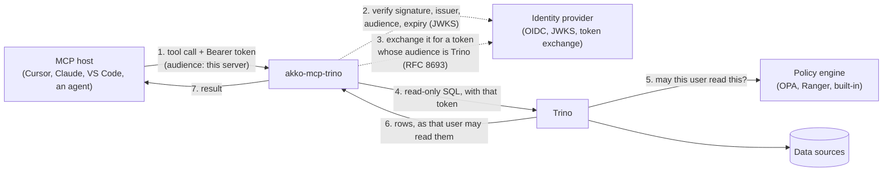

<p align="center">
  
  
  
  
  
  
  
  
  
  
</p>

# akko-mcp-trino

**English** · [Français](README.fr.md)

<!-- mcp-name: io.github.ab2dridi/akko-mcp-trino -->

**Give your AI agents read-only access to Trino, and nothing more.**

akko-mcp-trino is an [MCP](https://modelcontextprotocol.io) server for Trino.
It lets an agent list catalogs, schemas and tables, describe a table, explain a
query and run it, and it refuses every write it is sent: each statement is
parsed, and a write anywhere in it is refused before Trino. By default every
query runs as the user the agent acts for. The server verifies the user's
token, issued for this server, and obtains from the identity provider a
separate token for Trino (OAuth 2.0 Token Exchange): the user's own token never
leaves the server. Trino's access control (OPA, Ranger, or Trino's own rules)
then decides what that user may read. Results are bounded in rows and in time,
and every call leaves one audit line.

> **Upgrading from 0.5?** 0.6.0 changes the defaults: a verified caller is
> required, and the `jwt` mode exchanges the caller's token instead of passing
> it on. See [MIGRATING.md](MIGRATING.md).

## Why

An agent that reads a lakehouse needs a small, predictable surface: a few tools
whose descriptions a model understands, answers that never run away, and a
guarantee that a prompt injection cannot turn a question into a `DROP TABLE`
through it. This server is that surface, and nothing else. It does not decide
access: Trino decides for each user with the rules it already has, or, in
`service` mode, for the one identity you give it.

## Highlights

- **Read-only by construction, through this server.** SQL is parsed into an AST and refused if a write appears anywhere in the tree, CTEs and subqueries included. Table functions (`TABLE(...)`, such as a JDBC connector's `system.query`) and the `system` catalog are refused too, including through a name without a catalog when the session catalog is `system`. What a user may do in Trino by other means is Trino's rules: see [What read-only covers](#what-read-only-covers).
- **The user's own rights, safe by default.** In `jwt` mode, the default, the server verifies the caller's token (issued for this server, never for Trino), exchanges it at the identity provider for a token whose audience is Trino (RFC 8693), and Trino runs the query as that user. The caller's token is never passed on. A request without a valid token is refused with `401`.
- **A fallback without token exchange.** In `impersonation` mode the server authenticates to Trino as its own account (password or client certificate) and Trino runs the query as the verified caller, under an impersonation rule only that account has.
- **One identity, only when named.** In `service` mode every query runs as `TRINO_USER`. It is never chosen by default, and the server says so at start and to every host in its initialization instructions.
- **Bounded by default.** A row cap with a `truncated` flag (100), a time budget per query cancelled in Trino (60 s), a time budget per tool call (120 s).
- **One audit line per call.** Keyed by `X-Request-Id`, never the token, never the SQL text: who called which tool, with which outcome, for how long.
- **Eight tools,** annotated with what they can really do: `execute_query` is annotated read-only only while `TRINO_READ_ONLY` is true.
- **A guarded door.** Bearer tokens verified against any OIDC provider's JWKS (issuer, audience bound to this server, expiry, clock tolerance), a token issued for Trino refused, protected resource metadata (RFC 9728), a Host header filter.
- **Built to be extended without being forked.** Tool plugins and extensions are Python packages named at start: identity modes, guards at the door, audit fields, routes, tools. An extension can only refuse what the core allows, never widen it.
- **Any MCP host, any model.** Cursor, Claude Desktop, VS Code, the Python SDK… Mistral, or any OpenAI-compatible model through the example agent.
- **Small and proven.** 609 tests at 100 % line and branch coverage, including in-process suites on the real SDK for all three transports, a live run against Keycloak and Trino in CI ([`integration/`](integration/)), and a product-neutral guard.

## Documentation

- **How it works, end to end:** [akko-ai.com/en/docs/how-it-works](https://akko-ai.com/en/docs/how-it-works/) (also [en français](https://akko-ai.com/docs/comment-ca-marche/)).
- **Guide, prerequisites, configuration, examples:** [akko-ai.com/docs/akko-mcp-trino](https://akko-ai.com/docs/akko-mcp-trino/) (also [in English](https://akko-ai.com/en/docs/akko-mcp-trino/)) and [akko-ai.com/docs/exemples](https://akko-ai.com/docs/exemples/).
- **Reference, in this repository:** this README, [`examples/`](examples/), [`CHANGELOG.md`](CHANGELOG.md), [`MIGRATING.md`](MIGRATING.md), [`CONTRIBUTING.md`](CONTRIBUTING.md), [`SECURITY.md`](SECURITY.md).

## Contents

1. [How it works](#how-it-works)
2. [Compatibility](#compatibility)
3. [Prerequisites](#prerequisites)
4. [Install and run](#install-and-run)
5. [Connect an MCP host](#connect-an-mcp-host)
6. [Use it from an agent](#use-it-from-an-agent)
7. [The tools](#the-tools)
8. [What read-only covers](#what-read-only-covers)
9. [Extensions](#extensions)
10. [What happens on a request](#what-happens-on-a-request)
11. [Configuration](#configuration)
12. [Operations](#operations)
13. [Development](#development)
14. [Design notes](#design-notes)
15. [Contributing](#contributing)
16. [About AKKO](#about-akko)

## How it works



The host calls a tool with the user's access token. The server verifies it
(signature against the provider's JWKS, issuer, an audience naming this server,
expiry) and refuses a request without a valid one with `401`; a token issued for
Trino is refused too. The server then checks the statement (read-only,
identifiers, table functions, the `system` catalog) and runs it in Trino under
the identity mode `TRINO_IDENTITY_MODE` names. Trino asks its policy engine and
returns what that identity may read, bounded in rows and time.

| Mode | Who Trino sees | How Trino knows | When to use it |
|---|---|---|---|
| `jwt` (default) | the caller | a token for Trino the server obtained by token exchange (RFC 8693); Trino verifies it with its JWT authenticator | the identity provider supports OAuth 2.0 Token Exchange (RFC 8693); tested with Keycloak 26 |
| `impersonation` | the caller | the server's own account (password or client certificate) asks Trino to run the query as the caller; Trino allows it under an impersonation rule only that account has | the identity provider cannot exchange tokens |
| `oauth2` | the local user, checked with `SELECT current_user` | Trino's native OAuth2 browser login; the driver caches tokens and reauthenticates | local stdio hosts only, with a Trino coordinator configured for OAuth2 |
| `service` | `TRINO_USER`, the same for every caller | a password, a client certificate, or nothing, locally | only when named: one identity for everyone, announced at start and to every host |

The caller's own token never leaves the server, in any mode: the MCP
authorization specification forbids passing it on ("token passthrough"). The
caller's name comes from their verified token, or from Trino's `SELECT current_user`
in `oauth2`, never from an unverified header. The `jwt` and `impersonation` modes
refuse to start unless the door requires a valid token. An extension (see
[Extensions](#extensions)) may add other identity modes.

## Compatibility

| | Supported | Tested |
|---|---|---|
| Python | 3.12, 3.13 | 3.12, 3.13 (CI) |
| Trino | 351 and later; https with the JWT authenticator for `jwt`, with a password or certificate authenticator and impersonation rules for `impersonation`; http (local) or https for `service` | a recent release with the JWT and certificate authenticators, behind OPA and behind file-based rules, with row filters and column masks |
| Policy engines | OPA (`trino-opa`), Ranger (Trino plugin), Trino file-based access control | OPA and file-based rules, with row filters and column masks |
| Identity providers | any OIDC provider publishing a JWKS (the door); OAuth 2.0 Token Exchange, RFC 8693 (`jwt` mode) | Keycloak 26 (standard token exchange) |
| MCP | protocol negotiated by the official `mcp` SDK 2.2 (initialize handshake revisions 2024-11-05 to 2025-11-25, and the stateless 2026-07-28 revision); transports `streamable-http`, `sse` and `stdio` | all three transports, official SDK client at its default revision, in CI |
| MCP hosts | remote: anything that sends a bearer header; local: any stdio host | Python SDK, the example agent |
| Models | any, the server never talks to a model | Mistral Small 3.2 through OpenRouter, driving the tools |

## Prerequisites

| You need | Why | Notes |
|---|---|---|
| Python 3.12 or later | runtime | `pip` and a virtual environment |
| A reachable Trino coordinator | the engine | any recent version; https for `jwt` and `impersonation`, and whenever a secret is sent |
| An OIDC provider with a JWKS endpoint | the door | Keycloak, Entra ID, Okta, Dex… Tokens must carry `iss`, an `aud` naming this server, `exp`, and a subject (`preferred_username` or `sub`) |
| `jwt`: token exchange at the provider, and Trino's JWT authenticator | each user reads with their own rights | a confidential client for this server, allowed to exchange a token issued for it for one whose audience is Trino; `http-server.authentication.type=JWT` with the provider's JWKS and `required-audience` set to that audience |
| Or `impersonation`: an account for this server, and an impersonation rule | each user reads with their own rights, without token exchange | `TRINO_USER` with `TRINO_PASSWORD` or a client certificate; a Trino rule letting that account, and only it, impersonate users |
| Or `service`: one Trino identity | the rights of every caller | `TRINO_USER`, and `TRINO_PASSWORD` or a client certificate; give it read rights only on what every caller may read |
| A policy engine deciding for Trino | the governance | OPA (`opa.policy.uri`), Ranger, or Trino file-based rules |
| An MCP host | the client | Cursor, Claude Desktop, VS Code, or any client built on the `mcp` SDK |

Optional: a Prometheus to scrape `/metrics`.

## Install and run

```bash
pip install akko-mcp-trino        # or: pipx install akko-mcp-trino
uvx akko-mcp-trino --version      # run it without installing, the way most MCP hosts do
```

Or from source:

```bash
git clone https://github.com/AKKO-p/akko-mcp-trino.git
cd akko-mcp-trino
python -m venv .venv && source .venv/bin/activate
pip install -e .
```

The package installs a Python module (`akko_mcp_trino`) and a command
(`akko-mcp-trino`); `python -m akko_mcp_trino` is the same entrypoint.

Point it at your Trino and your identity provider, then serve. The defaults
are the safe ones: each query runs as the caller (`jwt`), and a request without
a valid token is refused.

```bash
export TRINO_HOST=trino.example.internal
export TRINO_PORT=8443
export TRINO_HTTP_SCHEME=https          # required: a token never travels over http
export TRINO_CATALOG=iceberg

# The door: tokens issued for this server, verified against the provider's JWKS
export MCP_JWKS_URL=https://idp.example.com/realms/data/protocol/openid-connect/certs
export MCP_OIDC_ISSUER=https://idp.example.com/realms/data
export MCP_OIDC_AUDIENCE=akko-mcp        # the audience the provider gives tokens for this server
export MCP_RESOURCE_URL=https://mcp.example.com/mcp   # optional: this server's canonical URL

# A token for Trino, by token exchange (RFC 8693), never the caller's own
export TRINO_TOKEN_EXCHANGE_URL=https://idp.example.com/realms/data/protocol/openid-connect/token
export TRINO_TOKEN_EXCHANGE_CLIENT_ID=akko-mcp
export TRINO_TOKEN_EXCHANGE_CLIENT_SECRET=...
export TRINO_TOKEN_EXCHANGE_AUDIENCE=trino

python -m akko_mcp_trino
```

Before serving, `akko-mcp-trino --check` prints the effective configuration
(never a secret), any warning, and exits with 2 if something would refuse to
start; over stdio it checks that `MCP_USER_TOKEN` is present, not that it is
valid (the real start verifies the token). Then:

```
INFO:__main__:serving transport=streamable-http port=3000 auth=True strict=True identity=jwt extensions=none
```

Check it is alive and can reach Trino:

```bash
curl -s localhost:3001/health   # {"status":"ok"}       never touches Trino
curl -s localhost:3001/ready    # {"status":"ready"}    jwt: Trino's /v1/info; impersonation and service: a bounded SELECT 1 as the server's account
curl -s localhost:3001/metrics  # Prometheus exposition
```

### Each user with their own rights (`jwt`, the default)

The caller's token is issued for this server: its audience is
`MCP_OIDC_AUDIENCE` (or `MCP_RESOURCE_URL`). The server exchanges it at the
provider for a token whose audience is `TRINO_TOKEN_EXCHANGE_AUDIENCE`, keeps
that token in memory until shortly before it expires, and sends it to Trino. A
token whose audience is Trino's is refused at the door, and a configuration
that would accept one refuses to start.

On the provider, give this server a confidential client allowed to exchange
tokens, and make Trino's audience available to it. With Keycloak 26: enable
*Standard token exchange* on the server's client, add an audience mapper for the
Trino client to it, and have the clients of your MCP hosts put the server's
client in the audience of the tokens they get (an audience mapper too). The
[`integration/`](integration/) folder holds such a realm, tested on every pull
request.

On the Trino side, `http-server.authentication.type=JWT`,
`http-server.authentication.jwt.key-file` set to the provider's JWKS URL,
`http-server.authentication.jwt.principal-field` naming the same claim the
server reads (`preferred_username` or `sub`), and `required-issuer` and
`required-audience` pinning the token to your provider and to Trino's audience.
Two users asking the same question then get the answers their own rights allow.
`/ready` asks Trino's public `/v1/info`, since there is no identity of the
server's own to query with.

### Without token exchange (`impersonation`)

When the provider cannot exchange tokens, the server reaches Trino as its own
account, and Trino runs each query as the verified caller:

```bash
export TRINO_IDENTITY_MODE=impersonation
export TRINO_USER=mcp-service
export TRINO_CLIENT_CERT=/certs/mcp-service.crt   # mTLS; or TRINO_PASSWORD over https
export TRINO_CLIENT_KEY=/certs/mcp-service.key
```

Trino must authenticate that account (the certificate or password
authenticator, besides the one your users have) and allow it, and only it, to
impersonate users. With file-based access control:

```json
{"impersonation": [{"original_user": "mcp-service", "new_user": ".*", "allow": true}]}
```

Narrow `new_user` to the users the agents may act for. Nobody else may
impersonate: a user who sends a header naming someone else is refused by Trino,
and the server never takes the caller's name from a header, only from their
verified token. Keep the account's credential as you would any service
credential: whoever holds it can act as any user the rule allows.

### One identity for every caller (`service`, only when named)

```bash
export TRINO_IDENTITY_MODE=service
export TRINO_USER=mcp-reader
export TRINO_PASSWORD=...               # or TRINO_CLIENT_CERT and TRINO_CLIENT_KEY; https only
```

Every query runs as `TRINO_USER`, whoever calls: give that identity the rights
every caller of this server may have, no more, and read-only rights only. The
server logs a warning at start, `--check` prints it, and every host receives it
in the `instructions` of the MCP initialization. The door stays on by default;
to run without one, locally, set `MCP_AUTH_ENABLED=false` and
`MCP_AUTH_REQUIRED=false` too, and the warning says so.

### Native browser login (`oauth2`, stdio only)

With Trino OAuth2 configured, keep your coordinator settings and run:

```bash
MCP_TRANSPORT=stdio TRINO_IDENTITY_MODE=oauth2 TRINO_HTTP_SCHEME=https \
MCP_AUTH_ENABLED=false MCP_AUTH_REQUIRED=false python -m akko_mcp_trino
```

The server sends Trino no user name: Trino runs every query as the user who
signed in, and `TRINO_USER` is ignored. Startup and discovery (`initialize`,
`ping`, `tools/list`, `resources/list`, `resources/templates/list`, `prompts/list`,
notifications) never log in, so the host does not time out waiting for the browser.
Every other request, a tool call or a resource read, logs in first: the URL is logged
to stderr only, and `SELECT current_user` must succeed before the request runs; its
result names the admission/audit principal. That is the only query that reaches Trino
without an admitted user. A request the extensions' guards refuse, or one for which
Trino names no user, is answered with an `INVALID_REQUEST` error that says why.
The first call may time out at the host while the browser login waits; once signed
in, call again. The user Trino names first stays the user of the process until it
exits: a reauthentication by the driver does not change who admission and audit name,
so sign in again as the same user, or restart the server to switch.
HTTP MCP transports are rejected.
`MCP_AUTH_REQUIRED=true` requires a verified `MCP_USER_TOKEN` in addition;
`false` never skips Trino login. The driver reuses tokens and reauthenticates,
with memory caching or optional `keyring`. `--check` does not log in.

### Container

A [Dockerfile](Dockerfile) ships with the repository (non-root, health check,
OCI labels). Run it with the same environment variables, publishing ports
`3000` (MCP) and `3001` (health).

## Connect an MCP host

The host sends the user's access token from the identity provider, issued for
this server; the server verifies it and names the caller in the audit line. A
host that supports MCP authorization finds the provider through the protected
resource metadata the server publishes when `MCP_RESOURCE_URL` is set.

Cursor, Claude Desktop, VS Code (`mcp.json`):

```json
{
  "mcpServers": {
    "trino": {
      "url": "http://localhost:3000/mcp",
      "headers": {"Authorization": "Bearer <the user's access token>"}
    }
  }
}
```

From Python, with the official SDK:

```python
import anyio
from mcp import ClientSession
from mcp.client.streamable_http import create_mcp_http_client, streamable_http_client


async def main(token: str):
    http = create_mcp_http_client(headers={"Authorization": f"Bearer {token}"})
    url = "http://localhost:3000/mcp"
    async with streamable_http_client(url, http_client=http) as (read, write):
        async with ClientSession(read, write) as session:
            await session.initialize()
            result = await session.call_tool("execute_query", {"sql": "SELECT 1"})
            print(result.content[0].text)


anyio.run(main, "<token>")
```

`streamable-http` (`/mcp`) is the default and what current hosts expect. Set
`MCP_TRANSPORT=sse` for older hosts (`/sse`); the guard is the same on both.

### Local hosts over stdio

Claude Desktop, Cursor and Mistral Vibe can launch the server themselves.
There is no request then, so the caller comes from the environment: the
user's own access token, issued for this server, verified exactly like a bearer
header would be, and bound to the process. Strict mode, the default, refuses to
start without it. Queries run as the user in `jwt` mode (the token is exchanged
for one for Trino, as over http) and in `impersonation` mode, and as
`TRINO_USER` in `service` mode.

```json
{
  "mcpServers": {
    "trino": {
      "command": "uvx",
      "args": ["akko-mcp-trino"],
      "env": {
        "MCP_TRANSPORT": "stdio",
        "TRINO_HOST": "trino.example.internal", "TRINO_PORT": "8443", "TRINO_HTTP_SCHEME": "https",
        "MCP_JWKS_URL": "https://idp.example.com/realms/data/protocol/openid-connect/certs",
        "MCP_OIDC_ISSUER": "https://idp.example.com/realms/data",
        "MCP_OIDC_AUDIENCE": "akko-mcp",
        "TRINO_TOKEN_EXCHANGE_URL": "https://idp.example.com/realms/data/protocol/openid-connect/token",
        "TRINO_TOKEN_EXCHANGE_CLIENT_ID": "akko-mcp",
        "TRINO_TOKEN_EXCHANGE_CLIENT_SECRET": "...",
        "TRINO_TOKEN_EXCHANGE_AUDIENCE": "trino",
        "MCP_USER_TOKEN": "<the user's access token>"
      }
    }
  }
}
```

## Use it from an agent

[`examples/agent.py`](examples/agent.py) is a complete agent in eighty lines:
any OpenAI-compatible model (Mistral on La Plateforme, through OpenRouter or
LiteLLM; or any other provider), the MCP tools, the user's token. The model
never sees the token; the server receives it on every tool call and verifies it.

```bash
pip install akko-mcp-trino openai
export LLM_BASE_URL=https://api.mistral.ai/v1
export LLM_API_KEY=...
export LLM_MODEL=mistral-small-latest
export MCP_URL=http://localhost:3000/mcp
export USER_TOKEN=<the user's access token>
python examples/agent.py "Which catalogs can I see, and what is in them?"
```

The [examples](examples/README.md) folder has the details.

## The tools

| Tool | Arguments | Returns |
|---|---|---|
| `search_columns` | `text`, `catalog`, `schema`, `cursor` (all but `text` optional) | `{"matches": [{"catalog", "schema", "table", "column", "type", "comment"}], "schemas_searched": n, "not_searched": [{"catalog", "schema", "reason"}], "complete": bool, "next_cursor": token or null}`: the columns whose name or comment contains the text |
| `list_catalogs` | `offset` (optional, 0 by default) | `{"catalogs": [...], "next_offset": n or null, "truncated": bool}`: one page of the catalogs Trino shows |
| `list_schemas` | `catalog`, `offset` (optional) | `{"schemas": [...], "next_offset": n or null, "truncated": bool}`: one page of the schemas in that catalog |
| `list_tables` | `catalog`, `schema`, `offset` (optional) | `{"tables": [...], "next_offset": n or null, "truncated": bool}`: one page of the tables and views in that schema |
| `describe_schema` | `catalog`, `schema`, `offset` (optional) | `{"catalog", "schema", "tables": [{"table", "type", "comment", "columns": [{"column", "type", "comment"}]}], "next_offset": n or null, "shortened": bool}`: one page of whole tables, with their comments and columns |
| `describe_table` | `catalog`, `schema`, `table`, `sample_rows` (0 to 20) | columns, types, comments, `truncated`; a governed sample when asked; what an extension's describers add |
| `explain_query` | `sql` | `{"plan": "..."}`: how Trino would run a read-only statement, without running it |
| `execute_query` | `sql`, `max_rows` (optional, lower than the server cap) | `{"columns": [...], "rows": [...], "row_count": n, "truncated": bool}` |

Every tool runs in Trino through the identity mode, the listing tools
included: metadata is data, and Trino lists only what that identity may see.
Every description is written for a model and says what the tool returns. The
descriptions of `describe_table` and `execute_query` also say that a masked
value or a missing row is the access policy, not an error to retry.

Every identifier is validated (`[A-Za-z_][A-Za-z0-9_-]*`) before it is placed
in SQL. `execute_query` accepts any SQL Trino accepts, **as long as it is a
read**: the statement is parsed into an AST and refused if it is more than one
statement, or if an `INSERT`, `UPDATE`, `DELETE`, `MERGE`, `CREATE`, `DROP`,
`ALTER`, `GRANT`, `CALL` or `SET` appears anywhere in the tree, including
inside a CTE, a subquery, or the statement an `EXPLAIN` explains. `EXPLAIN
ANALYZE` is refused: it executes what it explains. Table functions and the
`system` catalog are refused, and so is any `SHOW` that names `system`. A name
without a catalog is read in the session catalog (`TRINO_CATALOG`, `system` by
default); when that is `system`, a table without a catalog is refused (a CTE
is not a table), and only `SHOW CATALOGS` and a `SHOW SCHEMAS`, `SHOW TABLES`
or `SHOW COLUMNS` whose `FROM` gives the full name, catalog included, get
through. The metadata tools refuse `system` as a catalog name too, and
`list_catalogs` does not list it. So set `TRINO_CATALOG` to a data catalog;
the engine's policy must refuse `system` too, the guard being a second line.

Results are capped at `TRINO_MAX_ROWS` (100 by default, 1 at least): one row
more is read, so `truncated` says whether the answer was cut, and the rest of
the query is cancelled in Trino. With
`TRINO_QUERY_TIMEOUT_SECONDS` (60 s by default), a query that runs longer is
cancelled in Trino and the agent is told so. The budget is
enforced by the server, not set as a session property: a policy engine that
forbids users to set session properties would refuse every query otherwise.
With `MCP_CALL_TIMEOUT_SECONDS` (120 s by default), a whole tool call has a
time budget, every query it runs included: past it no query starts, the one running is cancelled
(even when the budget ran out before Trino named it), and the agent gets
`{"error": "the tool call exceeded its time budget…"}`, never what the call had
gathered so far, nor an answer that came past the deadline. A plugin that calls
its own backend bounds that request with
`akko_mcp_trino.audit.time_allowed(timeout)`: its own timeout, or what is left
of the call's budget when that is shorter.

The three listing tools page their answer: a page holds `TRINO_MAX_ROWS` names,
sorted by name, and `next_offset` says where the next page starts, or is `null`
on the last one. The agent calls again with `offset=next_offset` to read on;
`truncated` is true exactly when `next_offset` is not `null`. Schemas and tables
are paged in Trino (`ORDER BY` with `OFFSET` on `information_schema.schemata`
and `information_schema.tables`), so Trino decides what each page holds. Catalogs
are read with `SHOW CATALOGS`, which works even under a policy that refuses all
of `system`, whole, past the row cap, up to `MCP_MAX_CATALOGS` (10000 by default),
then paged by the server; `system` does not count against the bound. Above it
`list_catalogs` answers an error, never a cut list. `list_tables` on a schema that
does not exist, or that the caller may not see, answers `kind` `schema` ("not found
or not visible", the same for both), never an empty list. An `offset` that is not a whole number from 0 is refused
(`invalid_argument`) before Trino.

`describe_schema` gives an agent a schema's context in one call before it writes
SQL: its tables and views, each with its type, its comment and all its columns
(name, type, comment). It pages by tables, in Trino (`ORDER BY` with `OFFSET` on
`information_schema.tables`): a page holds up to `MCP_DESCRIBE_SCHEMA_TABLES`
tables (20 by default, 100 at most), always whole, and only while their columns add up to
`MCP_DESCRIBE_SCHEMA_COLUMNS` at most (1000 by default). The first table of a page
always comes whole, however wide; a page that holds fewer tables for the column
budget says so (`shortened: true`), and `next_offset` starts the next page at the
table left out. The comments come from `system.metadata.table_comments` and the
columns from `system.jdbc.columns`, two views of Trino's `system` catalog that Trino
filters for each user, read by statements the server builds, never by the agent's
SQL (see [What read-only covers](#what-read-only-covers)). A page costs four
statements: the schema check, the page of table names, the comments and the columns.
The last two hold one `UNION ALL` branch per table of the page, each filtered by
equality on the table's name, which Trino pushes down into these views: a page reads
the comments and columns of its own tables, never those of the whole schema (a list,
`IN` or `OR`, is not pushed down and would read every table of the schema). A schema
that does not exist and one the caller may not see answer the same error, `kind` `schema`; a
visible empty schema answers an empty list. Comments are text the owners of the
data wrote: the tool's description tells the model to read them as data, never as
instructions, and the server never places them in its own MCP instructions.
`describe_table` stays the tool for sample rows and what extensions add.

`search_columns` is where an agent starts when it does not know which table holds
what it needs: it finds the columns whose name or comment contains a text,
ignoring case, in every catalog the caller sees (`system` never), in one catalog,
or in one schema. The text is one escaped `LIKE` literal: its quotes cannot end the
statement, and its `%`, `_` and `!` are plain characters. A text shorter than
`MCP_SEARCH_MIN_LENGTH` (3 by default) is refused, so a letter or two does not read
every column. The search reads `system.jdbc.columns`, which Trino filters for each
user, one schema at a time in a stable order (catalogs, then their schemas, sorted),
so a catalog of many thousand tables answers schema by schema. It stays within the
call's budget (`MCP_CALL_TIMEOUT_SECONDS`): before each schema it keeps
`MCP_SEARCH_RESERVE_SECONDS` (2 by default) in reserve, each query is stopped in
Trino at what is left, and the search then answers what it searched rather than the
call's own error. The matches stop at the row cap (`TRINO_MAX_ROWS`). The answer
says exactly what was searched: `schemas_searched`, `not_searched` with a reason
for each part left (`time_budget`, `row_cap`, or the `kind` of Trino's error; a
`schema` of `null` is a whole catalog), and `complete`, true only when everything in
scope was searched, over every call of the search. `next_cursor` resumes the same
search where it stopped (that schema and the rest of its catalog, then every catalog
not opened), inside a schema when the row cap stopped it there. A schema, or the
schema list of a catalog, that takes longer than one query may
(`TRINO_QUERY_TIMEOUT_SECONDS`) while the call still has time is named
(`time_budget`) and skipped: resuming it would stop every later call at the same
place. So is one that takes longer than a whole call, when Trino's own limit is
left in place (`TRINO_QUERY_TIMEOUT_SECONDS=0`) or is as long as the call: a call
that runs out of time exactly where it resumed, having moved nothing, skips it, so
every call advances. A cursor is refused (`invalid_argument`) for another text or scope, for a
catalog the caller does not see, or when it was altered; every cursor the server
gives resumes, a schema such as Hive's `2024_sales` included, since a schema in a
cursor only ever enters a string literal. Without a call budget
(`MCP_CALL_TIMEOUT_SECONDS=0`) a search of every catalog would have no bound: it is
refused, a named catalog is searched, and `--check` warns of it. `--check` also
warns of `MCP_SEARCH_RESERVE_SECONDS=0` with a call budget: a search may then run
to the end of the call, which answers its own `time_budget` error. The audit line says how many matches came and whether the
search was cut, never the text, which may be a value. Comments are data, never
instructions, as for `describe_schema`.

The path an agent is told to follow: `search_columns` to find where the data
lives, `describe_schema` (or `describe_table` for sample rows) to learn the tables
it found, then `execute_query`.

The defaults are chosen for an agent, not for a batch job. A question an agent
asks should come back within a minute; a query that needs longer is usually a
full scan the agent should narrow, and the error it gets says so. Two minutes
per call leave room for a tool that runs two or three queries, without letting
an agent's turn hang on one tool. Set either to `0` to remove the limit (the query
then runs as long as Trino's own `query.max-execution-time` allows); `--check`
prints both.

`execute_query` is annotated `readOnlyHint: true` only while `TRINO_READ_ONLY`
is true. With `TRINO_READ_ONLY=false`, its annotations say it may write
(`readOnlyHint: false`, `destructiveHint: true`) and so does its description, so
that a host asks for the confirmation it would skip for a read-only tool. The
five other tools only read, whatever the setting.

Errors come back to the agent as `{"error": "...", "kind": "..."}`. `error` is
Trino's whole message; a permission refusal from Trino is an ordinary error, not a
crash. `kind` says what to do about it, and `identifier` names the column, table,
schema or catalog when Trino names the one it could not resolve:

| `kind` | Meaning |
|---|---|
| `syntax`, `column`, `table`, `schema`, `catalog`, `function`, `type` | Trino refused the statement; fix that part of it |
| `permission` | Trino or the identity provider refused the right; report it, do not retry |
| `invalid_argument` | the server refused an argument (an identifier, an `offset`) before reaching Trino |
| `read_only` | the statement writes and the server is read-only |
| `time_budget` | the call ran out of its time budget; narrow the request |
| `unavailable` | Trino could not answer (internal error, connection lost): the statement is neither valid nor invalid, try again later |
| `other` | any other error |

The audit line keeps only the error's code (see [Audit](#audit)); it is unchanged.

### Adding tools from another package

A product built on this server can add its own tools without forking it. A
package registers a registrar `(mcp, client) -> None`, or
`(mcp, client, tools) -> None`, under the entry-point group
`akko_mcp_trino.tools` and the operator names it in `MCP_TOOL_PLUGINS`:

```toml
[project.entry-points."akko_mcp_trino.tools"]
my-tools = "my_package.tools:register"
```

```python
from akko_mcp_trino.identity import current_subject


def register(mcp, client):
    @mcp.tool()
    def my_tool(text: str) -> str:
        return client.query("SELECT ...", user=current_subject())
```

Nothing is loaded that is not named, and an unknown name refuses to start.
Tools added this way go through the same client, hence the same identity mode as
the built-in ones, and every tool a registrar adds through `mcp.tool()` or
`mcp.add_tool()` leaves the same audit line, with no change to the plugin.
`build_server(extra_tool_registrars=...)` does the same from Python.

A registrar with a third argument receives the `ToolContext`:
`tools.tool(title, governed=..., open_world=...)` registers a tool with its MCP
annotations, `tools.run(sql)` queries Trino through the identity mode,
`tools.note(...)` records what the call did (the SQL it ran, the tables, the
rows, whether they were cut), and `tools.add_describer(fn)` adds to what
`describe_table` answers:

```python
import json


def register(mcp, client, tools):
    @tools.tool("Ask the data", governed=True, idempotent=False)
    def ask_data(question: str) -> str:
        answer = my_service.ask(question)  # runs its SQL through tools.run
        tools.note(sql=answer["sql"], tables=answer["tables"], rows=len(answer["rows"]))
        return json.dumps(answer)
```

## What read-only covers

The read-only guard covers **what passes through this server**: every statement
an agent sends is refused if a write appears anywhere in it, before Trino sees
it. It is not a guarantee about what a user may do in Trino by other means.

In `jwt` and `impersonation` modes, Trino runs each query as the user, with the
rights its policy gives that user. If that policy lets the user write, the user
can still write through any other Trino client (the CLI, a notebook, a BI
tool), with a token for Trino the provider gives them directly. The token the
server obtains by exchange is held in memory and never returned to the agent or
the host, but the user's own rights in Trino are what they are. In `service`
mode the same holds for `TRINO_USER`, for whoever holds its credential.

For read-only end to end, make the engine hold the line too:

- **`service`**: give `TRINO_USER` read rights only. With file-based access
  control, `{"catalogs": [{"user": "mcp-reader", "catalog": ".*", "allow": "read-only"}]}`;
  with OPA or Ranger, a policy granting that identity `SELECT` and nothing else.
- **`impersonation`**: limit the impersonation rule to the users the agents may
  act for, and, if those users may write elsewhere, give the server's account
  no rights of its own beyond `SELECT 1`.
- **`jwt`**: let only this server's client obtain tokens for Trino's audience by
  exchange, so that a token the agent's host holds never opens Trino; and give
  the users reached through agents read-only rules on the catalogs agents may
  reach, in the policy engine. Trino applies the same rules to a query whatever
  client sent it, so the policy is where a user's rights are read-only for
  every path, this one included.

The guard stays a second line, not the only one: the engine's policy must
refuse table functions and the `system` catalog too (see
[Design notes](#design-notes)), **except** reading `system.jdbc` and
`system.metadata`, which Trino filters for each user, as it does
`information_schema`: a user sees there only the tables and columns they may see
elsewhere. `describe_schema` reads `system.jdbc.columns` and
`system.metadata.table_comments`, and `search_columns` reads `system.jdbc.columns`,
by statements the server builds; a policy that refuses them makes them answer an
error that says so, with no other way tried. The
agent's own SQL stays refused on all of `system`, these views included.

Set `hide-inaccessible-columns=true` in Trino's `config.properties` too. Without it, a
`SELECT *` over a table with a column the policy hides is refused, and the refusal
names that column; with it, the hidden column is dropped from the result and named
nowhere.

## Extensions

A tool plugin adds tools. An extension may add more, around the core and never
in place of it. A package registers a factory `(config, env) -> Extension`
under the entry-point group `akko_mcp_trino.extensions`, and the operator names
it in `MCP_EXTENSIONS` (comma-separated, in order):

```toml
[project.entry-points."akko_mcp_trino.extensions"]
my-extension = "my_package.extension:create"
```

```python
from akko_mcp_trino.extensions import Extension, Refusal


class MyExtension(Extension):
    name = "my-extension"

    def after_auth(self, admission):
        if admission.principal is not None and admission.principal.subject.startswith("svc-"):
            return Refusal("service_accounts_refused", status=403)
        return None


def create(config, env):
    return MyExtension()
```

Nothing is loaded that is not named. An unknown name refuses to start, and so
does a factory that raises `ValueError` on a setting it cannot serve; `--check`
reports both. `akko_mcp_trino.extensions.Extension` is the base class: every
hook does nothing, so an extension overrides only what it adds.

| Hook | What it adds |
|---|---|
| `check_lines()` | lines `--check` prints, never a secret |
| `identity_modes()` | identity modes by `TRINO_IDENTITY_MODE` name, each an `IdentityMode` (`describe`, `connection(user)`, `ping`); one named like a core mode (`jwt`, `impersonation`, `oauth2`, `service`) replaces it |
| `audiences()` | token audiences accepted besides `MCP_OIDC_AUDIENCE` and `MCP_RESOURCE_URL`; never Trino's |
| `before_auth(admission)` | a refusal before the token is looked at, or `None` |
| `after_auth(admission)` | a refusal once the core has verified the token (or found none), or `None` |
| `public_documents()` | JSON documents served without a token, by request path; they take precedence over the core's |
| `challenge(refusal)` | the `WWW-Authenticate` value of a refusal; it takes precedence over the core's |
| `routes()` | Starlette routes added to the served app, behind the identity guard |
| `wrap_audit(audit)` | the audit sink the server writes to, given the one it would write to otherwise |
| `client_tags()` | client tags of a query run now (`X-Trino-Client-Tags`) |
| `describe_table_doc()` | text appended to the description of `describe_table` |
| `tool_registrars()` | tool registrars, called like a tool plugin's, before the plugins' |

A guard answers a `Refusal(reason, status=401, error="", headers={}, message="")`:
the reason goes into `X-Reason` and the body, `error` is the RFC 6750 code a
challenge may carry, `headers` are added to the response (`Retry-After`), and
`message`, when set, tells the client in the body what to do. It
reads an `Admission`: the request headers, the token the request presented, the verified `principal`
(None before authentication or without a token), `stdio` (true for a stdio
admission); `admission.bind(var, value)` sets a context variable for the
duration of the request, reset afterwards. Over stdio a process is admitted
once, at start, except with `TRINO_IDENTITY_MODE=oauth2`: there the guards run
on every request that is not discovery (see
[Native browser login](#native-browser-login-oauth2-stdio-only)), never at start
or for discovery, and always after Trino named the user, so `before_auth`
already sees that `principal` and a binding lasts one request. A guard that
counts sessions, or refuses at start to keep the server from serving, must
account for it.

The rule: **an extension can only refuse, never widen.** Its guards run around
the core's token verification, never instead of it; strict mode still refuses
a request without a verified identity whatever a guard answers, and the
read-only guard on SQL applies to every query. An identity mode decides who the
server is for Trino, query by query (`akko_mcp_trino.trino_client.resolve_identity`
picks the mode `TRINO_IDENTITY_MODE` names among the core's and the extensions',
and refuses an unknown one: there is no fallback to `service`). A mode that
sends Trino a token for the caller must obtain one for Trino, never forward the
caller's: `JwtIdentity.trino_token(bearer)` is the hook. A plugin that calls its
own backend for the caller reads the verified bearer with
`akko_mcp_trino.identity.current_bearer()`, and must exchange it the same way
rather than send it on. Trino decides
what that identity may read.

## What happens on a request

```mermaid
sequenceDiagram
    participant H as MCP host
    participant G as Guard (ASGI middleware)
    participant T as Tool
    participant Tr as Trino

    H->>G: POST /mcp  Authorization, X-Request-Id
    G->>G: request id: honoured or generated
    opt an extension's guard before the token
        G-->>H: its refusal  X-Reason
    end
    G->>G: verify JWT (JWKS, iss, aud = this server, exp) → Principal(subject)
    alt no valid token (none, forged, expired, issued for Trino)
        G-->>H: 401  X-Reason: unauthenticated, what to send
    end
    opt an extension's guard after the token
        G-->>H: its refusal  X-Reason
    end
    G->>T: Principal in a ContextVar
    T->>T: validate identifiers · refuse writes
    opt jwt mode, no valid exchanged token in memory
        T->>T: exchange the caller's token at the provider (RFC 8693)
    end
    T->>Tr: SQL as the caller (jwt: exchanged token; impersonation: server account), source
    Tr-->>T: rows (masked, filtered by the policy engine)
    T->>G: audit line {request_id, tool, subject, ok, error, duration_ms}
    G-->>H: result  X-Request-Id
```

## Configuration

Everything is read from the environment. Nothing is hardcoded. An extension
reads its own variables from the same environment.

### Trino

| Variable | Meaning | Default |
|---|---|---|
| `TRINO_HOST`, `TRINO_PORT` | the coordinator | `localhost`, `8080` |
| `TRINO_USER` | the server's own Trino account: every query runs as it in `service` mode; in `impersonation` mode it authenticates and impersonates the caller; ignored in `oauth2` mode | `trino` |
| `TRINO_PASSWORD` | its password, sent by Basic authentication; refused over `http`; `--check` says whether one is set, never which | none |
| `TRINO_CLIENT_CERT`, `TRINO_CLIENT_KEY` | a client certificate and its key (PEM paths) the account authenticates with instead (mTLS); https only | none |
| `TRINO_CATALOG` | session catalog, where a name without a catalog is read; set it to a data catalog (with `system`, such names are refused) | `system` |
| `TRINO_READ_ONLY` | refuse writes in `execute_query` | `true` |
| `TRINO_MAX_ROWS` | result cap, 1 at least; one more row is read to say whether the answer was `truncated`; also the size of one page of a listing | `100` |
| `MCP_MAX_CATALOGS` | the most catalogs `list_catalogs` reads before it pages them, `system` aside, 1 at least; above it the tool answers an error, never a cut list | `10000` |
| `MCP_DESCRIBE_SCHEMA_TABLES` | the most tables in one page of `describe_schema`, from 1 to 100: a page reads each of its tables by its own branch, so its cost grows with the page | `20` |
| `MCP_DESCRIBE_SCHEMA_COLUMNS` | the most columns one page of `describe_schema` holds in all, 1 at least; the first table of a page comes whole however wide, and a page shortened for this budget says so | `1000` |
| `MCP_SEARCH_MIN_LENGTH` | the shortest text `search_columns` searches, spaces at the ends aside, 1 at least | `3` |
| `MCP_SEARCH_RESERVE_SECONDS` | the seconds of the call's budget `search_columns` keeps in reserve, so that it answers what it searched before the call runs out; 0 or more, below `MCP_CALL_TIMEOUT_SECONDS` when that is set; 0 is warned of | `2` |
| `TRINO_QUERY_TIMEOUT_SECONDS` | time budget of one query: past it, the server cancels the query in Trino; `0` leaves the limit to Trino | `60` |
| `MCP_CALL_TIMEOUT_SECONDS` | time budget of one tool call, every query of the call included: past it, no query starts, the one running is cancelled and the agent gets an error; `0` sets none | `120` |
| `TRINO_SOURCE` | the source Trino records for every query (`X-Trino-Source`) | the server name |
| `TRINO_HTTP_SCHEME` | `http` or `https`; a password is never sent over `http` | `http` |
| `TRINO_VERIFY` | TLS verification: `true`, `false`, or a path to the CA bundle Trino's TLS chain is checked against | `true` |
| `TRINO_REQUEST_TIMEOUT_SECONDS` | per-request timeout on the Trino client | `30` |
| `TRINO_IDENTITY_MODE` | who the server is for Trino: `jwt` (caller, by token exchange), `impersonation` (caller, impersonated by `TRINO_USER`), `oauth2` (native browser login, stdio only, checked by the first request that is not discovery), or `service` (`TRINO_USER`, announced as a warning); all except `service` require https; `jwt` and `impersonation` also require a valid MCP token; an extension may add others, and an unknown mode refuses to start | `jwt` |
| `TRINO_TOKEN_EXCHANGE_URL` | `jwt`: the provider's token endpoint (https only) | none (required in `jwt`) |
| `TRINO_TOKEN_EXCHANGE_CLIENT_ID`, `TRINO_TOKEN_EXCHANGE_CLIENT_SECRET` | `jwt`: this server's confidential client at the provider, sent by Basic authentication; `--check` never prints the secret | none (required in `jwt`) |
| `TRINO_TOKEN_EXCHANGE_AUDIENCE` | `jwt`: the audience of the token requested for Trino, the one Trino's `required-audience` names; never an audience this server accepts | none (required in `jwt`) |
| `TRINO_TOKEN_EXCHANGE_SCOPE` | `jwt`: scopes to request with it, space-separated | none |
| `TRINO_TOKEN_EXCHANGE_VERIFY` | TLS verification of the token endpoint: `true`, `false`, or a CA bundle path | `true` |

### Identity

| Variable | Meaning | Default |
|---|---|---|
| `MCP_AUTH_ENABLED` | verify the callers' bearer tokens (the door) | `true` |
| `MCP_AUTH_REQUIRED` | refuse with `401` a request without a valid token; `jwt` and `impersonation` refuse to start without it; in `oauth2`, an additional MCP token gate, never a switch to disable Trino login | `true` |
| `MCP_JWKS_URL` | the provider's JWKS endpoint | none (required when auth is enabled) |
| `MCP_OIDC_ISSUER` | the issuer a token must carry | none |
| `MCP_OIDC_AUDIENCE` | the audience a token must carry: the one the provider gives tokens issued for this server (RFC 8707); never Trino's | none (this or `MCP_RESOURCE_URL` is required when auth is enabled) |
| `MCP_RESOURCE_URL` | this server's canonical URL, such as `https://mcp.example.com/mcp`: accepted as an audience, named in the protected resource metadata the server then publishes (RFC 9728) and in the challenge of a `401` | none |
| `MCP_JWT_LEEWAY_SECONDS` | tolerance on `exp`/`nbf`/`iat` for clock drift between the issuer and this server | `30` |
| `MCP_ALLOWED_HOSTS` | Host header filter (the SDK's DNS rebinding protection): `host` or `host:port` entries, comma-separated, `host:*` for any port (the only wildcard); once the filter is on, a request that carries an `Origin` header is refused (403); empty serves any Host | none (off) |

Auth enabled without a JWKS URL, or without an audience of this server's own,
refuses to start: an authentication layer that cannot verify anything must not
pretend to. So does a door that requires a token it cannot verify
(`MCP_AUTH_REQUIRED=true` with `MCP_AUTH_ENABLED=false`).

### Plugins and extensions

| Variable | Meaning | Default |
|---|---|---|
| `MCP_TOOL_PLUGINS` | comma-separated names of registrars installed under the entry-point group `akko_mcp_trino.tools` | none |
| `MCP_EXTENSIONS` | comma-separated names of extensions installed under the entry-point group `akko_mcp_trino.extensions` | none |

### Serving

| Variable | Meaning | Default |
|---|---|---|
| `MCP_TRANSPORT` | `streamable-http`, `sse` or `stdio` | `streamable-http` |
| `MCP_PORT`, `MCP_HEALTH_PORT` | listening ports | `3000`, `3001` |
| `MCP_SERVER_NAME` | name announced to hosts | `trino-mcp` |
| `MCP_USER_TOKEN` | stdio only: the user's access token, verified like a bearer header | none (required in strict mode) |

## Operations

### Refusals

Every refusal carries `X-Reason` and the request id, never the token. The core
refuses with `401 unauthenticated` a request without a valid token (none,
forged, expired, or issued for another audience, Trino's included), and says in
the body what to send:

```json
{"error": "unauthenticated", "message": "this server requires a bearer token issued for it by the identity provider: send Authorization: Bearer <access token>"}
```

When `MCP_RESOURCE_URL` is set, the server publishes its protected resource
metadata at `/.well-known/oauth-protected-resource` (and under the path of the
URL, such as `/.well-known/oauth-protected-resource/mcp`), naming the resource
and `MCP_OIDC_ISSUER` as its authorization server, and the `401` carries
`WWW-Authenticate: Bearer resource_metadata="…"`, as the MCP authorization
specification asks. An extension's guards add their own reasons; its
documents and challenges take precedence over the core's.

### Warnings

A configuration that leaves something open is said three times: as a
`WARNING` line at start, in `--check`, and to every MCP host in the
`instructions` of the initialization. The core warns of `service` mode and of a
door that does not require a valid token.

### Audit

Every response of the MCP endpoint carries `X-Request-Id`. It is the one the
gateway in front of the server sent, when it is a plain token (letters,
digits, `.`, `_`, `:`, `-`, at most 128), or one the server generated. A tool
call outside an HTTP request (stdio) gets its own id. Every tool call, a
plugin's included, writes one JSON line to the `mcp.audit` logger keyed by
that id:

```json
{"request_id":"edge-42","tool":"execute_query","subject":"alice","ok":false,"error":"USER_ERROR:PERMISSION_DENIED","duration_ms":84}
```

With the default logging configuration, the line comes out prefixed with
`INFO:mcp.audit:`; a collector that expects pure JSON strips that prefix.

| Field | Meaning |
|---|---|
| `request_id`, `tool`, `subject` | which call, which tool, for whom; the line has no field that could hold the bearer or the SQL text |
| `ok`, `error` | the outcome; `error` is a code, never a message, because a message from Trino may quote a value read from a row (`Cannot cast '<value>' to INT`): Trino's error type and name for a Trino error (`USER_ERROR:INVALID_CAST_ARGUMENT`), the class of any other exception (`TimeoutError`, `CallTimeout` past the call's budget), the code a tool names for its own refusal (`read_only`, `invalid_argument`) or a plugin with `note(error=...)`, else `tool_error`. The agent reads the whole message |
| `duration_ms` | how long the call took |

What a call did (the SHA-256 of its SQL, the tables, the rows, whether they
were cut) is kept in its record while it runs (`akko_mcp_trino.audit.note`);
the core's line does not write it, an extension may (`wrap_audit`).

### Health and metrics

`/health` on the health port never touches Trino, so a liveness probe cannot
kill the server because Trino is slow. `/ready` asks the identity mode: in
`jwt` mode Trino's public `/v1/info`; in `impersonation` and `service` modes, a
bounded `SELECT 1` as `TRINO_USER`, impersonating no one. `/metrics` exposes `mcp_trino_queries_total`,
`mcp_trino_query_errors_total` and `mcp_trino_query_duration_seconds`.

## Development

```bash
pip install -e ".[dev]"
ruff check akko_mcp_trino tests examples && ruff format akko_mcp_trino tests examples
ruff check akko_mcp_trino --select D100,D101,D102,D103,D105,D107   # every public name documented
mypy akko_mcp_trino           # the package ships py.typed and type-checks clean
pip-audit                     # no known vulnerability in the dependency tree
bash lint-vendor-neutral.sh   # fails if the package imports anything product-specific
pytest                        # 609 tests; line or branch coverage below 100 % fails the run
integration/run.sh            # live: Keycloak, Trino and three servers in Docker, then removed
python -m build && twine check dist/*
akko-mcp-trino --check        # effective configuration, no secrets; exit 2 if it would not start
```

`tests/test_core_alone.py` lists what the core holds (tools, modules,
settings, audit fields) and fails the day something is added unlisted.

Every module in `akko_mcp_trino/` has one responsibility and its tests, in
`tests/`:

| Module | Responsibility |
|---|---|
| `config.py` | read the environment, neutral defaults |
| `auth.py` | JWT verification against JWKS, `Principal` |
| `identity.py` | the verified caller in a ContextVar |
| `middleware.py` | the guard: token, request id, the extensions' guards and documents |
| `extensions.py` | the extension points and their loading |
| `transport_security.py` | the Host header filter (`MCP_ALLOWED_HOSTS`) |
| `audit.py` | the audit line, the request id, the record and the time budget of a call |
| `sql_guard.py` | identifier validation, read-only decision on the AST |
| `tools.py`, `plugins.py` | the eight tools and the `ToolContext`, loading tool plugins |
| `trino_client.py` | the Trino connection, the identity modes (`jwt`, `impersonation`, `oauth2`, `service` in the core) and the time budgets |
| `token_exchange.py` | OAuth 2.0 Token Exchange (RFC 8693): a token for Trino in exchange for the caller's |
| `health.py`, `metrics.py` | `/health`, `/ready` and `/metrics`; the Prometheus counters |
| `server.py`, `app.py`, `__main__.py` | assembly, transport, entrypoint and `--check` |

The README is tested too: every variable listed here is read by `config.py`,
and the defaults stated here are the defaults in the code.

## Design notes

**The guard is a pure ASGI middleware, not `BaseHTTPMiddleware`.** The latter
runs the downstream in a separate task and breaks ContextVar propagation: the
verified caller would never reach the tools.

**Mounting is transport-independent.** One code path builds the transport app
and mounts the guard, whatever the transport. The guard once lived only on the
branch the default transport never took; a test now asserts it for both.

**Every tool goes through the identity mode, not only `execute_query`.**
Listing catalogs, schemas and tables is reading metadata; a test walks every
tool to check it reaches Trino the same way.

**Read-only is decided on the AST, anywhere in the tree.** A leading-keyword
check lets `WITH w AS (DELETE FROM t) SELECT 1` through. So did a root-node
check, until a live adversarial proof caught it. The guard now walks the whole
tree.

**Table functions are refused.** `TABLE(pg.system.query(query => '...'))` parses
as a plain `SELECT`, yet it sends raw SQL to the source under the connector's
own account, so the engine applies neither row filters nor column masks. The
guard refuses every table function and the `system` catalog (which shows other
users' SQL in `system.runtime.queries`). The engine policy must refuse them as
well, `system.jdbc` and `system.metadata` aside; the guard is a second line, not
the only one.

**No token passthrough.** Up to 0.5, `jwt` mode sent Trino the caller's own
token, once verified. The MCP authorization specification forbids it: a token
issued for one service must not be sent on to another, or that service may
trust a token that was never meant for it (the "confused deputy"). Since 0.6,
the server accepts only tokens whose audience is its own, refuses a token
issued for Trino, and obtains for Trino a token of its own by OAuth 2.0 Token
Exchange (RFC 8693). Where the provider cannot exchange tokens, `impersonation`
is the explicit fallback; it is never chosen in silence.

**The verified identity, never one the caller names.** The caller's name
always comes from their verified token. A caller sending a header that names a
Trino user changes nothing: the server builds its own request to Trino. A
password, a token or a client certificate is never sent over plain http, and an
identity mode the core does not know refuses to start rather than fall back.

**Safe by default.** Up to 0.5, the defaults ran every query as `TRINO_USER`
and served a request without a token. Since 0.6, the default runs every query as
the caller and refuses a request without a valid token; `service` mode and an
open door are still possible, chosen by name, and announced as warnings. The
row and time budgets have defaults too: unbounded was a choice nobody had made.

**An extension can only refuse.** Its guards run around the token
verification, never instead of it, and the read-only guard applies whatever
they answer.

**The server does not decide access.** Trino does, for each caller or for the
configured identity. Putting policy in the server would duplicate, and eventually
contradict, what the engine already enforces for every other client.

## Contributing

Contributions are welcome: see [CONTRIBUTING.md](CONTRIBUTING.md) for the
ground rules (tests first, 100 % coverage, product-neutral, fail closed) and
[SECURITY.md](SECURITY.md) for reporting a vulnerability privately.
Changes are tracked in [CHANGELOG.md](CHANGELOG.md).

## About AKKO

akko-mcp-trino is built and maintained by [AKKO](https://akko-ai.com), a
French project working on governed access for AI agents to enterprise data,
in place, on the engines and identity providers organisations already run.

**Maintained by:** AKKO ([contact@akko-ai.com](mailto:contact@akko-ai.com)) ·
**Issues:** [github.com/AKKO-p/akko-mcp-trino/issues](https://github.com/AKKO-p/akko-mcp-trino/issues)

## License

Apache 2.0. See [LICENSE](LICENSE).
