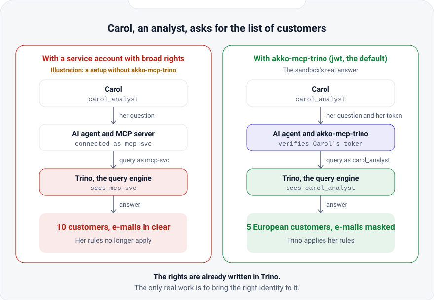
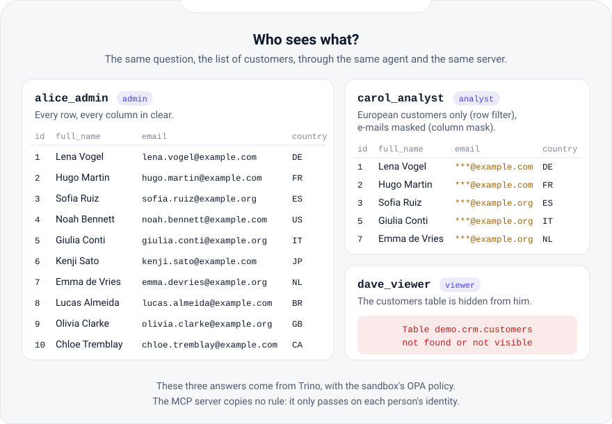
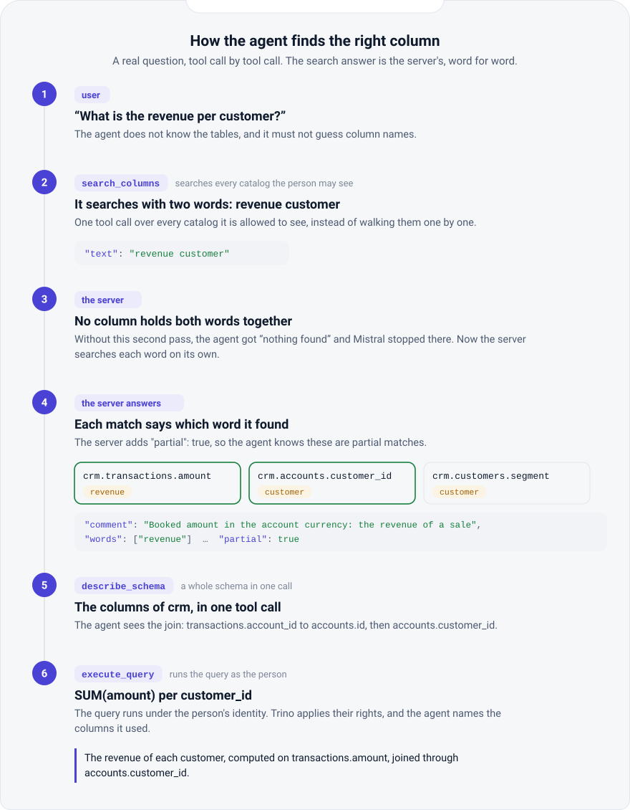
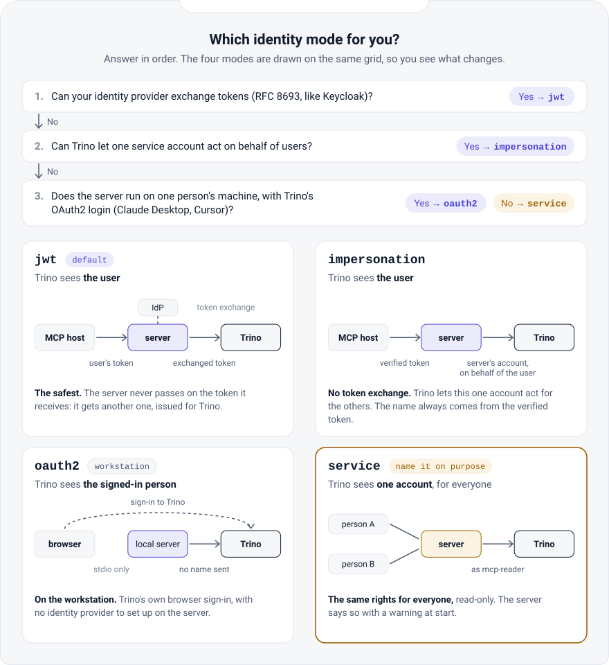
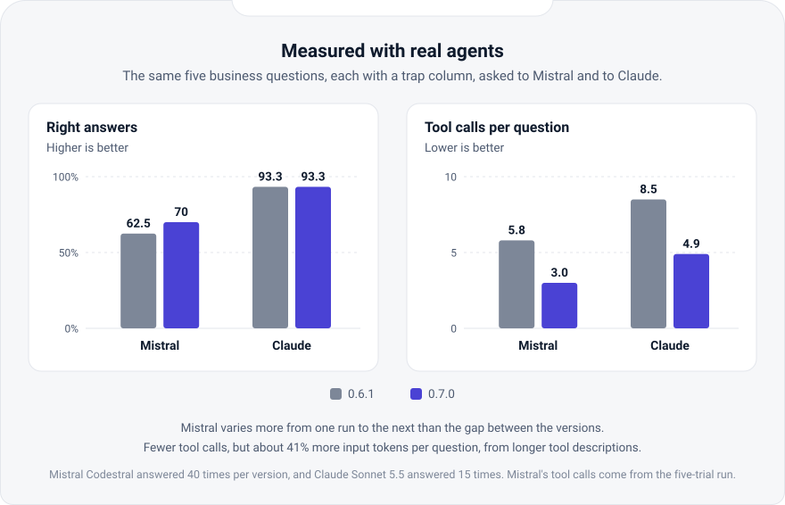

<p align="center">
  
  
  
  
  
  
  
  
</p>

# akko-mcp-trino

**English** · [Français](https://github.com/AKKO-p/akko-mcp-trino/blob/main/README.fr.md)

<!-- mcp-name: io.github.ab2dridi/akko-mcp-trino -->

**Give your AI agents read-only access to Trino, and nothing more.**

akko-mcp-trino is an [MCP](https://modelcontextprotocol.io) server for Trino. An agent can use it
to find tables and columns, describe a schema or a table, list catalogs, schemas and tables, and
explain or run a query. The server parses every statement and refuses any write before it reaches
Trino. By default, each query runs as the user the agent acts for. The server verifies the user's
token, which must be issued for this server. It then obtains a separate token for Trino from the
identity provider (OAuth 2.0 Token Exchange). The user's own token never leaves the server.
Trino's access control (OPA, Ranger, or Trino's own rules) then decides what that user may read.
Results are limited in rows and in time, and every call leaves one audit line.

> **Upgrading from 0.7.x?** 0.8.0 adds a ninth tool, `profile_table`, and context from a data
> catalog, off until `MCP_CONTEXT_PROVIDERS` names a provider. Without opting in, you meet three
> changes: `search_columns` reads 8 catalogs at once (`MCP_SEARCH_CONCURRENCY=1` for the load of
> 0.7), a token whose `azp` is present but empty names no client, and the server logs `httpx` at
> `WARNING` only. From 0.7.0, 0.7.1 and 0.7.2 are security releases: `execute_query` refuses
> `SHOW STATS`, `EXPLAIN`, `SHOW CREATE` and the other reads listed in
> [Security](https://github.com/AKKO-p/akko-mcp-trino/blob/main/docs/en/security.md#the-statements-an-agent-may-send), and the user is read from `sub`.
> With Keycloak, set `MCP_JWT_USER_CLAIM=preferred_username` before upgrading. See
> [MIGRATING.md](https://github.com/AKKO-p/akko-mcp-trino/blob/main/MIGRATING.md#from-07-to-08), and [Upgrading](https://github.com/AKKO-p/akko-mcp-trino/blob/main/docs/en/operations.md#upgrading) for other versions.

## Understand in five steps

<picture>
  <source media="(prefers-color-scheme: dark)" srcset="https://raw.githubusercontent.com/AKKO-p/akko-mcp-trino/v0.7.0/docs/images/understand-1-problem-dark.svg">
  
</picture>

An agent connected through one service account with broad rights reaches Trino under that
account, so the rules written for Carol no longer apply. The left panel is an illustration: the
sandbox's policy would refuse such an account. akko-mcp-trino brings Carol's own identity to Trino,
and the rules Trino already has do the rest.

<picture>
  <source media="(prefers-color-scheme: dark)" srcset="https://raw.githubusercontent.com/AKKO-p/akko-mcp-trino/v0.7.0/docs/images/understand-2-who-sees-what-dark.svg">
  
</picture>

The same query from the three users of the sandbox, through the same MCP client and the same
server. Trino applies the sandbox's OPA policy to each of them; the server copies no rule.

<picture>
  <source media="(prefers-color-scheme: dark)" srcset="https://raw.githubusercontent.com/AKKO-p/akko-mcp-trino/v0.7.0/docs/images/understand-3-step-by-step-dark.svg">
  
</picture>

A real trial, tool call by tool call: Mistral on 0.7.0 looks for the segment with the largest
balance. The search matches word by word, the error on a wrong join names the table to read, and
the agent fixes its join. Every tool answer shown is the server's, replayed in the sandbox.

<picture>
  <source media="(prefers-color-scheme: dark)" srcset="https://raw.githubusercontent.com/AKKO-p/akko-mcp-trino/v0.7.0/docs/images/understand-4-identity-modes-dark.svg">
  
</picture>

Four identity modes, from the safest to the simplest. `jwt` is the default; `service` gives
every caller the same account and is used only when you name it.

<picture>
  <source media="(prefers-color-scheme: dark)" srcset="https://raw.githubusercontent.com/AKKO-p/akko-mcp-trino/v0.7.0/docs/images/understand-5-measurements-dark.svg">
  
</picture>

The same five business questions, put to Mistral and to Claude, on 0.6.1 and on 0.7.0. Mistral
varies more from one run to the next than the gap between the versions, and 0.7.0 sends about 41%
more input tokens per question, because its tool descriptions are longer. The harness and its
reports are in [akko-sandbox](https://github.com/AKKO-p/akko-sandbox/tree/main/agent/reports).

The interactive version of these five steps is on
[akko-ai.com/en/docs/understand](https://akko-ai.com/en/docs/understand/) (also
[en français](https://akko-ai.com/docs/comprendre/)).

## Try it in five minutes

The sandbox starts Keycloak, Trino, OPA and the server on your machine, with the three users
above:

```bash
git clone https://github.com/AKKO-p/akko-sandbox.git
cd akko-sandbox
docker compose up -d --wait
./demo.sh
```

The [quickstart](https://github.com/AKKO-p/akko-mcp-trino/blob/main/docs/en/quickstart.md) goes on with a user's token, an MCP host and a first question.

## Why

An agent that reads a lakehouse needs a small, predictable surface: a few tools whose descriptions
a model understands, answers with hard limits, and a guarantee that a prompt injection cannot turn
a question into a `DROP TABLE` through this server. This server is that surface, and nothing
else. It does not decide access: Trino decides for each user with the rules it already has, or,
in `service` mode, for the one identity you give it.

## Features

- **Read-only by construction, through this server.** SQL is parsed into an AST and refused if a write appears anywhere in the tree, CTEs and subqueries included. Table functions (`TABLE(...)`, such as a JDBC connector's `system.query`) and the `system` catalog are refused too, including through a name without a catalog when the session catalog is `system`. What a user can do in Trino by other means is governed by Trino's rules: see [Security](https://github.com/AKKO-p/akko-mcp-trino/blob/main/docs/en/security.md#read-only-through-this-server).
- **Per-user rights by default.** In `jwt` mode, the default, the server verifies the caller's token (issued for this server, never for Trino), exchanges it at the identity provider for a token whose audience is Trino (RFC 8693), and Trino runs the query as that user. The caller's token is never passed on. A request without a valid token is refused with `401`.
- **A fallback without token exchange.** In `impersonation` mode, the server authenticates to Trino with its own account (password or client certificate), and Trino runs the query as the verified caller, under an impersonation rule that only this account has.
- **One identity, only when named.** In `service` mode, every query runs as `TRINO_USER`. It is never chosen by default, and the server says so at start and to every host in its initialization instructions.
- **Limits by default.** A row cap with a `truncated` flag (100), a time budget per query, cancelled in Trino (60 s), and a time budget per tool call (120 s).
- **One audit line per call.** Keyed by `X-Request-Id`, never holding the token or the SQL text: who called which tool, with which outcome, for how long.
- **Nine tools,** annotated with what they can really do: `execute_query` is annotated read-only only while `TRINO_READ_ONLY` is true.
- **Token verification.** Bearer tokens are verified against any OIDC provider's JWKS (issuer, audience bound to this server, expiry, clock tolerance), a token issued for Trino is refused, the protected resource metadata is published (RFC 9728), and the Host header is filtered.
- **Context from a data catalog, off by default.** With `MCP_CONTEXT_PROVIDERS`, `describe_table` and `describe_schema` add what a data catalog holds about a table (descriptions, glossary terms, classifications, owner), only for the tables Trino lists to the caller, and beyond descriptions only what allow lists name. Providers for Apache Atlas (`akko-mcp-trino-atlas`, installed by the `atlas` extra, or `atlas-kerberos` for Kerberos) and for a JSON file: see [Context from a data catalog](https://github.com/AKKO-p/akko-mcp-trino/blob/main/docs/en/catalog-context.md).
- **Extensible without forking.** Tool plugins and extensions are Python packages named at start: identity modes, guards, audit fields, routes, tools. An extension can only refuse what the core allows, never widen it.
- **Any MCP host, any model.** Cursor, Claude Desktop, VS Code and the Python SDK; and any model, Mistral included, through the example agent.
- **Tests.** 100% line and branch coverage, including in-process suites on the real SDK for all three transports, a live run against Keycloak and Trino in CI ([`integration/`](https://github.com/AKKO-p/akko-mcp-trino/tree/main/integration)), and a check that the package imports no vendor-specific code.

## Documentation

These pages describe `main`. The documentation of a release is at its tag.

| Page | What it covers |
|---|---|
| [Prerequisites](https://github.com/AKKO-p/akko-mcp-trino/blob/main/docs/en/prerequisites.md) | what you need, and the versions supported and tested |
| [Quickstart](https://github.com/AKKO-p/akko-mcp-trino/blob/main/docs/en/quickstart.md) | the sandbox, a user's token, a host, a first question |
| [Deployment](https://github.com/AKKO-p/akko-mcp-trino/blob/main/docs/en/deployment.md) | install and run, the container, Helm on Kubernetes and OpenShift, Trino Gateway, with or without a data catalog |
| [Identity](https://github.com/AKKO-p/akko-mcp-trino/blob/main/docs/en/identity.md) | the four identity modes, the user claim, token verification |
| [Connect an MCP host](https://github.com/AKKO-p/akko-mcp-trino/blob/main/docs/en/hosts.md) | Claude Desktop, Cursor, any stdio host, the Python SDK, an agent |
| [Context from a data catalog](https://github.com/AKKO-p/akko-mcp-trino/blob/main/docs/en/catalog-context.md) | what a context provider serves, its limits, the `file` provider |
| [Modules](https://github.com/AKKO-p/akko-mcp-trino/blob/main/docs/en/modules.md) | `token-policy`, `fingerprint-audit` and `trino-tags`, with real examples |
| [Developers](https://github.com/AKKO-p/akko-mcp-trino/blob/main/docs/en/developers.md) | the architecture, tool plugins, extensions, writing a context provider |
| [The tools](https://github.com/AKKO-p/akko-mcp-trino/blob/main/docs/en/tools.md) | the nine tools, their arguments, their answers, their errors |
| [Configuration](https://github.com/AKKO-p/akko-mcp-trino/blob/main/docs/en/configuration.md) | every variable, by theme, with its default and its limits |
| [Security](https://github.com/AKKO-p/akko-mcp-trino/blob/main/docs/en/security.md) | what read-only covers, Trino first, the statements an agent may send |
| [Operations](https://github.com/AKKO-p/akko-mcp-trino/blob/main/docs/en/operations.md) | resource groups, refusals, warnings, audit, health, metrics, upgrades |
| [Design notes](https://github.com/AKKO-p/akko-mcp-trino/blob/main/docs/en/design-notes.md) | why the server is built this way, and a few questions |

The documentation also exists [in French](https://github.com/AKKO-p/akko-mcp-trino/blob/main/docs/fr/index.md). The reference files stay at the
root: [`CHANGELOG.md`](https://github.com/AKKO-p/akko-mcp-trino/blob/main/CHANGELOG.md), [`MIGRATING.md`](https://github.com/AKKO-p/akko-mcp-trino/blob/main/MIGRATING.md),
[`SECURITY.md`](https://github.com/AKKO-p/akko-mcp-trino/blob/main/SECURITY.md) (also [in French](https://github.com/AKKO-p/akko-mcp-trino/blob/main/SECURITY.fr.md)) and the
[examples](https://github.com/AKKO-p/akko-mcp-trino/tree/main/examples). The site's guide is on
[akko-ai.com/en/docs/open-source-core](https://akko-ai.com/en/docs/open-source-core/).

## Compatibility

| | Supported |
|---|---|
| Python | 3.12, 3.13 |
| Trino | see [Prerequisites](https://github.com/AKKO-p/akko-mcp-trino/blob/main/docs/en/prerequisites.md#compatibility) |
| Policy engines | OPA (`trino-opa`), Ranger (Trino plugin), Trino file-based access control |
| Identity providers | any OIDC provider that publishes a JWKS; OAuth 2.0 Token Exchange, RFC 8693, for the default `jwt` mode |
| MCP | transports `streamable-http`, `sse` and `stdio`, through the official `mcp` SDK |
| Models | any: the server never talks to a model |

[Prerequisites](https://github.com/AKKO-p/akko-mcp-trino/blob/main/docs/en/prerequisites.md#compatibility) says what each mode needs from Trino and what
is tested. The images the integration suite runs are pinned in
[`integration/compose.yaml`](https://github.com/AKKO-p/akko-mcp-trino/blob/main/integration/compose.yaml).

## Contributing

Contributions are welcome. See [CONTRIBUTING.md](https://github.com/AKKO-p/akko-mcp-trino/blob/main/CONTRIBUTING.md) for the ground rules (tests
first, 100% coverage, product-neutral code, refuse when in doubt), and [SECURITY.md](https://github.com/AKKO-p/akko-mcp-trino/blob/main/SECURITY.md)
to report a vulnerability privately. Changes are tracked in [CHANGELOG.md](https://github.com/AKKO-p/akko-mcp-trino/blob/main/CHANGELOG.md).

## About AKKO

akko-mcp-trino is built and maintained by [AKKO](https://akko-ai.com), a French project working on
governed access to enterprise data for AI agents, where the data already lives, on the engines and
identity providers organizations already run.

**Maintained by:** AKKO ([contact@akko-ai.com](mailto:contact@akko-ai.com)) ·
**Issues:** [github.com/AKKO-p/akko-mcp-trino/issues](https://github.com/AKKO-p/akko-mcp-trino/issues)

## License

Apache 2.0. See [LICENSE](https://github.com/AKKO-p/akko-mcp-trino/blob/main/LICENSE) and [NOTICE](https://github.com/AKKO-p/akko-mcp-trino/blob/main/NOTICE).
