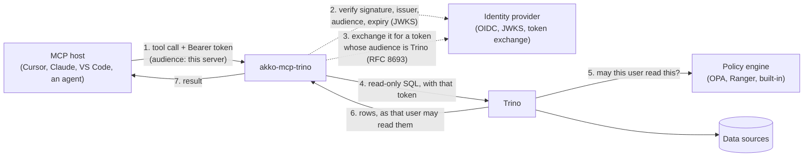

# Identity

**English** · [Français](../fr/identity.md)

## How it works



The host calls a tool with the user's access token. The server verifies it
(signature against the provider's JWKS, issuer, an audience naming this server,
expiry) and refuses a request without a valid one with `401`; a token issued for
Trino is refused too. The server then checks the statement (read-only,
identifiers, table functions, the `system` catalog) and runs it in Trino under
the identity mode `TRINO_IDENTITY_MODE` names. Trino asks its policy engine and
returns what that identity may read, bounded in rows and time.

| Mode | Who Trino sees | How Trino knows | When to use it |
|---|---|---|---|
| `jwt` (default) | the caller | a token for Trino the server obtained by token exchange (RFC 8693); Trino verifies it with its JWT authenticator | the identity provider supports OAuth 2.0 Token Exchange (RFC 8693) |
| `impersonation` | the caller | the server's own account (password or client certificate) asks Trino to run the query as the caller; Trino allows it under an impersonation rule only that account has | the identity provider cannot exchange tokens |
| `oauth2` | the local user, checked with `SELECT current_user` | Trino's native OAuth2 browser login; the driver caches tokens and reauthenticates | local stdio hosts only, with a Trino coordinator configured for OAuth2 |
| `service` | `TRINO_USER`, the same for every caller | a password, a client certificate, or nothing, locally | only when named: one identity for everyone, announced at start and to every host |

The caller's own token never leaves the server, in any mode: the MCP
authorization specification forbids passing it on ("token passthrough"). The
caller's name comes from their verified token, or from Trino's `SELECT current_user`
in `oauth2`, never from an unverified header. The `jwt` and `impersonation` modes
refuse to start unless the door requires a valid token. An extension (see
[Extensions](developers.md#extensions)) may add other identity modes.

## Each user with their own rights (`jwt`, the default)

The caller's token is issued for this server: its audience is
`MCP_OIDC_AUDIENCE` (or `MCP_RESOURCE_URL`). The server exchanges it at the
provider for a token whose audience is `TRINO_TOKEN_EXCHANGE_AUDIENCE`, keeps
that token in memory until shortly before it expires, and sends it to Trino. A
token whose audience is Trino's is refused at the door, and a configuration
that would accept one refuses to start. [Deployment](deployment.md#run) shows the
variables of this mode.

On the provider, give this server a confidential client allowed to exchange
tokens, and make Trino's audience available to it. With Keycloak: enable
*Standard token exchange* on the server's client, add an audience mapper for the
Trino client to it, and have the clients of your MCP hosts put the server's
client in the audience of the tokens they get (an audience mapper too). The
[`integration/`](../../integration/) folder holds such a realm, tested on every pull
request. Tested with the images of the integration suite (`integration/compose.yaml`), which
pins their versions.

On the Trino side, `http-server.authentication.type=JWT`,
`http-server.authentication.jwt.key-file` set to the provider's JWKS URL,
`http-server.authentication.jwt.principal-field` naming the same claim the
server reads (`MCP_JWT_USER_CLAIM`, `sub` by default), and `required-issuer` and
`required-audience` pinning the token to your provider and to Trino's audience.
Two users asking the same question then get the answers their own rights allow.
`/ready` asks Trino's public `/v1/info`, since there is no identity of the
server's own to query with.

## The user claim

The server reads the user from `sub` by default (`MCP_JWT_USER_CLAIM`). Keycloak's
`sub` is a UUID that Trino's rules do not know: set
`MCP_JWT_USER_CLAIM=preferred_username` on the server, and point Trino's
`principal-field` at the same claim. Entra ID, Okta and Dex give `sub` an opaque value
too; name the claim your access rules know (`upn`, `preferred_username`, `uid`...). A token
without it is refused, never read from another claim. The server accepts RS256 signatures by
default (`MCP_JWT_ALGORITHMS`, for example `RS256,RS512`).

## Without token exchange (`impersonation`)

When the provider cannot exchange tokens, the server reaches Trino as its own
account, and Trino runs each query as the verified caller:

```bash
export TRINO_IDENTITY_MODE=impersonation
export TRINO_USER=mcp-service
export TRINO_CLIENT_CERT=/certs/mcp-service.crt   # mTLS; or TRINO_PASSWORD over https
export TRINO_CLIENT_KEY=/certs/mcp-service.key
```

Trino must authenticate that account (the certificate or password
authenticator, besides the one your users have) and allow it, and only it, to
impersonate users. With file-based access control:

```json
{"impersonation": [{"original_user": "mcp-service", "new_user": ".*", "allow": true}]}
```

Narrow `new_user` to the users the agents may act for. Nobody else may
impersonate: a user who sends a header naming someone else is refused by Trino,
and the server never takes the caller's name from a header, only from their
verified token. Keep the account's credential as you would any service
credential: whoever holds it can act as any user the rule allows.

## One identity for every caller (`service`, only when named)

```bash
export TRINO_IDENTITY_MODE=service
export TRINO_USER=mcp-reader
export TRINO_PASSWORD=...               # or TRINO_CLIENT_CERT and TRINO_CLIENT_KEY; https only
```

Every query runs as `TRINO_USER`, whoever calls: give that identity the rights
every caller of this server may have, no more, and read-only rights only. The
server logs a warning at start, `--check` prints it, and every host receives it
in the `instructions` of the MCP initialization. The door stays on by default;
to run without one, locally, set `MCP_AUTH_ENABLED=false` and
`MCP_AUTH_REQUIRED=false` too, and the warning says so.

## Native browser login (`oauth2`, stdio only)

With Trino OAuth2 configured, keep your coordinator settings and run:

```bash
MCP_TRANSPORT=stdio TRINO_IDENTITY_MODE=oauth2 TRINO_HTTP_SCHEME=https \
MCP_AUTH_ENABLED=false MCP_AUTH_REQUIRED=false python -m akko_mcp_trino
```

The server sends Trino no user name: Trino runs every query as the user who
signed in, and `TRINO_USER` is ignored. Startup and discovery (`initialize`,
`ping`, `tools/list`, `resources/list`, `resources/templates/list`, `prompts/list`,
notifications) never log in, so the host does not time out waiting for the browser.
Every other request, a tool call or a resource read, logs in first: the URL is logged
to stderr only, and `SELECT current_user` must succeed before the request runs; its
result names the admission/audit principal. That is the only query that reaches Trino
without an admitted user. A request the extensions' guards refuse, or one for which
Trino names no user, is answered with an `INVALID_REQUEST` error that says why.
The first call may time out at the host while the browser login waits; once signed
in, call again. The user Trino names first stays the user of the process until it
exits: a reauthentication by the driver does not change who admission and audit name,
so sign in again as the same user, or restart the server to switch.
HTTP MCP transports are rejected.
`MCP_AUTH_REQUIRED=true` requires a verified `MCP_USER_TOKEN` in addition;
`false` never skips Trino login. The driver reuses tokens and reauthenticates,
with memory caching or optional `keyring`. `--check` does not log in.
[Connect an MCP host](hosts.md#2-your-own-trino-from-your-workstation-stdio-and-oauth2) gives
the host entries for this mode.

## The door

The host sends the user's access token from the identity provider, issued for
this server; the server verifies it and names the caller in the audit line. A
host that supports MCP authorization finds the provider through the protected
resource metadata the server publishes when `MCP_RESOURCE_URL` is set.

Auth enabled without a JWKS URL, or without an audience of this server's own,
refuses to start: an authentication layer that cannot verify anything must not
pretend to. So does a door that requires a token it cannot verify
(`MCP_AUTH_REQUIRED=true` with `MCP_AUTH_ENABLED=false`). The settings are in
[Configuration](configuration.md#identity), and the refusals a caller gets in
[Operations](operations.md#refusals).

## What happens on a request

```mermaid
sequenceDiagram
    participant H as MCP host
    participant G as Guard (ASGI middleware)
    participant T as Tool
    participant Tr as Trino

    H->>G: POST /mcp  Authorization, X-Request-Id
    G->>G: request id: honoured or generated
    opt an extension's guard before the token
        G-->>H: its refusal  X-Reason
    end
    G->>G: verify JWT (JWKS, iss, aud = this server, exp) → Principal(subject)
    alt no valid token (none, forged, expired, issued for Trino)
        G-->>H: 401  X-Reason: unauthenticated, what to send
    end
    opt an extension's guard after the token
        G-->>H: its refusal  X-Reason
    end
    G->>T: Principal in a ContextVar
    T->>T: validate identifiers · refuse writes
    opt jwt mode, no valid exchanged token in memory
        T->>T: exchange the caller's token at the provider (RFC 8693)
    end
    T->>Tr: SQL as the caller (jwt: exchanged token; impersonation: server account), source
    Tr-->>T: rows (masked, filtered by the policy engine)
    T->>G: audit line {request_id, tool, subject, ok, error, duration_ms}
    G-->>H: result  X-Request-Id
```
