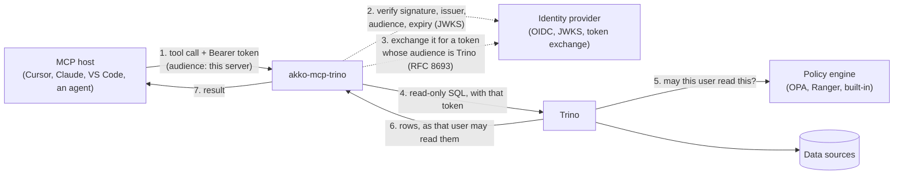

# Identity

**English** · [Français](../fr/identity.md)

## How it works



The host calls a tool with the user's access token. The server verifies the token: its
signature against the identity provider's JWKS, its issuer, an audience that names this server,
and its expiry. It refuses a request without a valid token with `401`, and it also refuses a token
issued for Trino. The server then checks the statement (read-only, identifiers, table functions,
the `system` catalog) and runs it in Trino under the identity mode that `TRINO_IDENTITY_MODE`
names. Trino asks its policy engine and returns what that identity may read, limited in rows and
in time.

| Mode | Who Trino sees | How Trino knows | When to use it |
|---|---|---|---|
| `jwt` (default) | the caller | a token for Trino that the server obtained by token exchange (RFC 8693); Trino verifies it with its JWT authenticator | the identity provider supports OAuth 2.0 Token Exchange (RFC 8693) |
| `impersonation` | the caller | the server's own account (password or client certificate) asks Trino to run the query as the caller; Trino allows it under an impersonation rule that only this account has | the identity provider cannot exchange tokens |
| `oauth2` | the local user, checked with `SELECT current_user` | Trino's native OAuth2 browser login; the driver caches tokens and signs in again when needed | local stdio hosts only, with a Trino coordinator configured for OAuth2 |
| `service` | `TRINO_USER`, the same for every caller | a password, a client certificate, or no credential against a local coordinator | only when named: one identity for everyone, announced at start and to every host |

In every mode, the caller's own token never leaves the server: the MCP authorization
specification forbids passing it on ("token passthrough"). The caller's name comes from their
verified token, or from Trino's `SELECT current_user` in `oauth2` mode, never from an unverified
header. The server refuses to start in `jwt` or `impersonation` mode unless token verification
requires a valid token. An extension (see [Extensions](developers.md#extensions)) may add other
identity modes.

## Each user with their own rights (`jwt`, the default)

The caller's token is issued for this server: its audience is `MCP_OIDC_AUDIENCE` (or
`MCP_RESOURCE_URL`). The server exchanges it at the identity provider for a token whose audience
is `TRINO_TOKEN_EXCHANGE_AUDIENCE`, keeps that token in memory until shortly before it expires,
and sends it to Trino. Token verification refuses a token whose audience is Trino's, and the
server refuses to start with a configuration that would accept one.
[Deployment](deployment.md#run) shows the variables of this mode.

On the identity provider, give this server a confidential client that may exchange tokens, and
make Trino's audience available to it. With Keycloak:

- enable *Standard token exchange* on the server's client;
- add an audience mapper for the Trino client to the server's client;
- on the clients of your MCP hosts, add the server's client to the audience of the tokens they
  get (with an audience mapper too).

The [`integration/`](../../integration/) folder holds such a realm, tested on every pull request.
The integration suite tests it with the images pinned in `integration/compose.yaml`.

On the Trino side, set:

- `http-server.authentication.type=JWT`;
- `http-server.authentication.jwt.key-file` to the identity provider's JWKS URL;
- `http-server.authentication.jwt.principal-field` to the claim the server reads
  (`MCP_JWT_USER_CLAIM`, `sub` by default);
- `required-issuer` and `required-audience`, which tie the token to your identity provider and to
  Trino's audience.

Two users who ask the same question then get the answers their own rights allow. `/ready` asks
Trino's public `/v1/info`, because the server has no identity of its own to query with.

## The user claim

The server reads the user from `sub` by default (`MCP_JWT_USER_CLAIM`). Keycloak puts a UUID in
`sub`, which Trino's rules do not know: set `MCP_JWT_USER_CLAIM=preferred_username` on the
server, and point Trino's `principal-field` at the same claim. Entra ID, Okta and Dex also put an
opaque value in `sub`. Name the claim your access rules know, such as `upn`,
`preferred_username` or `uid`. The server refuses a token without that claim and never falls back
to another one. It accepts RS256 signatures by default (`MCP_JWT_ALGORITHMS`, for example
`RS256,RS512`).

## Without token exchange (`impersonation`)

When the identity provider cannot exchange tokens, the server reaches Trino with its own account,
and Trino runs each query as the verified caller:

```bash
export TRINO_IDENTITY_MODE=impersonation
export TRINO_USER=mcp-service
export TRINO_CLIENT_CERT=/certs/mcp-service.crt   # mTLS; or TRINO_PASSWORD over https
export TRINO_CLIENT_KEY=/certs/mcp-service.key
```

Trino must authenticate that account (with the certificate or password authenticator, in
addition to the one your users authenticate with) and allow it, and only it, to impersonate
users. With file-based access control, the rule is:

```json
{"impersonation": [{"original_user": "mcp-service", "new_user": ".*", "allow": true}]}
```

Narrow `new_user` to the users the agents may act for. Nobody else may impersonate: Trino refuses
a user who sends a header that names someone else, and the server takes the caller's name only
from their verified token, never from a header. Keep the account's credential as you would any
service credential: whoever holds it can act as any user the rule allows.

## One identity for every caller (`service`, only when named)

```bash
export TRINO_IDENTITY_MODE=service
export TRINO_USER=mcp-reader
export TRINO_PASSWORD=...               # or TRINO_CLIENT_CERT and TRINO_CLIENT_KEY; https only
```

Every query runs as `TRINO_USER`, whoever calls. Give that identity read-only rights, and only on
data every caller of this server may read. The server logs a warning at start, `--check` prints
it, and every host receives it in the `instructions` of the MCP initialization. Token verification
stays on by default. To run without it, locally, also set `MCP_AUTH_ENABLED=false` and
`MCP_AUTH_REQUIRED=false`; the warning then says so.

## Native browser login (`oauth2`, stdio only)

With Trino OAuth2 configured, keep your coordinator settings and run:

```bash
MCP_TRANSPORT=stdio TRINO_IDENTITY_MODE=oauth2 TRINO_HTTP_SCHEME=https \
MCP_AUTH_ENABLED=false MCP_AUTH_REQUIRED=false python -m akko_mcp_trino
```

The server sends Trino no user name. Trino runs every query as the user who signed in, and
`TRINO_USER` is ignored.

- Startup and discovery requests (`initialize`, `ping`, `tools/list`, `resources/list`,
  `resources/templates/list`, `prompts/list`, notifications) never trigger a login, so the host
  does not time out waiting for the browser.
- Any other request (a tool call, a resource read) logs in first. The login URL is written to
  stderr only.
- After login, the server runs `SELECT current_user`, which must succeed before the request runs.
  Its result is the user that the extensions' guards and the audit line see. It is the only query
  that reaches Trino before the user is known.
- A request that a guard refuses, or for which Trino names no user, gets an `INVALID_REQUEST`
  error that says why.
- The first call may time out in the host while the browser login is open. Sign in, then call
  again.
- The first user Trino names stays the user of the process until it exits. A new sign-in by the
  driver does not change who the guards and the audit see: sign in again as the same user, or
  restart the server to switch users.
- `oauth2` works over stdio only. The server refuses to start with an HTTP transport.
- `MCP_AUTH_REQUIRED=true` also requires a verified `MCP_USER_TOKEN`. Setting it to `false` does
  not disable the Trino login.
- The driver reuses tokens and signs in again when needed, with an in-memory cache or the
  optional `keyring`. `--check` does not log in.

[Connect an MCP host](hosts.md#2-your-own-trino-from-your-workstation-stdio-and-oauth2) gives the
host entries for this mode.

## Token verification

The host sends the user's access token from the identity provider, issued for this server. The
server verifies it and names the caller in the audit line. A host that supports MCP
authorization finds the identity provider through the protected resource metadata that the
server publishes when `MCP_RESOURCE_URL` is set.

The server refuses to start if authentication is enabled without a JWKS URL, or without an
audience of its own: an authentication layer that cannot verify anything must not pretend to. It
also refuses to start when it must require a token it cannot verify (`MCP_AUTH_REQUIRED=true`
with `MCP_AUTH_ENABLED=false`). An empty `MCP_OIDC_ISSUER` does not stop the server, but then every
token is refused: set it whenever authentication is enabled. The settings are in
[Configuration](configuration.md#identity), and the refusals a caller gets in
[Operations](operations.md#refusals).

## What happens on a request

```mermaid
sequenceDiagram
    participant H as MCP host
    participant G as Middleware (ASGI)
    participant T as Tool
    participant Tr as Trino

    H->>G: POST /mcp  Authorization, X-Request-Id
    G->>G: request id: kept or generated
    opt an extension's guard before the token
        G-->>H: its refusal  X-Reason
    end
    G->>G: verify JWT (JWKS, iss, aud = this server, exp) → Principal(subject)
    alt no valid token (none, forged, expired, issued for Trino)
        G-->>H: 401  X-Reason: unauthenticated, what to send
    end
    opt an extension's guard after the token
        G-->>H: its refusal  X-Reason
    end
    G->>T: Principal in a ContextVar
    T->>T: validate identifiers · refuse writes
    opt jwt mode, no valid exchanged token in memory
        T->>T: exchange the caller's token at the provider (RFC 8693)
    end
    T->>Tr: SQL as the caller (jwt: exchanged token; impersonation: server account), source
    Tr-->>T: rows (masked, filtered by the policy engine)
    T->>G: audit line {request_id, tool, subject, ok, error, duration_ms}
    G-->>H: result  X-Request-Id
```
