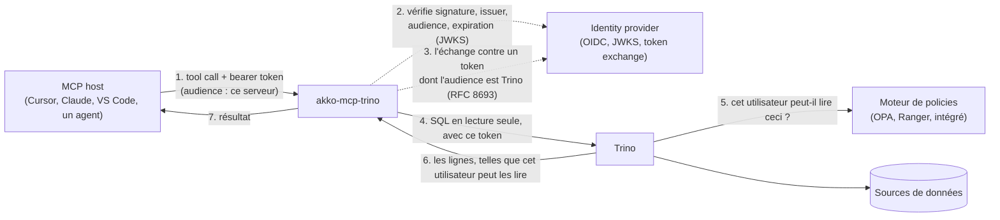

# Identité

[English](../en/identity.md) · **Français**

## Comment ça marche



Le MCP host appelle un tool avec le token d'accès de l'utilisateur. Le serveur vérifie ce token :
sa signature avec le JWKS de l'identity provider, son issuer, une audience qui nomme ce serveur,
et son expiration. Il refuse avec un `401` une requête sans token valide, et refuse aussi un token
émis pour Trino. Le serveur contrôle ensuite l'instruction (lecture seule, identifiants, table
functions, catalog `system`) et l'exécute dans Trino sous le mode d'identité que nomme
`TRINO_IDENTITY_MODE`. Trino interroge son moteur de policies et rend ce que cette identité peut
lire, limité en lignes et en durée.

| Mode | Qui Trino voit | Comment Trino le sait | Quand l'utiliser |
|---|---|---|---|
| `jwt` (par défaut) | l'appelant | un token pour Trino que le serveur a obtenu par token exchange (RFC 8693) ; Trino le vérifie avec son authentificateur JWT | l'identity provider prend en charge OAuth 2.0 Token Exchange (RFC 8693) |
| `impersonation` | l'appelant | le compte propre du serveur (mot de passe ou certificat client) demande à Trino d'exécuter la requête au nom de l'appelant ; Trino l'autorise selon une règle d'impersonation réservée à ce compte | l'identity provider ne sait pas échanger de tokens |
| `oauth2` | l'utilisateur local, vérifié par `SELECT current_user` | la connexion navigateur OAuth2 native de Trino ; le pilote garde les tokens en cache et se reconnecte quand il le faut | MCP hosts locaux en stdio seulement, avec un coordinateur Trino configuré pour OAuth2 |
| `service` | `TRINO_USER`, le même pour tous les appelants | un mot de passe, un certificat client, ou aucun secret face à un coordinateur local | seulement si on le nomme : une identité unique pour tous, annoncée au démarrage et à chaque MCP host |

Quel que soit le mode, le token de l'appelant ne quitte jamais le serveur : la spécification
d'autorisation de MCP interdit de le transmettre (« token passthrough »). Le nom de l'appelant
vient de son token vérifié, ou du `SELECT current_user` de Trino en mode `oauth2`, jamais d'un
en-tête non vérifié. Le serveur refuse de démarrer en mode `jwt` ou `impersonation` si la
vérification du token n'exige pas un token valide. Une extension (voir
[Extensions](developers.md#extensions)) peut ajouter d'autres modes d'identité.

## Chaque utilisateur avec ses droits (`jwt`, par défaut)

Le token de l'appelant est émis pour ce serveur : son audience est `MCP_OIDC_AUDIENCE` (ou
`MCP_RESOURCE_URL`). Le serveur l'échange auprès de l'identity provider contre un token dont
l'audience est `TRINO_TOKEN_EXCHANGE_AUDIENCE`, garde ce token en mémoire jusqu'à peu avant son
expiration, et l'envoie à Trino. La vérification du token refuse un token dont l'audience est
celle de Trino, et le serveur refuse de démarrer avec une configuration qui en accepterait un.
[Déploiement](deployment.md#lancer) montre les variables de ce mode.

Côté identity provider, donnez à ce serveur un client confidentiel autorisé à échanger des
tokens, et rendez-lui accessible l'audience de Trino. Avec Keycloak :

- activez *Standard token exchange* sur le client du serveur ;
- ajoutez au client du serveur un audience mapper vers le client Trino ;
- sur les clients de vos MCP hosts, ajoutez le client du serveur à l'audience des tokens qu'ils
  obtiennent (par un audience mapper, là aussi).

Le dossier [`integration/`](../../integration/) contient un tel realm, testé à chaque pull
request. La suite d'intégration le teste avec les images épinglées dans `integration/compose.yaml`.

Côté Trino, posez :

- `http-server.authentication.type=JWT` ;
- `http-server.authentication.jwt.key-file` sur l'URL JWKS de l'identity provider ;
- `http-server.authentication.jwt.principal-field` sur le claim que lit le serveur
  (`MCP_JWT_USER_CLAIM`, `sub` par défaut) ;
- `required-issuer` et `required-audience`, qui lient le token à votre identity provider et à
  l'audience de Trino.

Deux utilisateurs qui posent la même question obtiennent alors les réponses que leurs droits
permettent. `/ready` interroge le `/v1/info` public de Trino, puisque le serveur n'a pas d'identité
propre pour interroger Trino.

## Le claim de l'utilisateur

Le serveur lit l'utilisateur dans `sub` par défaut (`MCP_JWT_USER_CLAIM`). Keycloak met dans `sub`
un UUID que les règles de Trino ne connaissent pas : posez `MCP_JWT_USER_CLAIM=preferred_username`
sur le serveur, et le même claim dans le `principal-field` de Trino. Entra ID, Okta et Dex mettent
aussi une valeur opaque dans `sub`. Nommez le claim que vos règles d'accès connaissent, comme
`upn`, `preferred_username` ou `uid`. Le serveur refuse un token sans ce claim et ne se rabat
jamais sur un autre. Il accepte les signatures RS256 par défaut (`MCP_JWT_ALGORITHMS`, par exemple
`RS256,RS512`).

## Sans token exchange (`impersonation`)

Quand l'identity provider ne sait pas échanger de tokens, le serveur joint Trino avec son propre
compte, et Trino exécute chaque requête au nom de l'appelant vérifié :

```bash
export TRINO_IDENTITY_MODE=impersonation
export TRINO_USER=mcp-service
export TRINO_CLIENT_CERT=/certs/mcp-service.crt   # mTLS ; ou TRINO_PASSWORD en https
export TRINO_CLIENT_KEY=/certs/mcp-service.key
```

Trino doit authentifier ce compte (par l'authentificateur par certificat ou par mot de passe, en
plus de celui de vos utilisateurs) et l'autoriser, lui seul, à agir au nom des utilisateurs. Avec
le contrôle d'accès par fichier, la règle s'écrit ainsi :

```json
{"impersonation": [{"original_user": "mcp-service", "new_user": ".*", "allow": true}]}
```

Restreignez `new_user` aux utilisateurs pour qui les agents peuvent travailler. Personne d'autre ne
peut agir au nom d'un autre : Trino refuse un utilisateur qui envoie un en-tête nommant quelqu'un
d'autre, et le serveur ne prend le nom de l'appelant que dans son token vérifié, jamais dans un
en-tête. Gardez le secret de ce compte comme celui de tout service account : qui le détient peut
agir au nom de tout utilisateur que la règle permet.

## Une identité pour tous les appelants (`service`, seulement si on la nomme)

```bash
export TRINO_IDENTITY_MODE=service
export TRINO_USER=mcp-reader
read -rs TRINO_PASSWORD && export TRINO_PASSWORD   # ou TRINO_CLIENT_CERT et TRINO_CLIENT_KEY ; https seulement
```

`read -rs` lit le mot de passe sans l'afficher : il reste hors de l'historique du shell.
Chaque requête s'exécute sous `TRINO_USER`, quel que soit l'appelant. Donnez à cette identité des
droits en lecture seule, et seulement sur les données que tout appelant de ce serveur peut lire.
Le serveur écrit un avertissement au démarrage, `--check` l'affiche, et chaque MCP host le reçoit
dans les `instructions` de l'initialisation MCP. La vérification du token reste active par défaut.
Pour tourner sans, en local, posez aussi `MCP_AUTH_ENABLED=false` et `MCP_AUTH_REQUIRED=false` ;
l'avertissement le dit alors.

## Connexion navigateur native (`oauth2`, en stdio uniquement)

Avec Trino OAuth2 configuré, gardez les réglages de votre coordinateur et lancez :

```bash
MCP_TRANSPORT=stdio TRINO_IDENTITY_MODE=oauth2 TRINO_HTTP_SCHEME=https \
MCP_AUTH_ENABLED=false MCP_AUTH_REQUIRED=false python -m akko_mcp_trino
```

Le serveur n'envoie aucun nom à Trino. Trino exécute chaque requête au nom de la personne
connectée, et `TRINO_USER` est ignoré.

- Le démarrage et les requêtes de découverte (`initialize`, `ping`, `tools/list`,
  `resources/list`, `resources/templates/list`, `prompts/list`, les notifications) ne déclenchent
  jamais de connexion : le MCP host ne tombe pas en timeout en attendant le navigateur.
- Toute autre requête (un appel de tool, une lecture de ressource) se connecte d'abord. L'URL de
  connexion va uniquement sur stderr.
- Après la connexion, le serveur lance `SELECT current_user`, qui doit réussir avant la requête.
  Son résultat est l'utilisateur que voient les gardes des extensions et la ligne d'audit. C'est la
  seule requête qui atteint Trino avant que l'utilisateur soit connu.
- Une requête qu'une garde refuse, ou pour laquelle Trino ne nomme personne, reçoit une erreur
  `INVALID_REQUEST` qui dit pourquoi.
- Le premier appel peut tomber en timeout dans le MCP host pendant la connexion navigateur.
  Connectez-vous, puis relancez l'appel.
- Le premier utilisateur que nomme Trino reste celui du processus jusqu'à son arrêt. Une nouvelle
  connexion du pilote ne change pas ce que voient les gardes et l'audit : reconnectez-vous avec le
  même compte, ou redémarrez le serveur pour changer d'utilisateur.
- `oauth2` ne marche qu'en stdio. Le serveur refuse de démarrer avec un transport HTTP.
- `MCP_AUTH_REQUIRED=true` exige en plus un `MCP_USER_TOKEN` vérifié. Le poser à `false` ne
  dispense jamais de la connexion à Trino.
- Le pilote réutilise les tokens et se reconnecte quand il le faut, avec un cache en mémoire ou
  `keyring` en option. `--check` ne se connecte pas.

[Brancher un MCP host](hosts.md#2-votre-propre-trino-depuis-votre-poste-stdio-et-oauth2) donne
les entrées des MCP hosts pour ce mode.

## La vérification du token

Le MCP host envoie le token d'accès de l'utilisateur délivré par l'identity provider, émis pour ce
serveur. Le serveur le vérifie et nomme l'appelant dans la ligne d'audit. Un MCP host qui prend en
charge l'autorisation MCP trouve l'identity provider par les métadonnées de ressource protégée que
le serveur publie quand `MCP_RESOURCE_URL` est posé.

Le serveur refuse de démarrer si l'authentification est active sans URL JWKS, ou sans audience
propre : une couche d'authentification qui ne peut rien vérifier ne doit pas faire semblant. Il
refuse aussi de démarrer quand il doit exiger un token qu'il ne peut pas vérifier
(`MCP_AUTH_REQUIRED=true` avec `MCP_AUTH_ENABLED=false`). Un `MCP_OIDC_ISSUER` vide n'empêche pas
le démarrage, mais chaque token est alors refusé : posez-le dès que l'authentification est active.
Les réglages sont dans [Configuration](configuration.md#identité), et les refus que reçoit un
appelant dans [Exploitation](operations.md#refus).

## Le trajet d'une requête

```mermaid
sequenceDiagram
    participant H as MCP host
    participant G as Middleware (ASGI)
    participant T as Tool
    participant Tr as Trino

    H->>G: POST /mcp  Authorization, X-Request-Id
    G->>G: identifiant de requête : repris ou créé
    opt la garde d'une extension avant le token
        G-->>H: son refus  X-Reason
    end
    G->>G: vérifie le JWT (JWKS, iss, aud = ce serveur, exp) → Principal(subject)
    alt pas de token valide (absent, falsifié, expiré, émis pour Trino)
        G-->>H: 401  X-Reason: unauthenticated, ce qu'il faut envoyer
    end
    opt la garde d'une extension après le token
        G-->>H: son refus  X-Reason
    end
    G->>T: Principal dans une ContextVar
    T->>T: valide les identifiants · refuse les écritures
    opt mode jwt, pas de token échangé valide en mémoire
        T->>T: échange le token de l'appelant auprès de l'IdP (RFC 8693)
    end
    T->>Tr: SQL au nom de l'appelant (jwt : token échangé ; impersonation : compte du serveur), source
    Tr-->>T: lignes (masquées, filtrées par le moteur de policies)
    T->>G: ligne d'audit {request_id, tool, subject, ok, error, duration_ms}
    G-->>H: résultat  X-Request-Id
```
