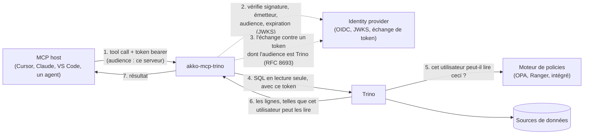

# Identité

[English](../en/identity.md) · **Français**

## Comment ça marche



Le MCP host appelle un tool avec le token d'accès de l'utilisateur. Le serveur le vérifie
(signature avec le JWKS de l'IdP, émetteur, audience qui nomme ce serveur, expiration) et refuse
en `401` une requête sans token valide ; un token émis pour Trino est refusé aussi. Le serveur
contrôle ensuite l'instruction (lecture seule, identifiants, table functions, catalog `system`)
et l'exécute dans Trino sous le mode d'identité que nomme `TRINO_IDENTITY_MODE`. Trino interroge
son moteur de policies et rend ce que cette identité peut lire, borné en lignes et en durée.

| Mode | Qui Trino voit | Comment Trino le sait | Quand l'utiliser |
|---|---|---|---|
| `jwt` (par défaut) | l'appelant | un token pour Trino que le serveur a obtenu par échange (RFC 8693) ; Trino le vérifie avec son authentificateur JWT | l'IdP prend en charge OAuth 2.0 Token Exchange (RFC 8693) |
| `impersonation` | l'appelant | le compte du serveur (mot de passe ou certificat client) demande à Trino d'exécuter la requête au nom de l'appelant ; Trino l'autorise selon une règle d'impersonation réservée à ce compte | l'IdP ne sait pas échanger de tokens |
| `oauth2` | l'utilisateur local, vérifié par `SELECT current_user` | la connexion navigateur OAuth2 native de Trino ; le pilote garde les tokens en cache et se réauthentifie | MCP hosts locaux en stdio seulement, avec un coordinateur Trino configuré pour OAuth2 |
| `service` | `TRINO_USER`, le même pour tous les appelants | un mot de passe, un certificat client, ou rien, en local | seulement si on le nomme : une identité unique pour tous, annoncée au démarrage et à chaque MCP host |

Le token de l'appelant ne quitte jamais le serveur, quel que soit le mode : la spécification
d'autorisation de MCP interdit de le transmettre (« token passthrough »). Le nom de l'appelant
vient de son token vérifié, ou du `SELECT current_user` de Trino en `oauth2`, jamais d'un en-tête
non vérifié. Les modes `jwt` et `impersonation` refusent de démarrer si la porte n'exige pas un
token valide. Une extension (voir [Extensions](developers.md#extensions)) peut ajouter d'autres
modes d'identité.

## Chaque utilisateur avec ses droits (`jwt`, par défaut)

Le token de l'appelant est émis pour ce serveur : son audience est `MCP_OIDC_AUDIENCE` (ou
`MCP_RESOURCE_URL`). Le serveur l'échange auprès de l'IdP contre un token dont l'audience est
`TRINO_TOKEN_EXCHANGE_AUDIENCE`, garde ce token en mémoire jusque peu avant son expiration, et
l'envoie à Trino. Un token dont l'audience est celle de Trino est refusé à la porte, et une
configuration qui en accepterait un refuse de démarrer. [Déploiement](deployment.md#lancer) montre
les variables de ce mode.

Côté IdP, donnez à ce serveur un client confidentiel autorisé à échanger des tokens, et rendez-lui
accessible l'audience de Trino. Avec Keycloak, activez *Standard token exchange* sur le client du
serveur, ajoutez-lui un mappeur d'audience vers le client Trino, et faites placer par les clients
de vos MCP hosts le client du serveur dans l'audience des tokens qu'ils obtiennent (un mappeur
d'audience aussi). Le dossier [`integration/`](../../integration/) contient un tel realm, testé à
chaque pull request. Testé avec les images de la suite d'intégration
(`integration/compose.yaml`), qui en fixe les versions.

Côté Trino, posez `http-server.authentication.type=JWT`, `http-server.authentication.jwt.key-file`
réglé sur l'URL JWKS de l'IdP, `http-server.authentication.jwt.principal-field` sur la même
revendication que celle que lit le serveur (`MCP_JWT_USER_CLAIM`, `sub` par défaut), et
`required-issuer` et `required-audience` qui lient le token à votre IdP et à l'audience de Trino.
Deux personnes qui posent la même question obtiennent alors les réponses que leurs droits
permettent. `/ready` interroge le `/v1/info` public de Trino, puisque le serveur n'a pas
d'identité à lui pour interroger.

## La revendication de l'utilisateur

Le serveur lit l'utilisateur dans `sub` par défaut (`MCP_JWT_USER_CLAIM`). Le `sub` de Keycloak
est un UUID que les règles de Trino ne connaissent pas : posez
`MCP_JWT_USER_CLAIM=preferred_username` sur le serveur, et la même revendication dans le
`principal-field` de Trino. Entra ID, Okta et Dex donnent aussi au `sub` une valeur opaque :
nommez la revendication que vos règles connaissent (`upn`, `preferred_username`, `uid`...). Un
token qui ne la porte pas est refusé, jamais lu dans une autre revendication. Le serveur accepte
les signatures RS256 par défaut (`MCP_JWT_ALGORITHMS`, par exemple `RS256,RS512`).

## Sans échange de token (`impersonation`)

Quand l'IdP ne sait pas échanger de tokens, le serveur rejoint Trino avec son propre compte, et
Trino exécute chaque requête au nom de l'appelant vérifié :

```bash
export TRINO_IDENTITY_MODE=impersonation
export TRINO_USER=mcp-service
export TRINO_CLIENT_CERT=/certs/mcp-service.crt   # mTLS ; ou TRINO_PASSWORD en https
export TRINO_CLIENT_KEY=/certs/mcp-service.key
```

Trino doit authentifier ce compte (l'authentificateur par certificat ou par mot de passe, en plus
de celui de vos utilisateurs) et l'autoriser, lui seul, à agir au nom des utilisateurs. Avec le
contrôle d'accès par fichier, la règle s'écrit ainsi :

```json
{"impersonation": [{"original_user": "mcp-service", "new_user": ".*", "allow": true}]}
```

Restreignez `new_user` aux utilisateurs pour qui les agents peuvent travailler. Personne d'autre ne
peut agir au nom d'un autre : un utilisateur qui envoie un en-tête nommant quelqu'un d'autre est
refusé par Trino, et le serveur ne prend jamais le nom de l'appelant dans un en-tête, seulement
dans son token vérifié. Gardez le secret de ce compte comme celui de tout compte de service :
qui le détient peut agir au nom de tout utilisateur que la règle permet.

## Une identité pour tous les appelants (`service`, seulement si on la nomme)

```bash
export TRINO_IDENTITY_MODE=service
export TRINO_USER=mcp-reader
export TRINO_PASSWORD=...               # ou TRINO_CLIENT_CERT et TRINO_CLIENT_KEY ; https seulement
```

Chaque requête s'exécute sous `TRINO_USER`, quel que soit l'appelant : donnez à cette identité
les droits que tout appelant de ce serveur peut avoir, pas plus, et en lecture seule. Le serveur
écrit un avertissement au démarrage, `--check` l'affiche, et chaque MCP host le reçoit dans les
`instructions` de l'initialisation MCP. La porte reste active par défaut ; pour tourner sans,
en local, posez aussi `MCP_AUTH_ENABLED=false` et `MCP_AUTH_REQUIRED=false`, et l'avertissement
le dit.

## Connexion navigateur native (`oauth2`, en stdio uniquement)

Avec Trino OAuth2 configuré, gardez les réglages de votre coordinateur et lancez :

```bash
MCP_TRANSPORT=stdio TRINO_IDENTITY_MODE=oauth2 TRINO_HTTP_SCHEME=https \
MCP_AUTH_ENABLED=false MCP_AUTH_REQUIRED=false python -m akko_mcp_trino
```

Le serveur n'envoie aucun nom à Trino : Trino exécute chaque requête au nom de la personne
connectée, et `TRINO_USER` est ignoré. Le démarrage et la découverte (`initialize`, `ping`,
`tools/list`, `resources/list`, `resources/templates/list`, `prompts/list`, les notifications) ne
se connectent jamais : le MCP host n'expire pas en attendant le navigateur. Toute autre requête,
un appel de tool ou une lecture de ressource, se connecte d'abord. L'URL va uniquement sur
stderr, et `SELECT current_user` doit réussir avant la requête ; son résultat nomme l'utilisateur
dans l'admission et l'audit. C'est la seule requête qui atteint Trino sans utilisateur admis. Une
requête refusée par les gardes des extensions, ou pour laquelle Trino ne nomme personne, reçoit
une erreur `INVALID_REQUEST` qui dit pourquoi. Le premier appel peut expirer côté MCP host
pendant la connexion navigateur : une fois connecté, relancez-le. L'utilisateur que Trino nomme en
premier reste celui du processus jusqu'à son arrêt : une réauthentification du pilote ne change
pas le nom de l'admission et de l'audit. Reconnectez-vous avec le même compte, ou redémarrez le
serveur pour en changer. Les transports MCP HTTP sont refusés. `MCP_AUTH_REQUIRED=true` exige en
plus un `MCP_USER_TOKEN` vérifié ; `false` ne saute jamais la connexion à Trino. Le pilote réutilise
les tokens et se réauthentifie, avec un cache en mémoire ou `keyring` en option. `--check` ne se
connecte pas.
[Brancher un MCP host](hosts.md#2-votre-propre-trino-depuis-votre-poste--stdio-et-oauth2) donne
les entrées des MCP hosts pour ce mode.

## La porte

Le MCP host envoie le token d'accès de l'utilisateur délivré par l'IdP, émis pour ce serveur ; le
serveur le vérifie et nomme l'appelant dans la ligne d'audit. Un MCP host qui prend en charge
l'autorisation MCP trouve l'IdP par les métadonnées de ressource protégée que le serveur publie
quand `MCP_RESOURCE_URL` est posé.

L'authentification activée sans URL JWKS, ou sans audience propre à ce serveur, empêche le
démarrage : une couche d'authentification qui ne peut rien vérifier ne doit pas faire semblant.
De même pour une porte qui exige un token qu'elle ne peut pas vérifier
(`MCP_AUTH_REQUIRED=true` avec `MCP_AUTH_ENABLED=false`). Les réglages sont dans
[Configuration](configuration.md#identité), et les refus que reçoit un appelant dans
[Exploitation](operations.md#refus).

## Le trajet d'une requête

```mermaid
sequenceDiagram
    participant H as MCP host
    participant G as Garde (middleware ASGI)
    participant T as Tool
    participant Tr as Trino

    H->>G: POST /mcp  Authorization, X-Request-Id
    G->>G: identifiant de requête : repris ou créé
    opt la garde d'une extension avant le token
        G-->>H: son refus  X-Reason
    end
    G->>G: vérifie le JWT (JWKS, iss, aud = ce serveur, exp) → Principal(subject)
    alt pas de token valide (absent, falsifié, expiré, émis pour Trino)
        G-->>H: 401  X-Reason: unauthenticated, ce qu'il faut envoyer
    end
    opt la garde d'une extension après le token
        G-->>H: son refus  X-Reason
    end
    G->>T: Principal dans une ContextVar
    T->>T: valide les identifiants · refuse les écritures
    opt mode jwt, pas de token échangé valide en mémoire
        T->>T: échange le token de l'appelant auprès de l'IdP (RFC 8693)
    end
    T->>Tr: SQL au nom de l'appelant (jwt : token échangé ; impersonation : compte du serveur), source
    Tr-->>T: lignes (masquées, filtrées par le moteur de policies)
    T->>G: ligne d'audit {request_id, tool, subject, ok, error, duration_ms}
    G-->>H: résultat  X-Request-Id
```
